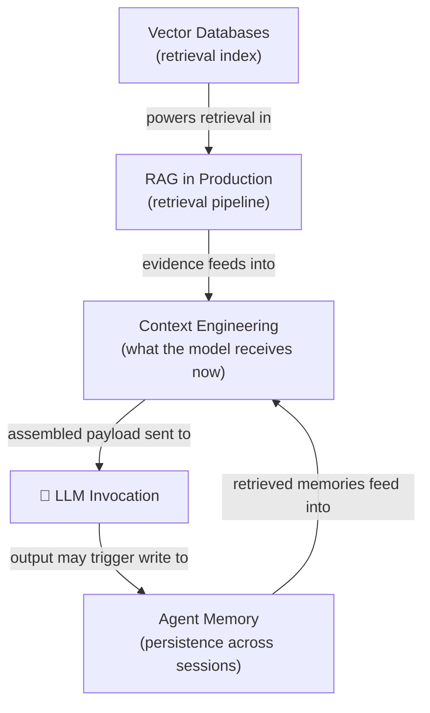

# AI Engineering

> Technical deep dives on production AI systems: architecture, algorithms, trade-offs, research and operational considerations.

---

## Topics

| Topic | What it studies | Status |
|-------|----------------|--------|
| [Vector Databases](vector-databases/00-INDEX.md) | Embedding geometry · ANN indexes (HNSW, IVF-PQ, DiskANN) · compression · storage internals · query processing · distributed architecture · system comparison · production ops | Active |
| [Context Engineering](context-engineering/00-INDEX.md) | Context windows, selection, compression, tool context, security, evaluation and production architecture | Active |
| [Agent Memory](agent-memory/00-INDEX.md) | Memory taxonomy, lifecycle, retrieval, real systems (Mem0, Letta, Zep), evaluation, security | Active |
| [Prompt Engineering](prompt-engineering/00-INDEX.md) | Anatomy · zero/few-shot · decomposition · system instructions · structured output · debugging · caching · injection · capstone | Active |
| [AI Security](ai-security/00-INDEX.md) | AI threat models · prompt injection · agent/tool permissions · RAG isolation · PII · red teaming · governance · secure agentic RAG capstone | Active |
| [RAG in Production](rag-in-production/00-INDEX.md) | 12-category failure taxonomy, CITE-RAG architecture, hybrid search, sufficiency check, observability, production checklist | Active |

---

## How the Topics Relate

**Boundaries that matter:**
- Context management ≠ agent memory (different engineering problems)
- Retrieval is an *input source* to context assembly — not the same as context management
- A stored memory is *not* automatically in context — retrieval + injection required

---

*Last updated: 2026-11-19*
