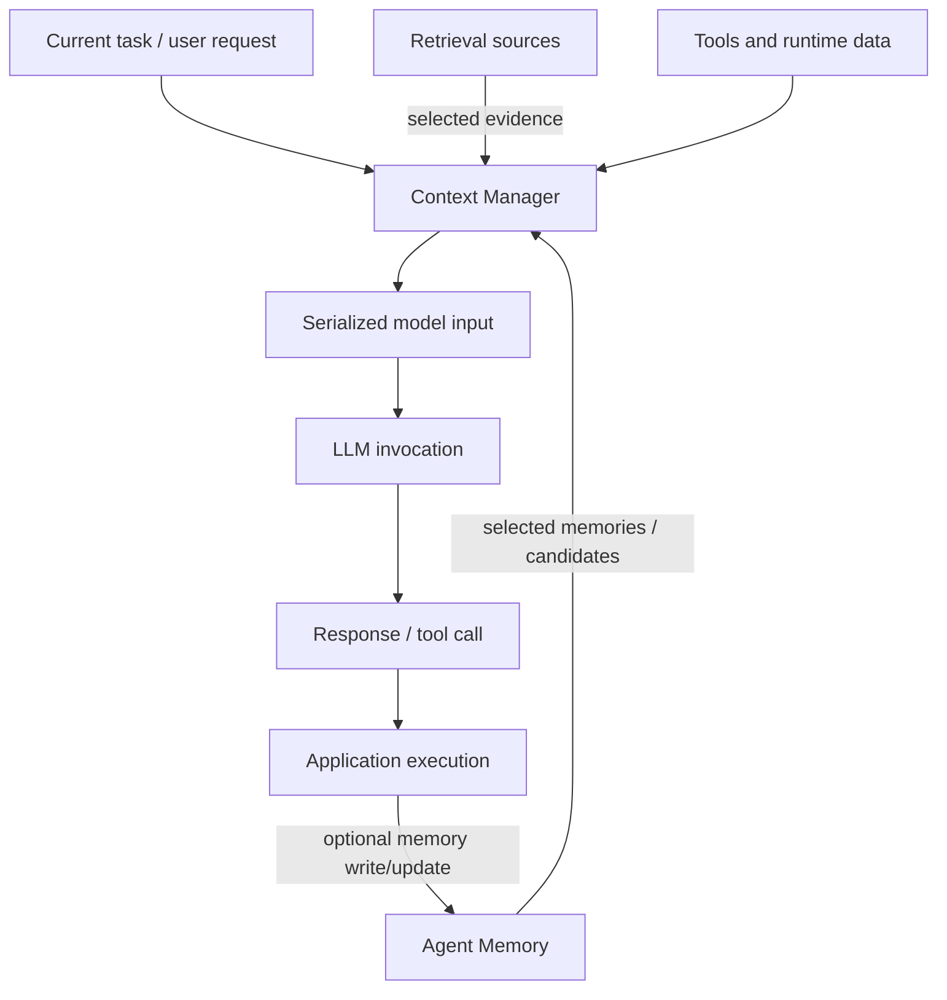

# AI Engineering

This section collects focused field notes on production AI systems. Each subject has its own index and learning path.

## Field guides

| Area | Focus | Status |
|---|---|---|
| [Context Manager](context-manager/00-INDEX.md) | Constructing, selecting, ordering, budgeting, compressing and evaluating the active model context | Active |
| [Agent Memory](agent-memory/00-INDEX.md) | Persisting, updating, retrieving and evaluating information across tasks and sessions | Planned |
| [Vector databases](vector-databases/00-INDEX.md) | Embeddings, ANN indexes, storage engines, filtered/hybrid retrieval and operations | Existing |
| [RAG production audit](rag-production-coverage-audit.md) | Production failure modes and coverage checklist for RAG systems | Existing |

## How the field guides relate

**Boundary:** Context management decides what the model receives for this invocation. Agent memory decides what information persists and may be useful in future invocations. They are related, but they are not the same problem.
