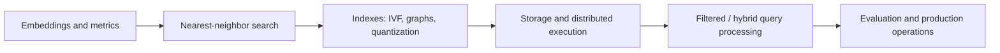

# AI Engineering

This section collects engineering notes on production AI systems, retrieval, model serving, and evaluation.

## Vector databases

The vector database field notes cover embeddings, ANN indexes, storage engines, filtered and hybrid retrieval, evaluation, and production operations. Begin at the [master index](vector-databases/00-INDEX.md); its learning paths and question lookup connect concepts to research and implementation.

**Figure 1.** Simplified learning path through the [vector database notes](vector-databases/00-INDEX.md).

**Takeaway:** Understand the representation and objective before choosing an index, then validate the whole query path under the target workload.
