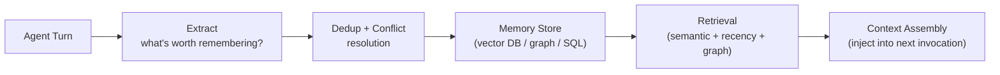

# Agent Memory — Field Notes Index

> **Scope:** How an agent retains, updates, retrieves, and manages information across turns, tasks, and sessions. This is the persistence problem — distinct from context management (what the model gets now) and retrieval (finding candidates).
>
> **Status:** Research and architecture distilled into the blog. Implementation experiments planned.

---

## The One Document

| File | What it covers | Read time |
|------|---------------|-----------|
| [agent-memory.md](agent-memory.md) | Full depth: memory vs. context boundary → memory taxonomy (episodic, semantic, procedural, prospective) → representation formats (text chunks, structured records, knowledge graphs, parametric) → lifecycle (extract → dedup → conflict → store → link → consolidate → forget) → retrieval strategies (semantic, recency, graph traversal, hybrid) → real systems (Mem0, Letta/MemGPT, Zep/Graphiti) → evaluation (LongMemEval, MemoryAgentBench) → architecture patterns → security & privacy | ~50 min |

---

## Mental Model

**Key boundary:**
- A stored memory is **not** automatically in context. The agent must retrieve and inject it.
- Context management decides what the model receives *now* → see [context-engineering](../context-engineering/00-INDEX.md)
- Retrieval from a knowledge base is not the same as agent memory → see [rag-in-production](../rag-in-production/00-INDEX.md)

---

## Fast-Access: Question → Section

| If asked… | Jump to |
|-----------|---------|
| Memory vs. context — what's the difference? | [§1 Why Memory Is Not Context](agent-memory.md#1-why-memory-is-not-context) |
| What are the 4 types of agent memory? | [§2 Memory Taxonomy](agent-memory.md#2-the-memory-taxonomy) |
| When to use vector DB vs. knowledge graph? | [§3 Representations](agent-memory.md#3-memory-representations--what-form-does-it-take) |
| How does memory extraction work? | [§4 Memory Lifecycle](agent-memory.md#4-the-memory-lifecycle) |
| How do I handle contradictory memories? | [§4 Conflict Resolution](agent-memory.md#4-the-memory-lifecycle) |
| Why does pure semantic search fail on temporal queries? | [§5 Retrieval](agent-memory.md#5-memory-retrieval--finding-the-right-thing) |
| How does Letta/MemGPT manage memory? | [§6 Real Systems](agent-memory.md#6-real-systems-what-they-actually-do) |
| How does Graphiti's temporal graph work? | [§6 Real Systems](agent-memory.md#6-real-systems-what-they-actually-do) |
| How do I evaluate memory quality? | [§7 Evaluation](agent-memory.md#7-memory-evaluation--how-do-you-know-it-works) |
| Simple chatbot vs multi-session agent — which pattern? | [§8 Architecture Patterns](agent-memory.md#8-architecture-patterns) |
| How do I prevent cross-user memory leakage? | [§9 Security](agent-memory.md#9-security-and-privacy) |

---

## Research References

| Paper | Why it matters |
|-------|---------------|
| [MemGPT (Packer et al., 2023)](https://arxiv.org/abs/2310.08560) | Agent-managed memory via function calls; virtual context window |
| [A-MEM (Weng et al., 2025)](https://arxiv.org/abs/2502.12110) | Linked memory nodes; building a memory graph not a list |
| [LongMemEval (Wu et al., 2024)](https://arxiv.org/abs/2410.10813) | 500-turn evaluation; temporal recall failures of pure semantic search |
| [MemoryAgentBench (2025)](https://arxiv.org/abs/2507.05257) | Cross-session task completion benchmark for memory systems |
| [Graphiti (Zep)](https://github.com/getzep/graphiti) | Temporal knowledge graph for production agent memory |
| [Mem0](https://github.com/mem0ai/mem0) | LLM-extracted, vector-searchable memory records |

---

*Last updated: 2026-11-11*
