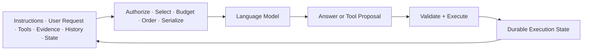

# Context Engineering — Technical Deep Dive

> A reference guide to the engineering of active model context: constructing, budgeting, selecting, ordering, compressing, securing and evaluating what language models receive during inference.

---

## Read the Deep Dive

[**Context Engineering: From Context Windows to Production Systems**](context-engineering.md)

A technical article covering model-input architecture, token budgets, retrieval and selection, progressive tool disclosure, conversation compaction, execution handoffs, evaluation and real-world long-context economics.

---

## Contents

| Area | Topics | Read |
|---|---|---|
| Foundations | Definition, RAG and memory boundaries, six context source layers | [Context Engineering](context-engineering.md#what-is-context-engineering) |
| Context windows | Tokenization, model limits, input/output budgeting, overflow policies | [Token Budgets](context-engineering.md#token-budgets--the-hard-constraint) |
| Context utilization | Position effects, Lost in the Middle, RULER and LongBench | [Position Effects](context-engineering.md#position-effects--where-you-put-it-matters) · [Long Context](context-engineering.md#long-context--the-utilization-problem) |
| Evidence selection | Query understanding, MMR, evidence coverage and hard authorization filters | [Retrieval as Context Selection](context-engineering.md#retrieval-as-context-selection) |
| Tool context | Registries, toolsets, progressive disclosure, schema loading | [Tool Context](context-engineering.md#tool-context-and-progressive-disclosure) |
| Compression | Selection, summaries, compaction, loss accounting | [Context Compression](context-engineering.md#context-compression-compaction-and-loss-accounting) |
| Stateful agents | Execution checkpoints, durable state and cross-agent handoffs | [Execution Context](context-engineering.md#execution-context-and-state-handoffs) · [Multi-Agent Transfer](context-engineering.md#multi-agent-context-transfer) |
| Reliability | Observability, replay, prompt injection and tenant boundaries | [Observability](context-engineering.md#context-observability-and-failure-diagnosis) · [Security](context-engineering.md#context-security-and-trust-boundaries) |
| Evaluation | Context-length sensitivity, evidence usage, task correctness and economics | [Evaluation](context-engineering.md#evaluation-does-context-actually-help) |
| Architecture | A production context engineering architecture and long-running agent design | [Production Architecture](context-engineering.md#production-context-engineering-architecture) |
| Million-token windows | 1M context, caching, prefill, KV-cache considerations, cost and provider limits | [1M-Token Windows](context-engineering.md#1m-token-context-windows-what-changes-in-production-november-2026) |
| Advanced considerations | Few-shot example selection, contextual retrieval, waste detection and replay | [Additional Considerations](context-engineering.md#additional-production-considerations) |
| Research | Linked academic studies and engineering references | [References](context-engineering.md#references) |

---

## How Context Engineering Fits into an AI System

**Context engineering** manages the information available for the present invocation. **Agent memory** persists or retrieves information across sessions. **RAG** supplies candidate evidence. **Inference engineering** operates the model-serving systems. The orchestration **harness** connects these concerns and adds execution controls.

Related deep dives: [Agent Memory](../agent-memory/00-INDEX.md) · [RAG in Production](../rag-in-production/00-INDEX.md) · [Vector Databases](../vector-databases/00-INDEX.md).

---

## Research and Production Perspective

The available context-window size is a capacity limit, not a guarantee of accurate utilization. Strategies such as reranking, MMR, contextual retrieval, summary compaction, prompt caching and dynamic tool selection have model-, workload- and provider-dependent trade-offs. Architectural recommendations should be validated against task correctness, evidence coverage, privacy, latency and cost.

*Last reviewed: 2026-11-16*
