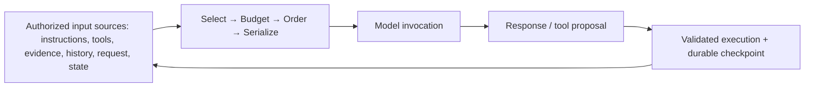

# Context Engineering — Field Notes Index

> **Scope:** How AI applications select, structure, budget, secure, observe and manage information presented to a model at inference time. Retrieval, agent memory and inference serving are related disciplines with distinct responsibilities.
>
> **Learning status:** CM-00–CM-06 covered in our learning sessions. CM-07–CM-14 have reference notes, **not yet completed as lessons or validated experimentally**.

---

## Main Deep Dive

[**Context Engineering: A Field Note for AI Engineers**](context-engineering.md) — a conceptual, research-informed treatment of context-window behavior, evidence selection, tool context, compaction, execution handoffs, security, evaluation and production engineering. No tutorial code is required.

**Source review:** Reassessed against [rohitg00/ai-engineering-from-scratch — Context Engineering](https://github.com/rohitg00/ai-engineering-from-scratch/blob/main/phases/11-llm-engineering/05-context-engineering/docs/en.md). The blog retains useful original explanations and supplements gaps in few-shot context, dynamic assembly, replay, contextual retrieval, token-level inference costs and long-context deployment.

---

## Quick Navigation

| Question | Blog section |
|---|---|
| What is context engineering, and how is it different from memory and RAG? | [Definition and boundaries](context-engineering.md#what-is-context-engineering) |
| Which inputs form the active context? | [Six source layers](context-engineering.md#the-context-stack-six-layers) |
| How should I allocate context and generation headroom? | [Token budgets](context-engineering.md#token-budgets--the-hard-constraint) |
| What is lost in the middle? | [Position effects](context-engineering.md#position-effects--where-you-put-it-matters) |
| Why does a large context window not guarantee accuracy? | [Long-context utilization](context-engineering.md#long-context--the-utilization-problem) |
| How do retrieval and evidence selection differ? | [Retrieval as selection](context-engineering.md#retrieval-as-context-selection) |
| How can agents load only relevant tools? | [CM-07: Tool context](context-engineering.md#cm-07--tool-context-and-progressive-disclosure) |
| How does compaction preserve a task? | [CM-08: Compaction](context-engineering.md#cm-08--context-compression-compaction-and-loss-accounting) |
| How should execution context persist across turns? | [CM-09: Checkpoints](context-engineering.md#cm-09--execution-context-and-state-handoffs) |
| What should pass between collaborating agents? | [CM-10: Handoffs](context-engineering.md#cm-10--multi-agent-context-transfer) |
| How do we trace and debug context failures? | [CM-11: Observability](context-engineering.md#cm-11--context-observability-and-failure-diagnosis) |
| How are prompt injections and tenant leaks prevented? | [CM-12: Security](context-engineering.md#cm-12--context-security-and-trust-boundaries) |
| How do we measure whether a strategy improves accuracy? | [CM-13: Evaluation](context-engineering.md#cm-13--evaluation-does-context-actually-help) |
| What should a production context manager contain? | [CM-14: Architecture](context-engineering.md#cm-14--production-architecture-and-capstone) |
| Do 1M-token windows make selection unnecessary? | [1M-token production realities](context-engineering.md#1m-token-context-windows-what-changes-in-production-november-2026) |
| What was missing from the external reference comparison? | [Cross-reference review](context-engineering.md#cross-reference-review-missing-concepts-and-production-considerations) |

---

## Mental Model

- **Context management** manages the model's active input for an invocation.
- **Agent memory** stores and retrieves information across invocations or sessions; see [agent-memory](../agent-memory/00-INDEX.md).
- **RAG** retrieves possible evidence for context selection; see [rag-in-production](../rag-in-production/00-INDEX.md).
- **Inference serving** handles model execution, attention computation, KV caching, scheduling and associated latency. Context engineering affects its workload but is not identical to it.
- **Harness engineering** additionally includes execution, policy enforcement, retries, state orchestration and operational safeguards.

---

## Curriculum and Learning Status

| ID | Topic | Learning status | Reference in blog |
|---|---|---|---|
| CM-00 | Foundations and terminology | ✅ Covered | Definition and boundaries |
| CM-01 | Context construction and assembly | ✅ Covered | Context stack and pipeline |
| CM-02 | Tokenization, budgets and windows | ✅ Covered | Token budgets and 1M windows |
| CM-03 | Position effects | ✅ Covered | Lost in the Middle |
| CM-04 | Long-context behavior | ✅ Covered | LongBench and RULER |
| CM-05 | Retrieval as context selection | ✅ Covered | Retrieval, ranking and evidence |
| CM-06 | Relevance and selection policies | ✅ Covered | MMR, coverage, metadata and constraints |
| CM-07 | Tool context and progressive disclosure | ▶ Next | Conceptual reference available |
| CM-08 | Compression and compaction | Planned | Conceptual reference available |
| CM-09 | Execution context and state handoffs | Planned | Conceptual reference available |
| CM-10 | Multi-agent context transfer | Planned | Conceptual reference available |
| CM-11 | Observability and debugging | Planned | Conceptual reference available |
| CM-12 | Security and trust boundaries | Planned | Conceptual reference available |
| CM-13 | Evaluation and benchmarks | Planned | Conceptual reference available |
| CM-14 | Production architecture and capstone | Planned | Conceptual reference available |

**Progress:** 7/15 lessons covered, 8 remaining. Document coverage ≠ mastery or experimentally verified results.

---

## Review Notes and Evidence Standards

- Preserve **model context capacity vs effective utilization vs production economics** as separate concepts.
- Treat positions, compression ratios and token savings as **model/task-dependent**, not universal constants.
- Keep historical research results distinct from current provider/model limits; check official docs before deployment.
- Require actual evaluation before claiming that MMR, contextual retrieval, progressive disclosure, compaction or 1M context improves a particular product.
- No tutorial code is needed in this conceptual article; architecture diagrams, equations and concrete scenarios remain appropriate.

*Last reviewed: 2026-11-16*
