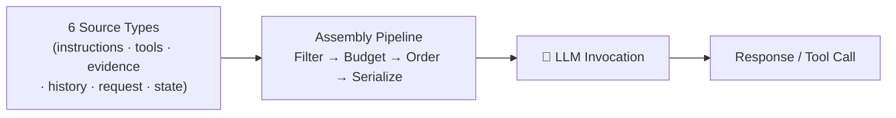

# Context Engineering — Field Notes Index

> **Scope:** How an AI application constructs, budgets, orders, and manages the information sent to a model for each invocation. This is the application-layer engineering problem — not RAG, not agent memory, not inference serving.
>
> **Status:** CM-00 through CM-06 completed and distilled into the blog. CM-07 onwards in progress.

---

## The One Document

| File | What it covers | Read time |
|------|---------------|-----------|
| [context-engineering.md](context-engineering.md) | Full depth: what context engineering is (and isn't) → the 6-layer context stack → token budget arithmetic → position effects (Lost in the Middle) → long context utilization (LongBench, RULER) → retrieval as context selection (MMR, coverage) → progressive disclosure → compression (LLMLingua) → debugging context failures → security (prompt injection, tenant leakage) | ~45 min |

---

## Mental Model

**Key boundary:**
- **Context management** = what the model receives *now* (this invocation)
- **Agent memory** = what persists *across* invocations → see [agent-memory](../agent-memory/00-INDEX.md)
- **Retrieval / RAG** = one *input source* to context assembly → see [rag-in-production](../rag-in-production/00-INDEX.md)

---

## Fast-Access: Question → Section

| If asked… | Jump to |
|-----------|---------|
| What exactly is context engineering? | [§1 Definition](context-engineering.md#1-what-is-context-engineering) |
| What are the 6 source types? | [§2 Context Stack](context-engineering.md#2-the-context-stack-six-layers) |
| How do I calculate the token budget? | [§3 Token Budgets](context-engineering.md#3-token-budgets--the-hard-constraint) |
| Does position in context affect answers? | [§4 Position Effects](context-engineering.md#4-position-effects--where-you-put-it-matters) |
| Does a 100k context window mean 100k usable? | [§5 Long Context](context-engineering.md#5-long-context--the-utilization-problem) |
| What is MMR and evidence coverage? | [§6 Retrieval as Selection](context-engineering.md#6-retrieval-as-context-selection) |
| How do I avoid loading 50 tool schemas? | [§7 Progressive Disclosure](context-engineering.md#7-progressive-disclosure--dont-load-what-you-dont-need) |
| What is LLMLingua and when to use it? | [§8 Compression](context-engineering.md#8-context-compression) |
| How do I debug when the model ignores evidence? | [§9 Context Failures](context-engineering.md#9-context-failures--debugging) |
| How do I prevent prompt injection? | [§10 Security](context-engineering.md#10-context-security) |

---

## Completed Modules (Learning Log)

| Module | Topic | Status |
|--------|-------|--------|
| CM-00 | Foundations: context vs. memory vs. retrieval vs. KV cache | ✅ |
| CM-01 | Context construction and assembly pipeline | ✅ |
| CM-02 | Tokenization, budgets, context windows | ✅ |
| CM-03 | Context ordering and position effects (Lost in the Middle) | ✅ |
| CM-04 | Long-context utilization (LongBench, RULER) | ✅ |
| CM-05 | Retrieval as context selection | ✅ |
| CM-06 | Evidence coverage, MMR, budget-aware selection | ✅ |
| CM-07 | Tool context and progressive disclosure | 🔄 Next |
| CM-08 | Context compression and compaction | Planned |
| CM-09 | Execution context and state handoff | Planned |
| CM-10 | Multi-agent context transfer | Planned |
| CM-11 | Context observability and debugging | Planned |
| CM-12 | Context security and trust boundaries | Planned |
| CM-13 | Evaluation and benchmarks | Planned |
| CM-14 | Production architecture capstone | Planned |

---

*Last updated: 2026-11-11*
