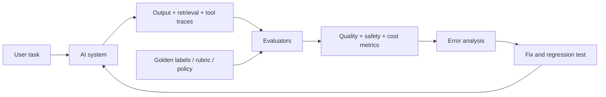

# LLM & Agent Evals — Field Notes

> **One navigation file + one long technical blog.** CampusX 2026 LLM Evaluation playlist as a syllabus backbone, extended with original examples, production design, reproducible calculations, RAG/agent evaluation, and interview drills.

[**Read the complete engineering guide →**](evals-deep-dive.md)

## The mental model

**Evals are an executable definition of success**: a dataset + system version + scoring rules + analysis + release decisions, not just a one-off judge prompt.

## Read in this order if interviewing tomorrow

| Priority | Topic | Deep-dive section | Outcome |
|---|---|---|---|
| P0 | Evals lifecycle, model vs application, slices | [§1–4](evals-deep-dive.md#1-evals-are-an-engineering-loop) | Explain what and why |
| P0 | Reference metrics & judge calibration | [§5–7](evals-deep-dive.md#5-evaluation-methods-and-their-failure-modes) | Pick reliable evaluators |
| P0 | RAG retrieval, generator & triad | [§9–12](evals-deep-dive.md#9-rag-the-component-level-evaluation-map) | Answer “how would you evaluate RAG?” |
| P0 | Safety, regression, online monitoring | [§13–16](evals-deep-dive.md#13-safety-and-adversarial-evaluation) | Explain deployment gates |
| P1 | Operational metrics, experiments, agents | [§17–19](evals-deep-dive.md#17-operational-evals-latency-throughput-and-cost) | Production depth |
| P1 | Full code, interview answers | [§20–23](evals-deep-dive.md#20-a-minimal-reproducible-eval-harness) | Demonstrate hands-on skill |

## Playlist alignment — all 19 videos

This is an **original engineering synthesis aligned to verified video titles and course description**; the full spoken video transcripts were not available for checking examples line by line. Examples in the blog are deliberately constructed, not represented as quotations from the instructor.

| # | CampusX topic | Read |
|---|---|---|
| 1 | Roadmap to LLM evaluations | §1 |
| 2 | Model vs application evals | §2 |
| 3 | Complete evaluation workflow | §3–4 |
| 4 | Multiple evaluation pipelines | §4 |
| 5 | Reference-based, reference-free, LLM judges | §5–7 |
| 6 | Offline vs online evals | §8, §16 |
| 7 | Model capabilities | §2, §18 |
| 8 | Benchmark saturation & contamination | §18 |
| 9 | Evolution of benchmarks | §18 |
| 10 | Reading model leaderboards | §18 |
| 11 | Running custom model evaluations | §18 |
| 12 | RAG evaluation interview explanation | §9–12, §22 |
| 13 | Retriever evaluation hands-on | §10 |
| 14 | Generator and RAG triad | §11–12 |
| 15 | G-Eval | §7 |
| 16 | Toxicity, leakage, scope drift | §13 |
| 17 | RAG operational evals | §17 |
| 18 | Regression tests | §15 |
| 19 | Online RAG evaluation with LangSmith | §16, §21 |

## Glossary at a glance

| Term | Engineering definition |
|---|---|
| Dataset / golden set | Versioned tasks with labels, evidence or expected behavior |
| Evaluator | Deterministic function, model judge, human reviewer or state checker |
| Metric | Aggregation of evaluator outcomes over examples |
| Slice | A meaningful subgroup: tenant, query intent, risk, language, etc. |
| Faithfulness | Whether response claims follow from provided evidence |
| Correctness | Whether the response is true or meets task expectations |
| Answer relevance | Whether the response actually addresses the request |
| Retrieval recall@k | Fraction of all labeled relevant items found in top k |
| MRR | Mean reciprocal rank of first relevant hit |
| NDCG | Ranking quality relative to an ideal ranking using relevance grades |
| Pairwise judge | Chooses which candidate better satisfies a rubric |
| Online eval | Measurement using sampled real traffic and feedback |
| Regression gate | A pass/fail criterion before releasing a change |

## Source trail

- [CampusX LLM Evaluation playlist](https://www.youtube.com/playlist?list=PLEneLIDJFpcA)
- [Video index and durations, 19 lessons](https://playlistduration.com/playlist/PLEneLIDJFpcA)
- [CampusX course description and chapter titles](https://learnwith.campusx.in/s/store/package/6aa9375ad620e0a7e2a043db/courses/Notes--LLM-Evals-YouTube)
- [OpenAI evaluation best practices](https://developers.openai.com/api/docs/guides/evaluation-best-practices)
- [OpenAI RAG retrieval evaluation](https://developers.openai.com/cookbook/examples/evaluation/evaluate_rag_with_llamaindex)
- [RAGAS paper](https://arxiv.org/abs/2309.15217)
- [Microsoft evaluation metrics](https://learn.microsoft.com/en-us/ai/playbook/technology-guidance/generative-ai/working-with-llms/evaluation/list-of-eval-metrics)

*Updated: 2026-11-19. Navigation only; all detailed content lives in the linked long blog.*
