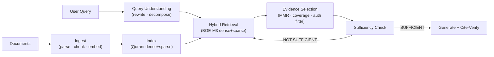

# RAG in Production — Field Notes Index

> **Scope:** Building production-grade RAG systems — from document ingestion through retrieval, evidence selection, generation, citation verification, and production operations. Based on real experience building CITE-RAG (multi-hop retrieval with inline citations).
>
> **Status:** Deep dive + production checklist complete.

---

## Documents

| File | What it covers | Read time |
|------|---------------|-----------|
| [rag-deep-dive.md](rag-deep-dive.md) | The 12-category RAG failure taxonomy, full CITE-RAG architecture, hybrid search internals, sufficiency check pattern, observability stack, design decision rationale | ~40 min |
| [rag-checklist.md](rag-checklist.md) | 10-phase production checklist (~90 items) — fill this out per project | 10 min to fill |

---

## Mental Model

---

## The 12 Failure Categories

| # | Category | Key failure | Key fix |
|---|---------|------------|---------|
| 1 | Source Data | Duplicate docs, stale info | SHA-256 dedup, hard-delete cascade |
| 2 | Ingestion | Parser crash, silent truncation | Per-page isolation, page count check |
| 3 | Chunking | Boundary damage, table fragmentation | Sentence-aware split, UUID5 IDs |
| 4 | Query Understanding | Vocabulary mismatch, multi-hop | Hybrid search, decomposition |
| 5 | Retrieval | Recall collapse with filters | Filter strategy (pre/post/in-graph) |
| 6 | Evidence Selection | Near-duplicate over-selection | MMR + coverage-aware selection |
| 7 | Generation | Hallucinated citations | Citation grounding verification |
| 8 | Multi-hop | Single-pass misses answer | Sufficiency check + iterative loop |
| 9 | Security | Prompt injection, tenant leakage | sanitize_text(), hard user_id filter |
| 10 | Evaluation | No ground truth, metric theater | Held-out QA set, recall@k sampled |
| 11 | Production Ops | Silent recall regression | Log + alert on recall@k per request |
| 12 | Multi-tenancy | Cross-tenant retrieval | HARD pre-filter, rate limit per tenant |

---

## Fast-Access: Question → Section

| If asked… | Jump to |
|-----------|---------|
| Why do most RAG systems fail silently? | [§1 The Illusion](rag-deep-dive.md#1-the-illusion-of-working-rag) |
| Full taxonomy of RAG failures? | [§2 12 Categories](rag-deep-dive.md#2-the-12-failure-categories-full-taxonomy) |
| Why BGE-M3 instead of separate dense+sparse? | [§3 Architecture Decisions](rag-deep-dive.md#3-the-architecture-that-actually-works) |
| Why is hybrid search better than dense-only? | [§4 Hybrid Search](rag-deep-dive.md#4-hybrid-search--why-dense-only-isnt-enough) |
| How does the sufficiency check work? | [§5 Sufficiency Check](rag-deep-dive.md#5-the-sufficiency-check-pattern) |
| What should I log per request? | [§6 Observability](rag-deep-dive.md#6-observability-stack-for-rag) |
| Checklist for a new RAG project? | [rag-checklist.md](rag-checklist.md) |

---

## Related
- [Vector Databases](../vector-databases/00-INDEX.md) — the retrieval index underneath RAG
- [Context Engineering](../context-engineering/00-INDEX.md) — how evidence enters the model context

---

*Last updated: 2026-11-11*
