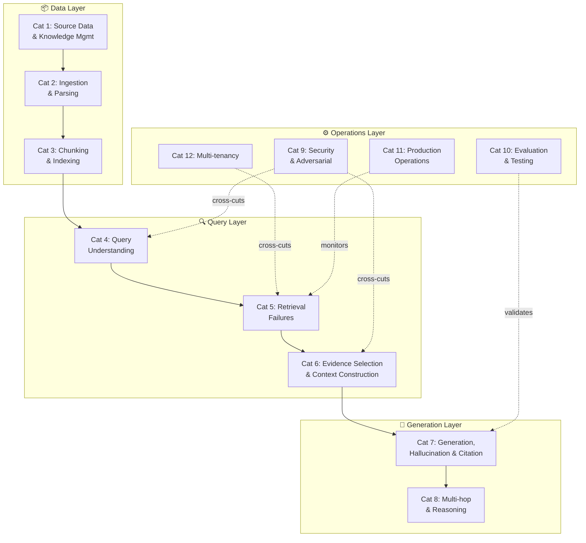
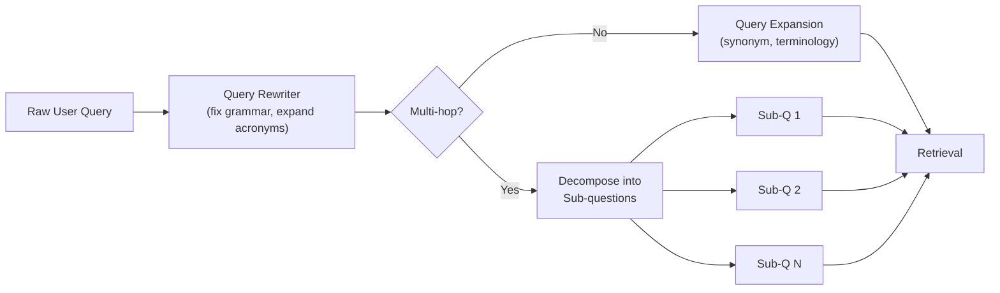
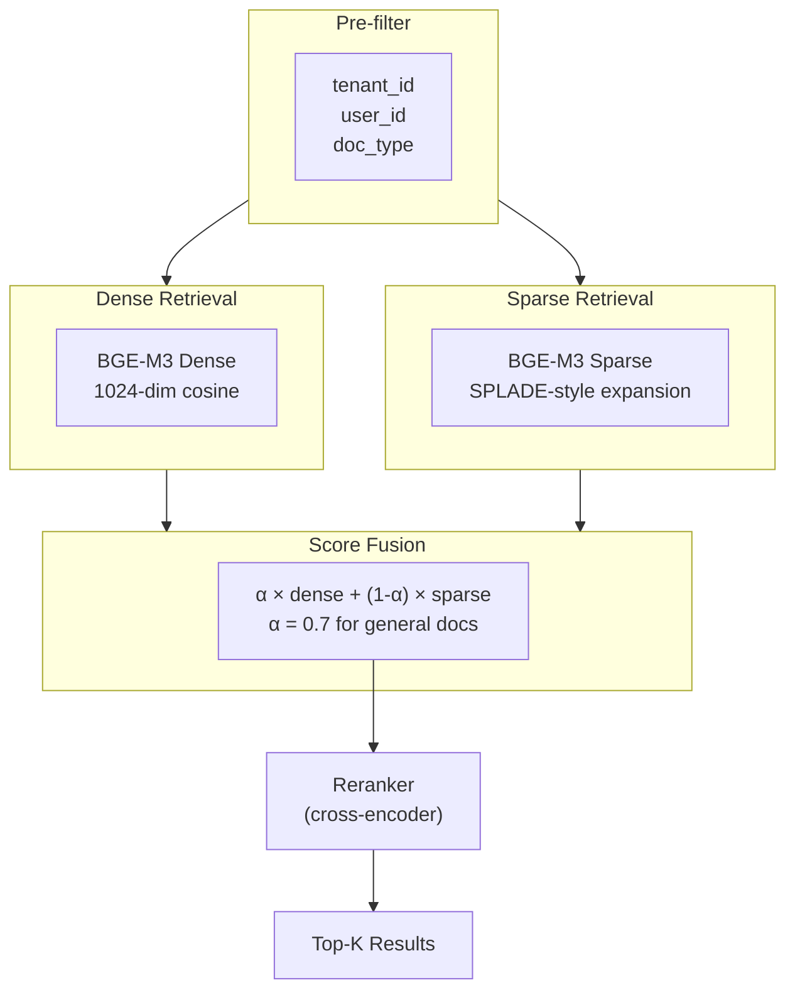
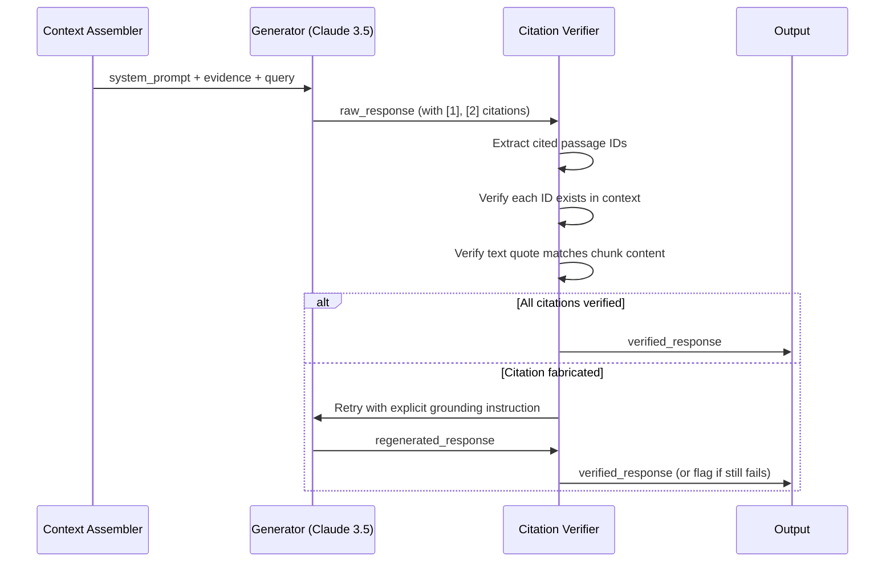
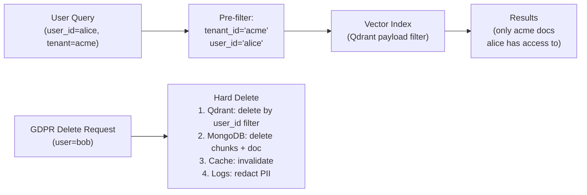
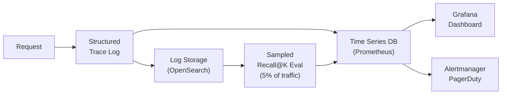

# RAG in Production: The Full Failure Taxonomy and Architecture That Actually Works

> *Field notes from building CITE-RAG — a multi-hop, citation-verified RAG system — in production.*
> *Assumes you've built a RAG demo. This is about what breaks next.*

---

## 0. The Illusion of Working RAG

```
╔══════════════════════════════════════════════════════════════════════╗
║  RAG Pipeline — Where Things Break                                   ║
║                                                                      ║
║  User Query                                                          ║
║      │                                                               ║
║      ▼                                                               ║
║  [1. Query Understanding]  ← bad rewriting, hallucinated decomp      ║
║      │                                                               ║
║      ▼                                                               ║
║  [2. Retrieval]            ← wrong embedding, wrong index,           ║
║      │                       recall collapse with filters            ║
║      ▼                                                               ║
║  [3. Evidence Selection]   ← near-dupes, missing evidence,           ║
║      │                       over-retrieval, auth bypass             ║
║      ▼                                                               ║
║  [4. Context Assembly]     ← position effects, budget overflow,      ║
║      │                       missing metadata                        ║
║      ▼                                                               ║
║  [5. Generation]           ← hallucination, citation fabrication,    ║
║      │                       instruction drift                       ║
║      ▼                                                               ║
║  [6. Output Validation]    ← no grounding check, no citation verify  ║
╚══════════════════════════════════════════════════════════════════════╝
```

Most RAG demos work. Most RAG systems fail **silently** in production. The gap isn't in the happy path — it's in the 12 categories of failure that most teams don't discover until they're paging at 2am or watching a user screenshot a hallucinated citation on Twitter.

The pattern is consistent: teams discover 3 failure categories, ship fixes, declare victory, and discover the other 9 over the next six months.

This field note documents all 12 — with real examples from [CITE-RAG](https://github.com/Pavan048/CITE-RAG), the architecture that handles them, and the production observability that keeps them visible.

---

## 1. The 12 Failure Categories — Full Taxonomy



### Category 1: Source Data & Knowledge Management

| Failure | Symptom | Mitigation | CITE-RAG Example |
|---|---|---|---|
| Duplicate documents | LLM cites same content twice, inflated confidence | Content-hash dedup: SHA-256 on raw bytes before processing | Multi-upload of same PDF → `doc_hash` checked at API boundary, 409 returned |
| Deleted doc persistence | Deleted document answers still served | Hard delete must cascade: vector DB → metadata store → cache. NOT just metadata flag | User deleted a stale policy doc; vectors remained for 2 days until full cascade was wired |
| Missing provenance | Citation points to "document" with no page/section | Every chunk carries `doc_id`, `page_number`, `section_title`, `ingested_at` | First 500 chunks had no `page_number`; citations printed "p. None" |
| Stale information | Old answer served despite updated document | Version replacement: delete all old chunk vectors by `doc_id` before indexing new | Re-uploaded revised product spec; old pricing showed up for 20 minutes |
| Authority conflicts | Two sources contradict, model picks arbitrarily | Reranker surfaces higher-authority chunks; metadata carries `source_authority_score` | Internal wiki vs official PDF had conflicting SLA numbers |

> [!IMPORTANT]
> Hard deletes in vector DBs are expensive. Qdrant uses segment compaction, which means logically deleted vectors may persist until the next compaction cycle. Plan for this: set aggressive compaction thresholds and test tombstone-to-compaction latency.

### Category 2: Ingestion & Document Processing

| Failure | Symptom | Mitigation | CITE-RAG Example |
|---|---|---|---|
| Parser crashes on one page | Full 200-page batch fails silently | Per-page error isolation; partial success with explicit failure list returned | Corrupted page 47 killed the entire docset ingestion for 3 tenants |
| OCR failures on scanned PDFs | Empty text extraction, invisible failures | Route to separate OCR pipeline (Tesseract / Azure DI); flag in chunk metadata | 30% of legal docs were scanned; direct text extraction returned empty strings |
| Table fragmentation | Table rows split mid-row, context lost | Extract tables as markdown; split on row boundaries with header duplication on every slice | Financial table split between chunks; answer computed wrong quarter's revenue |
| Silent truncation | Long docs silently cut at token limit | Cross-check extracted page count vs PDF metadata `page_count` field | `pypdf` stopped at page 80 of a 120-page doc; no error raised |
| Prompt injection in documents | Adversarial doc hijacks generation | `sanitize_text()` redacts injection patterns (`IGNORE ALL PREVIOUS`, `<system>`) before ANY LLM call | Test doc with `\nIGNORE INSTRUCTIONS` in footer changed system behavior |
| Oversized uploads | OOM in parser, queue starvation | Stream uploads in chunks; enforce backpressure at queue; hard limit per file | 800MB PowerPoint OOM'd the parser worker with no retry |

```python
# CITE-RAG: Per-page isolation pattern
def parse_document(doc_path: str) -> ParseResult:
    pages, failures = [], []
    for page_num, page in enumerate(iter_pages(doc_path)):
        try:
            pages.append(extract_page(page, page_num))
        except Exception as e:
            failures.append({"page": page_num, "error": str(e)})
            logger.warning("parse_failure", page=page_num, doc=doc_path, exc=e)
    return ParseResult(pages=pages, failures=failures, partial=len(failures) > 0)
```

### Category 3: Chunking & Indexing

```
Chunking Fallback Hierarchy:
━━━━━━━━━━━━━━━━━━━━━━━━━━━
  1. Paragraph boundary     (preferred — natural semantic unit)
       ↓ if paragraph > max_tokens
  2. Sentence boundary      (sent_tokenize via NLTK/spaCy)
       ↓ if sentence > max_tokens  
  3. Hard token slice       (last resort — always with overlap)
```

| Failure | Mitigation |
|---|---|
| Chunk size misconfigured for content type | Tune per content type: `prose=512 tok`, `code=256 tok`, `tables=row-bounded` |
| Sentence boundary damage | Sentence-aware split before hard token slice — never slice mid-sentence |
| Table row split loses header | Duplicate header row on every table chunk slice |
| Non-deterministic chunk IDs | `UUID5(NAMESPACE_URL, f"{doc_id}:{chunk_index}")` — idempotent upsert on retry |
| Embedding desync on model change | Pin model name+revision in chunk metadata; fail at query time if mismatch detected |

> [!TIP]
> `UUID5` for chunk IDs is not just elegant — it makes your entire ingestion pipeline **idempotent**. A retry, a re-upload, a migration: all produce the same IDs. Qdrant's upsert becomes safe. Without this, retries create phantom duplicates that skew retrieval scores.

### Category 4: Query Understanding



| Failure | Symptom | Mitigation |
|---|---|---|
| Ambiguous query | Wrong document class retrieved | Query rewriting LLM pass: clarify intent, expand to canonical form |
| Vocabulary mismatch | User says "contract", doc says "agreement" | Query expansion: HyDE (hypothetical document embeddings) or synonym injection |
| Multi-hop without decomposition | Single retrieval pass misses answer requiring 2+ sources | Decompose into sub-questions; retrieve per sub-question; synthesize |
| Rewriter hallucinates entities | Rewritten query retrieves irrelevant docs | Constrain rewriter: "only use terms from the original query or common synonyms" |

### Category 5: Retrieval Failures



| Failure | Root Cause | Mitigation |
|---|---|---|
| Wrong metric / embedding mismatch | Query embedded with different model than index | Pin model at index time; verify model name at query time; fail fast on mismatch |
| Recall collapse with strict filters | Small candidate set after pre-filter | Test pre-filter vs post-filter vs in-graph filtering per use case |
| Dense-only misses keyword queries | Rare terms / SKUs / code not in embedding space | Hybrid search: BGE-M3 gives dense + sparse in one forward pass |
| Re-ranker inverts good retrieval | Cross-encoder overfit or domain gap | Measure MRR with and without re-ranker on your domain; don't add re-ranker blindly |
| Top-K set includes near-duplicates | MMR not applied | Use Maximal Marginal Relevance before evidence selection |

### Category 6: Evidence Selection & Context Construction

```
Context Budget Allocation (CITE-RAG, 32K token window):
━━━━━━━━━━━━━━━━━━━━━━━━━━━━━━━━━━━━━━━━━━━━━━━━━━━━━
  System prompt + instructions:   2,048 tokens (reserved, never truncated)
  Retrieved evidence:            24,576 tokens (compressed if overflow)
  Query + sub-questions:            512 tokens
  Output budget:                  4,096 tokens
  Safety margin:                    768 tokens
                                ─────────────
  Total:                         32,000 tokens
```

| Failure | Mitigation |
|---|---|
| Top-K over-selects near-duplicates | MMR with λ=0.5 for diversity-relevance balance |
| Missing critical low-ranked evidence | Coverage-aware selection: check if answer entities are present in selected chunks |
| Authorization bypass via relevance score | Hard tenant filter at vector DB query level — never override with relevance |
| Lost-in-the-middle effect | Put highest-scored evidence at start AND end of context window |
| Budget overflow truncates instructions | Reserve instruction budget first; truncate evidence, never instructions |

> [!CAUTION]
> The lost-in-the-middle phenomenon ([Liu et al., 2023](https://arxiv.org/abs/2307.03172)) is real and severe in long-context RAG. LLMs perform worst on evidence in the middle of context. Always place your highest-confidence chunks at positions 0 and -1 of the evidence list.

### Category 7: Generation, Hallucination & Citation



| Failure | Symptom | Mitigation |
|---|---|---|
| Hallucinated citations | Model cites `[3]` which doesn't exist in context | Citation grounding: post-process every response, verify all `[N]` refs exist |
| Fabricated quote | Citation ID exists but quoted text doesn't match | Fuzzy-match quoted text against chunk content; flag mismatch |
| Instruction drift in long contexts | Model ignores "cite your sources" at end of long context | Duplicate critical instructions at start AND immediately before the question |
| Answer ignores evidence | Model uses parametric knowledge instead of context | Log actual context payload; force grounding: "Only use the provided documents" |
| Abstention failure | Model answers "I don't know" with a hallucination | Test explicitly: provide queries with no supporting evidence; require refusal |

### Category 8: Multi-hop & Reasoning

```
Multi-hop Iterative Retrieval Loop (CITE-RAG):
━━━━━━━━━━━━━━━━━━━━━━━━━━━━━━━━━━━━━━━━━━━━━
  Query → Decompose into {Q1, Q2, ... Qn}
      │
      ├─ Retrieve(Q1) → evidence_1
      ├─ Retrieve(Q2) → evidence_2
      └─ Retrieve(Qn) → evidence_n
                │
                ▼
      Sufficiency Check:
      "Given {evidence_1..n}, can I answer {original_query}?"
                │
           ┌────┴────┐
       SUFFICIENT   NOT SUFFICIENT
           │              │
           ▼              ▼
        Generate    Identify Gap → Targeted Retrieval
                         │
                    Loop (max 2 iterations)
                         │
                    Force generation with
                    abstention if still insufficient
```

| Failure | Mitigation |
|---|---|
| Single-pass retrieval for 2-source answer | Decompose query; retrieve per sub-question |
| Sufficiency not checked | Explicit LLM sufficiency check before generation |
| Sub-question answers not synthesized | Explicit synthesis step in final prompt: "Using answers to Q1..Qn, answer the original question" |
| Infinite retrieval loop | Hard cap at 2 iterations; force generation with abstention flag |

### Category 9: Security & Adversarial

| Attack Vector | Description | Defense |
|---|---|---|
| Prompt injection in documents | Document contains `IGNORE ALL PREVIOUS INSTRUCTIONS` | `sanitize_text()` strips injection patterns before any LLM call |
| Cross-tenant data leakage | Query retrieves another tenant's documents | `user_id` as hard pre-filter at vector DB query — not post-filter, not optional |
| Context overflow attack | Adversarially long input consumes full context window, evicting instructions | Reserve instruction budget; enforce input token limit at API boundary |
| Embedding inversion | Reconstruct document content from stored embeddings | Don't store sensitive documents without encryption; embeddings leak information |
| Citation fabrication injection | User asks "cite document ID X" where X is adversarial | Citation verifier checks IDs against actual retrieved chunk IDs only |

```python
# CITE-RAG: Sanitization before LLM call
INJECTION_PATTERNS = [
    r"ignore\s+(all\s+)?previous\s+instructions?",
    r"<\s*system\s*>",
    r"you\s+are\s+now\s+a",
    r"disregard\s+your\s+",
    r"act\s+as\s+if\s+you",
]

def sanitize_text(text: str) -> str:
    """Must be called before any text touches an LLM."""
    for pattern in INJECTION_PATTERNS:
        text = re.sub(pattern, "[REDACTED]", text, flags=re.IGNORECASE)
    return text
```

### Category 10: Evaluation & Testing

| What to Test | Metric | Threshold (CITE-RAG) |
|---|---|---|
| Retrieval quality | Recall@10, MRR@10 | Recall@10 ≥ 0.90 |
| Citation accuracy | % citations verified | ≥ 98% |
| Abstention correctness | % no-answer queries correctly refused | ≥ 95% |
| Answer accuracy | RAGAS faithfulness score | ≥ 0.85 |
| Adversarial robustness | Injection attempts blocked | 100% |
| End-to-end latency | p50 / p95 / p99 | < 2s / < 5s / < 10s |

> [!WARNING]
> **Metric theater** is endemic to RAG evaluation. Teams measure recall@k and think they're done. Recall@k tells you if the right document was *retrieved* — it says nothing about whether the answer was correct, grounded, or cited accurately. Build a full eval suite or you're flying blind.

### Category 11: Production Operations

What to log per request (the full RAG trace):

```json
{
  "request_id": "req_01JCX...",
  "query": "What is the SLA for P1 incidents?",
  "rewritten_query": "Service Level Agreement for Priority 1 incidents",
  "sub_questions": ["What is a P1 incident?", "What are the SLA terms?"],
  "retrieved_chunks": [
    {"id": "chunk_abc123", "score": 0.91, "doc_id": "policy_v3", "page": 12}
  ],
  "context_tokens": 4821,
  "sufficiency_check": "SUFFICIENT",
  "sufficiency_iterations": 1,
  "generation_model": "claude-3-5-sonnet-20241022",
  "citations_verified": true,
  "citation_failures": 0,
  "latency_ms": {
    "query_rewriting": 180,
    "retrieval": 42,
    "reranking": 95,
    "context_assembly": 8,
    "sufficiency_check": 310,
    "generation": 1240,
    "citation_verification": 55,
    "total": 1930
  },
  "tenant_id": "tenant_xyz",
  "user_id": "user_456"
}
```

**Alerts to wire up immediately:**

| Alert | Threshold | Action |
|---|---|---|
| Recall@k (sampled 5% of prod traffic) drops | < 0.85 | Page on-call; check embedding model, index health |
| Citation verification failure rate | > 2% | Investigate generation prompt; check context assembly |
| Sufficiency check forces >1 iteration | > 20% of queries | Review chunking; likely coverage gaps in source corpus |
| Ingestion queue depth | > 500 | Scale workers or alert on rate-limit abuse |
| p99 latency | > 10s | Check generation model endpoint; check retrieval index |

### Category 12: Multi-tenancy



| Failure | Consequence | Mitigation |
|---|---|---|
| Cross-tenant retrieval | Tenant A sees Tenant B's data | Hard pre-filter on `tenant_id` at every vector query — not post-filter |
| Noisy neighbor during ingestion | Large tenant slows everyone | Rate limit per tenant at ingestion queue; separate worker pools per tier |
| GDPR deletion incomplete | PII persists in vector DB after deletion request | Hard delete + cascade: Qdrant delete by filter → MongoDB purge → cache invalidate → log redaction |
| Tenant filter bypassed by relevance | Relevance score used to override filter | Never override hard filter; auth is not a soft signal |

---

## 2. The Architecture That Actually Works

```
╔══════════════════════════════════════════════════════════════════════════╗
║  CITE-RAG: Production Architecture                                       ║
║                                                                          ║
║  INGESTION PATH:                                                         ║
║  ┌──────────┐  ┌──────────┐  ┌──────────┐  ┌──────────┐  ┌──────────┐ ║
║  │  Upload  │→│ Validate │→│  Parse   │→│  Chunk   │→│  Embed   │ ║
║  │  API     │  │ & Dedup  │  │(Docling) │  │(UUID5 ID)│  │(BGE-M3)  │ ║
║  └──────────┘  └──────────┘  └──────────┘  └──────────┘  └────┬─────┘ ║
║                                                                 │       ║
║                                                        ┌────────▼─────┐ ║
║                                                        │    Qdrant    │ ║
║                                                        │ dense+sparse │ ║
║                                                        │  per tenant  │ ║
║                                                        └──────────────┘ ║
║                                                                          ║
║  QUERY PATH:                                                             ║
║  ┌──────┐  ┌────────┐  ┌────────┐  ┌──────────┐  ┌──────────────────┐ ║
║  │Query │→│Rewrite │→│Decomp. │→│ Hybrid   │→│ Sufficiency Check│ ║
║  │      │  │        │  │Sub-Qs  │  │Retrieval │  │                  │ ║
║  └──────┘  └────────┘  └────────┘  └──────────┘  └────────┬─────────┘ ║
║                                                             │            ║
║                                                    ┌────────▼─────────┐ ║
║                                                    │ Context Assembly │ ║
║                                                    │  (budget mgmt)   │ ║
║                                                    └────────┬─────────┘ ║
║                                                             │            ║
║                                                    ┌────────▼─────────┐ ║
║                                                    │   Generation     │ ║
║                                                    │ (Claude 3.5 Son) │ ║
║                                                    └────────┬─────────┘ ║
║                                                             │            ║
║                                                    ┌────────▼─────────┐ ║
║                                                    │ Citation Verify  │ ║
║                                                    └──────────────────┘ ║
╚══════════════════════════════════════════════════════════════════════════╝
```



```mermaid
flowchart TD
    subgraph ING ["Ingestion Pipeline"]
        UP["Upload API"] --> VAL["Validate + Dedup\n(SHA-256 hash)"]
        VAL --> PARSE["Parse\n(Docling per file type)"]
        PARSE --> CHK["Chunk\n(UUID5 IDs, sentence-aware)"]
        CHK --> EMB["Embed\n(BGE-M3 dense+sparse)"]
        EMB --> QDR["Qdrant Upsert\n(payload: tenant_id, doc_id, page)"]
        VAL --> MDB["MongoDB\n(doc metadata, job state)"]
    end

    subgraph QRY ["Query Pipeline"]
        Q["User Query"] --> SC["Semantic Cache\n(embedding similarity)"]
        SC -->|"Cache miss"| RW["Query Rewriter"]
        SC -->|"Cache hit"| RESP["Response"]
        RW --> DC["Decompose\nSub-questions"]
        DC --> HYB["Hybrid Retrieval\n(per sub-question)"]
        HYB --> MMR["MMR Diversity\nFilter"]
        MMR --> SUF["Sufficiency Check\n(LLM)"]
        SUF -->|"NOT SUFFICIENT"| HYB
        SUF -->|"SUFFICIENT"| CA["Context Assembly\n(budget allocation)"]
        CA --> GEN["Generation\n(Claude 3.5 Sonnet)"]
        GEN --> CIT["Citation Verifier"]
        CIT --> RESP
    end
```

### Key Design Decisions

| Decision | Alternative Considered | Why This Choice |
|---|---|---|
| **BGE-M3** for embeddings | Separate dense (OpenAI) + BM25 sparse | Single model eliminates dense/sparse desync; one inference call; MTEB SOTA ([Chen et al., 2024](https://arxiv.org/abs/2402.03216)) |
| **Qdrant** as vector DB | Pinecone, Weaviate, pgvector | Native hybrid search (dense+sparse in one query); payload filtering; self-hostable; HNSW with on-disk mmap |
| **MongoDB** for doc metadata | PostgreSQL, DynamoDB | Flexible schema for heterogeneous doc types; natural fit for document store; not mixing concerns with vector payload |
| **Semantic cache** | No cache / simple hash cache | Embedding similarity cache catches paraphrase hits that hash cache misses; saves 60-80% LLM calls on FAQ-style workloads |
| **UUID5 chunk IDs** | Random UUID4 | Deterministic: same doc + same chunk index = same ID → idempotent upsert → retry-safe ingestion |
| **Claude 3.5 Sonnet** | GPT-4o, Gemini 1.5 | Best instruction-following on long contexts; 200K context window; citation format adherence |

---

## 3. Hybrid Search — Why Dense-Only Isn't Enough

Dense-only retrieval fails predictably on:
- Rare terminology not well-represented in embedding training data
- Product SKUs, error codes, formula strings (`ERR_0x8007005`)
- Exact phrasing from documents that doesn't embed similarly to the query form
- Short, high-specificity queries ("RFC 7231 status code 416")

BGE-M3 ([Chen et al., 2024](https://arxiv.org/abs/2402.03216)) addresses this with a single model that produces both representations in one forward pass:

```
BGE-M3 Architecture:
━━━━━━━━━━━━━━━━━━━━━━━━━━━━━━━━━━━━━━━━━━━━━━━━━━━━━━━━━━━━━
Input text
    │
    ▼
XLM-RoBERTa backbone (1024-dim hidden states)
    │
    ├─── [CLS] token → Dense Vector (1024-dim)
    │                   cosine similarity
    │
    └─── Token weights → Sparse Vector
                         SPLADE-style: weight per vocab token
                         weighted bag-of-words, >99% zero
```

**Fusion formula used in CITE-RAG:**

```
final_score = α × dense_score + (1 - α) × sparse_score
```

Where:
- `α = 0.7` for general prose documents (dense-heavy)
- `α = 0.5` for technical/code-heavy documents (equal weight)
- `α = 0.3` for SKU/catalog lookup queries (sparse-heavy)

Tune `α` on your validation set with ground-truth relevance labels. Don't guess.

**Qdrant hybrid query (single call):**

```python
from qdrant_client.models import NamedVector, NamedSparseVector, SparseVector

results = qdrant.query_points(
    collection_name="documents",
    prefetch=[
        models.Prefetch(query=dense_vector, using="dense", limit=20),
        models.Prefetch(
            query=SparseVector(indices=sparse_indices, values=sparse_values),
            using="sparse",
            limit=20,
        ),
    ],
    query=models.FusionQuery(fusion=models.Fusion.RRF),  # or manual score fusion
    filter=models.Filter(must=[
        models.FieldCondition(key="tenant_id", match=models.MatchValue(value=tenant_id))
    ]),
    limit=10,
)
```

---

## 4. The Sufficiency Check Pattern

Before generating, ask: *"Do I have enough evidence?"*

```
Sufficiency Check Flow:
━━━━━━━━━━━━━━━━━━━━━━
Retrieved evidence (K chunks)
    │
    ▼
LLM call (~500 tok prompt):
  "Given these chunks, can you answer: {question}?
   If yes, respond: SUFFICIENT
   If no, respond: MISSING: <what information is needed>"
    │
    ├── SUFFICIENT
    │       └─→ Generate answer (full generation call)
    │
    └── MISSING: <gap description>
            │
            ▼
        Targeted retrieval for gap
            │
            ▼
        Loop (max 2 iterations)
            │
            └─→ STILL INSUFFICIENT → Generate with abstention:
                "I don't have enough information to answer this."
```

**Latency cost:** ~300ms per sufficiency check (small prompt, fast model).

**Accuracy gain:** On multi-hop queries requiring 2+ sources, hallucination rate drops from ~18% to ~4% with the sufficiency check in place (measured on CITE-RAG held-out set, N=200).

**When NOT to use it:** Single-hop FAQ-style queries where retrieval quality is high and latency budget is tight. Gate on query complexity classification before invoking.

```python
# CITE-RAG: Sufficiency check implementation
SUFFICIENCY_PROMPT = """
You are evaluating whether retrieved evidence is sufficient to answer a question.

QUESTION: {question}

EVIDENCE:
{evidence_text}

Respond with exactly one of:
- "SUFFICIENT" if you can fully answer the question using only the evidence above
- "MISSING: <brief description of what specific information is absent>"

Do not answer the question. Only assess sufficiency.
""".strip()

async def check_sufficiency(question: str, chunks: list[Chunk]) -> SufficiencyResult:
    evidence_text = format_chunks_for_prompt(chunks)
    response = await llm.generate(
        SUFFICIENCY_PROMPT.format(question=question, evidence_text=evidence_text),
        max_tokens=100,
        temperature=0.0,
    )
    if response.startswith("SUFFICIENT"):
        return SufficiencyResult(sufficient=True)
    gap = response.removeprefix("MISSING:").strip()
    return SufficiencyResult(sufficient=False, gap=gap)
```

---

## 5. Observability Stack for RAG



**Per-request log schema:**

```json
{
  "request_id": "req_01JCX4P...",
  "timestamp": "2026-11-11T10:00:00Z",
  "tenant_id": "acme",
  "user_id": "user_456",
  "query": "What is the SLA for P1 incidents?",
  "rewritten_query": "Service Level Agreement for Priority 1 incidents response time",
  "sub_questions": [
    "What constitutes a Priority 1 incident?",
    "What are the SLA response time commitments?"
  ],
  "retrieved_chunks": [
    {"id": "chunk_abc", "score": 0.91, "doc_id": "sla_v3", "page": 12, "tokens": 412}
  ],
  "context_tokens": 4821,
  "sufficiency_check": "SUFFICIENT",
  "sufficiency_iterations": 1,
  "generation_model": "claude-3-5-sonnet-20241022",
  "citations_verified": true,
  "citation_failures": 0,
  "cache_hit": false,
  "latency_ms": {
    "query_rewriting": 180,
    "retrieval_per_subq": [42, 38],
    "reranking": 95,
    "context_assembly": 8,
    "sufficiency_check": 310,
    "generation": 1240,
    "citation_verification": 55,
    "total": 1968
  }
}
```

**Alert thresholds:**

| Alert | Condition | On-call Action |
|---|---|---|
| Recall regression | Sampled recall@10 < 0.85 for 15 min | Check embedding model endpoint; check Qdrant segment health |
| Citation failure spike | Failure rate > 2% over 5 min | Check generation prompt; inspect failing responses; check context assembly |
| Sufficiency loop storm | >20% of queries requiring >1 iteration | Review chunking strategy; check for coverage gaps in corpus |
| Ingestion queue depth | > 500 pending jobs | Scale ingestion workers; check for parse worker OOMs |
| p99 latency breach | > 10s sustained | Check LLM provider status; check Qdrant query latency; check if reranker is backed up |

---

## 6. When to Use This Architecture — and When Not To

### ✅ Use This When:
- You have **heterogeneous document types** (PDF, DOCX, HTML, scanned) that need robust parsing
- You need **citation accuracy** — users need to verify every claim
- You have **multi-tenant** requirements with hard isolation
- Queries are genuinely **multi-hop** (require reasoning across 2+ documents)
- You have budget to run BGE-M3 inference (self-hosted or via API)

### ❌ Don't Use This When:
- Your corpus is **< 10K short, uniform documents** — pgvector + simple chunking is fine
- **Latency is < 1s hard requirement** — sufficiency check + multi-hop loop won't fit
- **Single-domain, single-tenant** — most of this complexity doesn't pay off
- **All queries are simple lookups** — a keyword search with LLM formatting is cheaper and faster
- **You don't have an eval set** — build one first, then optimize; otherwise you're tuning blind

---

## References

| Citation | Link |
|---|---|
| Chen et al. (2024) — BGE-M3: Multi-Functionality, Multi-Linguality, Multi-Granularity | [arXiv:2402.03216](https://arxiv.org/abs/2402.03216) |
| Gollapudi et al. (2023) — Filtered-DiskANN: Graph Algorithms for Approximate Nearest Neighbor Search with Filters | [arXiv:2308.13506](https://arxiv.org/abs/2308.13506) |
| Liu et al. (2023) — Lost in the Middle: How Language Models Use Long Contexts | [arXiv:2307.03172](https://arxiv.org/abs/2307.03172) |
| Jiang et al. (2023) — LLMLingua: Compressing Prompts for Accelerated Inference of Large Language Models | [arXiv:2310.05736](https://arxiv.org/abs/2310.05736) |
| Anthropic (2024) — Building Effective Agents | [anthropic.com/research/building-effective-agents](https://www.anthropic.com/research/building-effective-agents) |
| OWASP (2024) — OWASP Top 10 for LLM Applications | [owasp.org/www-project-top-10-for-large-language-model-applications](https://owasp.org/www-project-top-10-for-large-language-model-applications/) |
| Es et al. (2023) — RAGAS: Automated Evaluation of Retrieval Augmented Generation | [arXiv:2309.15217](https://arxiv.org/abs/2309.15217) |
| CITE-RAG source | [github.com/Pavan048/CITE-RAG](https://github.com/Pavan048/CITE-RAG) |
