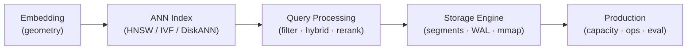

# Vector Databases — Field Notes Index

> **Scope:** Internals of vector storage and approximate nearest-neighbor retrieval — from embedding geometry through ANN indexes, compression, storage engines, query processing, and production operations.
>
> **Format:** One deep-dive blog. Depth over breadth. Targeted at engineers who already know what a vector database is and want to understand how it works inside.

---

## The One Document

| File | What it covers | Read time |
|------|---------------|-----------|
| [vector-databases.md](vector-databases.md) | Full depth: embeddings → ANN algorithms (HNSW, IVF-PQ, DiskANN) → compression (PQ, SQ, RaBitQ, MRL) → storage internals (segments, WAL, mmap, tiering) → query processing (filtered, hybrid, reranking) → distributed architecture → system comparison → evaluation → production | ~60 min |

---

## Mental Model

---

## Fast-Access: Question → Section

| If asked… | Jump to |
|-----------|---------|
| When are cosine and dot product equivalent? | [§ Embeddings & Similarity](vector-databases.md#1-what-is-a-vector-database-really) |
| How does HNSW search work layer by layer? | [§ HNSW Internals](vector-databases.md#3-indexing-algorithms--internals) |
| What are `M`, `efConstruction`, `efSearch`? | [§ HNSW Parameters](vector-databases.md#3-indexing-algorithms--internals) |
| When does IVF beat HNSW? | [§ IVF](vector-databases.md#3-indexing-algorithms--internals) |
| How does DiskANN avoid RAM? | [§ DiskANN](vector-databases.md#3-indexing-algorithms--internals) |
| How much memory does PQ save? | [§ Product Quantization](vector-databases.md#4-compression--quantization--bytes-vs-recall) |
| What is RaBitQ? | [§ Binary & RaBitQ](vector-databases.md#4-compression--quantization--bytes-vs-recall) |
| What are Matryoshka embeddings? | [§ MRL](vector-databases.md#4-compression--quantization--bytes-vs-recall) |
| How do segments, WAL, and compaction relate? | [§ Storage Engine](vector-databases.md#5-storage-engine-internals) |
| What is pre-filter vs post-filter vs in-graph? | [§ Filtered Search](vector-databases.md#6-query-processing--the-full-pipeline) |
| How does hybrid BM25+dense work? | [§ Hybrid Search](vector-databases.md#6-query-processing--the-full-pipeline) |
| How is global top-k merged across shards? | [§ Distributed Architecture](vector-databases.md#7-distributed-architecture) |
| Qdrant vs Milvus vs pgvector — which? | [§ System Comparison](vector-databases.md#8-system-comparison--internals-matter) |
| How much RAM for 10M × 768 float32 + HNSW? | [§ Capacity Planning](vector-databases.md#10-production-engineering) |
| What are recall@k and QPS Pareto curves? | [§ Evaluation](vector-databases.md#9-evaluation--benchmarking) |

---

## Learning Paths

| Goal | Recommended reading |
|------|-------------------|
| **Interview in 2 days** | §1 → §3 (HNSW + IVF only) → §6 (filtered search) → §8 (system comparison) → §10 (capacity formula) |
| **Production-ready in 1 week** | Full document, §5 and §10 twice |
| **Architect-level** | Full document + paper links in §3 and §4 |

---

*Last updated: 2026-11-11*
