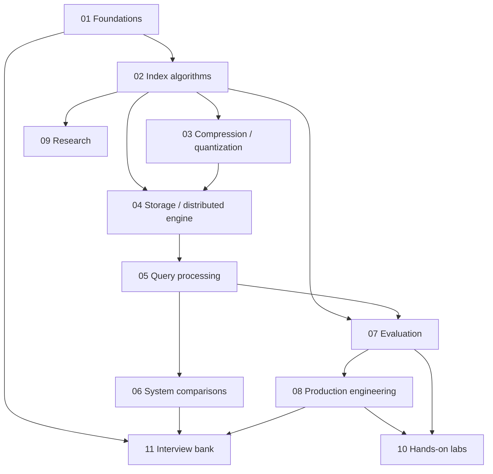
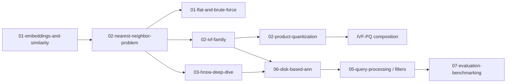

# Vector Databases — Master Index

> [!TIP]
> **TL;DR:** Vector retrieval combines a model-defined geometry, a top-k objective, and data-system guarantees. Start with embeddings and exact kNN, then choose and benchmark indexes under the target filters, update rate, latency SLO, and memory/SSD budget. The collection is authored as concise field notes, with diagrams before prose and source links on each topic. Benchmarks are procedures, not fabricated results; run them on your target workload before making capacity or product decisions.

## One-screen map

**Figure 1.** Domain map. The boxes link to sections below; the arrows show learning dependencies, not runtime call flow.

**Takeaway:** Fundamentals, algorithms, systems, and evaluation build on each other; production decisions require evidence from all four.

## Learning paths

| Path | Suggested order | Estimated time |
|---|---|---:|
| Interview in 3 days | [Embeddings](01-foundations/01-embeddings-and-similarity.md) → [kNN](01-foundations/02-nearest-neighbor-problem.md) → [HNSW](02-indexing-algorithms/03-hnsw-deep-dive.md) → [IVF](02-indexing-algorithms/02-ivf-family.md) → [PQ](03-compression-quantization/02-product-quantization.md) → [metrics](07-evaluation-benchmarking/01-metrics-recall-qps-latency.md) → [fundamentals Q&A](11-interview-bank/01-fundamentals-qa.md) → [algorithms Q&A](11-interview-bank/02-algorithms-qa.md) | 6–8 h |
| SDE-1 production-ready in 2 weeks | Foundations → [HNSW](02-indexing-algorithms/03-hnsw-deep-dive.md) → [storage/LSM](04-storage-engine-internals/01-segment-architecture-and-lsm.md) → [filtering](05-query-processing/01-filtered-and-hybrid-search.md) → [evaluation](07-evaluation-benchmarking/03-building-your-own-eval.md) → [capacity](08-production-engineering/01-capacity-planning-and-cost.md) → [ingestion](08-production-engineering/02-ingestion-pipelines-and-reindexing.md) → labs → [debugging scenarios](11-interview-bank/04-debugging-scenarios.md) | 18–24 h |
| Architect-level full depth | All foundations → algorithms and quantization → storage and distributed search → query processing → system comparisons → evaluation → production → papers/labs/interview bank | 50–70 h |

Time estimates are planning estimates, not measured reading times; reading times are estimates and are not measured.

## Concept dependency graph

**Figure 2.** Dependency sketch. `IVF-PQ composition` is covered by the IVF and PQ modules rather than a separate planned file.

**Takeaway:** Understand exact retrieval and metric semantics before reasoning about approximate indexes.

## Full file map — grouped study plan

The 72 catalogue entries sit in six ordered passes and eleven smaller topic clusters. Read the pass summaries in order; use each cluster as a manageable study session. Every entry remains listed below.

### Pass 1 — Build the mental model (5 entries)

**Study focus:** Map → embedding geometry → exact kNN → database categories.

#### Foundations (5 entries)

| # | File | Focus | Difficulty | Read | Lab | Interview | Status |
|---:|---|---|---:|---:|:---:|:---:|:---:|
| 0 | [README](README.md) | Topic entry point | 1 | 2m | No | No | reviewed |
| 1 | [01 foundations README](01-foundations/README.md) | Metric semantics → exact objective → system category | 1 | 2m | No | No | reviewed |
| 2 | [Embeddings and similarity](01-foundations/01-embeddings-and-similarity.md) | Metric semantics, normalization, anisotropy, hubness | 3 | 12m | No | Yes | reviewed |
| 3 | [Nearest-neighbor problem](01-foundations/02-nearest-neighbor-problem.md) | Exact cost, ANN, recall@k | 2 | 12m | No | Yes | reviewed |
| 4 | [Vector DB vs traditional DB](01-foundations/03-vector-db-vs-traditional-db.md) | RDBMS, inverted index, pgvector, FAISS categories | 2 | 12m | No | Yes | reviewed |

### Pass 2 — Learn how ANN skips work (7 entries)

**Study focus:** Flat baseline → IVF → graph indexes → hashing/trees → disk search.

#### Index families (7 entries)

| # | File | Focus | Difficulty | Read | Lab | Interview | Status |
|---:|---|---|---:|---:|:---:|:---:|:---:|
| 5 | [02 indexing README](02-indexing-algorithms/README.md) | Indexing mini-index | 1 | 2m | No | No | authored |
| 6 | [Flat / brute force](02-indexing-algorithms/01-flat-and-brute-force.md) | Exact scan and baseline | 2 | 10m | Yes | Yes | authored |
| 7 | [IVF family](02-indexing-algorithms/02-ivf-family.md) | Coarse quantization, list probing, variants | 4 | 18m | Yes | Yes | authored |
| 8 | [HNSW deep dive](02-indexing-algorithms/03-hnsw-deep-dive.md) | Layered graph, search, construction, updates | 5 | 25m | Yes | Yes | authored |
| 9 | [Graph index family](02-indexing-algorithms/04-graph-index-family.md) | NSG, Vamana/DiskANN, CAGRA, SSG | 4 | 20m | No | Yes | authored |
| 10 | [LSH and tree methods](02-indexing-algorithms/05-lsh-and-tree-methods.md) | LSH, Annoy, KD/ball trees | 3 | 15m | No | Yes | authored |
| 11 | [Disk-based ANN](02-indexing-algorithms/06-disk-based-ann.md) | SSD I/O, DiskANN, FreshDiskANN, SPANN, SPFresh | 5 | 22m | Yes | Yes | authored |

### Pass 3 — Reduce bytes and understand the engine (11 entries)

**Study focus:** Compression and storage are grouped as two related cost concerns..

#### Compression and representation (6 entries)

| # | File | Focus | Difficulty | Read | Lab | Interview | Status |
|---:|---|---|---:|---:|:---:|:---:|:---:|
| 12 | [03 quantization README](03-compression-quantization/README.md) | Compression mini-index | 1 | 2m | No | No | authored |
| 13 | [Scalar quantization](03-compression-quantization/01-scalar-quantization.md) | Scalar encodings and error | 3 | 12m | No | Yes | authored |
| 14 | [Product quantization](03-compression-quantization/02-product-quantization.md) | PQ, ADC/SDC, OPQ, sizing | 4 | 20m | Yes | Yes | authored |
| 15 | [Binary and RaBitQ](03-compression-quantization/03-binary-and-rabitq.md) | Binary vectors and RaBitQ | 4 | 18m | No | Yes | authored |
| 16 | [Anisotropic quantization / ScaNN](03-compression-quantization/04-anisotropic-quantization-scann.md) | MIPS-aware quantization | 4 | 18m | No | Yes | authored |
| 17 | [Matryoshka embeddings](03-compression-quantization/05-matryoshka-embeddings.md) | Truncatable representations | 3 | 14m | No | Yes | authored |

#### Storage and distribution (5 entries)

| # | File | Focus | Difficulty | Read | Lab | Interview | Status |
|---:|---|---|---:|---:|:---:|:---:|:---:|
| 18 | [04 storage README](04-storage-engine-internals/README.md) | Storage mini-index | 1 | 2m | No | No | authored |
| 19 | [Segments and LSM](04-storage-engine-internals/01-segment-architecture-and-lsm.md) | Immutable segments, compaction, tombstones | 4 | 20m | No | Yes | authored |
| 20 | [Memory, disk, mmap, tiering](04-storage-engine-internals/02-memory-vs-disk-mmap-tiering.md) | Page cache, NUMA, hot/cold tiers | 4 | 18m | No | Yes | authored |
| 21 | [WAL, durability, replication](04-storage-engine-internals/03-wal-durability-replication.md) | Recovery and consistency contracts | 4 | 18m | No | Yes | authored |
| 22 | [Sharding and distributed search](04-storage-engine-internals/04-sharding-and-distributed-search.md) | Scatter-gather, top-k merge, replicas | 4 | 18m | No | Yes | authored |

### Pass 4 — Shape the query and choose a system (15 entries)

**Study focus:** Retrieval plans define the workload; system notes compare where to run it..

#### Query processing (5 entries)

| # | File | Focus | Difficulty | Read | Lab | Interview | Status |
|---:|---|---|---:|---:|:---:|:---:|:---:|
| 23 | [05 query README](05-query-processing/README.md) | Query mini-index | 1 | 2m | No | No | authored |
| 24 | [Filtered / hybrid search](05-query-processing/01-filtered-and-hybrid-search.md) | Pre/post/in-graph, ACORN, Filtered-DiskANN | 5 | 22m | Yes | Yes | authored |
| 25 | [BM25, dense/sparse hybrid](05-query-processing/02-hybrid-bm25-dense-sparse.md) | BM25, SPLADE, RRF, fusion | 4 | 18m | No | Yes | authored |
| 26 | [Reranking and multivector](05-query-processing/03-reranking-and-multivector.md) | Cross-encoders, ColBERT, PLAID, MUVERA | 4 | 18m | No | Yes | authored |
| 27 | [Query planning and cost model](05-query-processing/04-query-planning-and-cost-model.md) | Cost/selectivity-aware plans | 4 | 18m | No | Yes | authored |

#### System categories and choices (10 entries)

| # | File | Focus | Difficulty | Read | Lab | Interview | Status |
|---:|---|---|---:|---:|:---:|:---:|:---:|
| 28 | [06 comparisons README](06-system-comparisons/README.md) | System comparison mini-index | 1 | 2m | No | No | authored |
| 29 | [pgvector](06-system-comparisons/01-pgvector.md) | PostgreSQL extension behavior | 3 | 15m | No | Yes | authored |
| 30 | [Qdrant](06-system-comparisons/02-qdrant.md) | Purpose-built database internals | 3 | 15m | No | Yes | authored |
| 31 | [Milvus](06-system-comparisons/03-milvus.md) | Distributed vector DB architecture | 4 | 18m | No | Yes | authored |
| 32 | [Weaviate](06-system-comparisons/04-weaviate.md) | Database architecture and modules | 3 | 15m | No | Yes | authored |
| 33 | [Pinecone](06-system-comparisons/05-pinecone.md) | Managed service trade-offs | 3 | 15m | No | Yes | authored |
| 34 | [Elasticsearch / OpenSearch / Lucene](06-system-comparisons/06-elasticsearch-opensearch-lucene.md) | Search engines with vector retrieval | 4 | 18m | No | Yes | authored |
| 35 | [FAISS library](06-system-comparisons/07-faiss-library.md) | ANN library category and APIs | 3 | 15m | No | Yes | authored |
| 36 | [LanceDB, Turbopuffer, Chroma](06-system-comparisons/08-lancedb-turbopuffer-chroma.md) | Embedded/object-store/managed trade-offs | 4 | 18m | No | Yes | authored |
| 37 | [Decision matrix](06-system-comparisons/09-decision-matrix.md) | Workload-to-system selection | 3 | 15m | No | Yes | authored |

### Pass 5 — Prove quality and operate it (11 entries)

**Study focus:** Measurement gates precede capacity, rollout, and on-call ownership..

#### Evaluation and benchmarks (4 entries)

| # | File | Focus | Difficulty | Read | Lab | Interview | Status |
|---:|---|---|---:|---:|:---:|:---:|:---:|
| 38 | [07 evaluation README](07-evaluation-benchmarking/README.md) | Evaluation mini-index | 1 | 2m | No | No | authored |
| 39 | [Metrics](07-evaluation-benchmarking/01-metrics-recall-qps-latency.md) | Recall, throughput, latency distributions | 3 | 15m | No | Yes | authored |
| 40 | [ANN benchmarks](07-evaluation-benchmarking/02-ann-benchmarks-and-big-ann.md) | Benchmark methodology and datasets | 3 | 15m | No | Yes | authored |
| 41 | [Build your own eval](07-evaluation-benchmarking/03-building-your-own-eval.md) | Reproducible ground truth and sweeps | 4 | 18m | Yes | Yes | authored |

#### Production engineering (7 entries)

| # | File | Focus | Difficulty | Read | Lab | Interview | Status |
|---:|---|---|---:|---:|:---:|:---:|:---:|
| 42 | [08 production README](08-production-engineering/README.md) | Production mini-index | 1 | 2m | No | No | authored |
| 43 | [Capacity planning](08-production-engineering/01-capacity-planning-and-cost.md) | RAM, SSD, replicas, cost model | 4 | 18m | Yes | Yes | authored |
| 44 | [Ingestion and reindexing](08-production-engineering/02-ingestion-pipelines-and-reindexing.md) | Backfills, model migrations, freshness | 4 | 18m | No | Yes | authored |
| 45 | [Tuning playbook](08-production-engineering/03-tuning-playbook.md) | Workload and index tuning workflow | 4 | 18m | Yes | Yes | authored |
| 46 | [Observability and failure modes](08-production-engineering/04-observability-and-failure-modes.md) | Signals, incidents, recovery | 4 | 18m | No | Yes | authored |
| 47 | [Multi-tenancy and security](08-production-engineering/05-multi-tenancy-security.md) | Isolation, authorization, noisy neighbors | 4 | 18m | No | Yes | authored |
| 48 | [RAG retrieval](08-production-engineering/06-rag-specific-retrieval.md) | Retrieval quality in RAG pipelines | 3 | 15m | No | Yes | authored |

### Pass 6 — Extend through evidence and practice (23 entries)

**Study focus:** Read selected papers, run small controlled experiments, then rehearse explanations..

#### Research and papers (7 entries)

| # | File | Focus | Difficulty | Read | Lab | Interview | Status |
|---:|---|---|---:|---:|:---:|:---:|:---:|
| 49 | [09 research README](09-research/README.md) | Research mini-index | 1 | 2m | No | No | authored |
| 50 | [Paper index](09-research/01-paper-index.md) | Bibliography and lineage | 3 | 18m | No | Yes | authored |
| 51 | [HNSW paper note](09-research/02-paper-notes/hnsw-malkov-yashunin.md) | HNSW contribution and limitations | 3 | 15m | No | Yes | authored |
| 52 | [DiskANN paper note](09-research/02-paper-notes/diskann-subramanya.md) | Vamana and SSD search | 3 | 15m | No | Yes | authored |
| 53 | [PQ paper note](09-research/02-paper-notes/product-quantization-jegou.md) | Product quantization | 3 | 15m | No | Yes | authored |
| 54 | [Filtered-DiskANN paper note](09-research/02-paper-notes/filtered-diskann-gollapudi.md) | Filter-aware graph construction | 3 | 15m | No | Yes | authored |
| 55 | [Open problems and trends](09-research/03-open-problems-and-trends.md) | Evidence-backed emerging directions | 4 | 18m | No | Yes | authored |

#### Hands-on labs (9 entries)

| # | File | Focus | Difficulty | Read | Lab | Interview | Status |
|---:|---|---|---:|---:|:---:|:---:|:---:|
| 56 | [10 labs README](10-hands-on-labs/README.md) | Lab catalog | 1 | 2m | Yes | No | authored |
| 57 | [Brute-force kNN lab](10-hands-on-labs/01-brute-force-knn/) | Exact ground-truth baseline | 2 | 30m | Yes | No | authored |
| 58 | [IVF from scratch lab](10-hands-on-labs/02-ivf-from-scratch/) | Coarse quantization and probing | 3 | 45m | Yes | No | authored |
| 59 | [Tiny HNSW lab](10-hands-on-labs/03-tiny-hnsw-from-scratch/) | Graph build/search mechanics | 4 | 60m | Yes | No | authored |
| 60 | [PQ from scratch lab](10-hands-on-labs/04-pq-from-scratch/) | Encode and ADC | 4 | 60m | Yes | No | authored |
| 61 | [FAISS sweep lab](10-hands-on-labs/05-faiss-sweep/) | Recall / QPS / memory sweep | 3 | 45m | Yes | No | authored |
| 62 | [hnswlib parameter sweep](10-hands-on-labs/06-hnswlib-param-sweep/) | HNSW recall-latency curves | 3 | 45m | Yes | No | authored |
| 63 | [pgvector vs Qdrant lab](10-hands-on-labs/07-pgvector-vs-qdrant/) | Controlled system comparison | 4 | 60m | Yes | No | authored |
| 64 | [Filtered recall lab](10-hands-on-labs/08-filtered-search-recall/) | Predicate selectivity experiment | 4 | 60m | Yes | No | authored |

#### Interview practice (7 entries)

| # | File | Focus | Difficulty | Read | Lab | Interview | Status |
|---:|---|---|---:|---:|:---:|:---:|:---:|
| 65 | [11 interviews README](11-interview-bank/README.md) | Interview mini-index | 1 | 2m | No | Yes | authored |
| 66 | [Fundamentals Q&A](11-interview-bank/01-fundamentals-qa.md) | Embeddings and retrieval basics | 2 | 20m | No | Yes | authored |
| 67 | [Algorithms Q&A](11-interview-bank/02-algorithms-qa.md) | Index trade-offs | 4 | 25m | No | Yes | authored |
| 68 | [System design Q&A](11-interview-bank/03-system-design-qa.md) | Design a vector retrieval platform | 4 | 25m | No | Yes | authored |
| 69 | [Debugging scenarios](11-interview-bank/04-debugging-scenarios.md) | Production diagnosis | 4 | 25m | No | Yes | authored |
| 70 | [Tricky corner cases](11-interview-bank/05-tricky-corner-cases.md) | Edge cases and traps | 4 | 20m | No | Yes | authored |
| 71 | [Rapid-fire 100](11-interview-bank/06-rapid-fire-100.md) | Concise retrieval questions | 3 | 25m | No | Yes | authored |

## Question-to-file lookup

| If asked… | Read |
|---|---|
| What does an embedding represent? | [Embeddings and similarity](01-foundations/01-embeddings-and-similarity.md) |
| When are cosine and dot product equivalent? | [Embeddings and similarity](01-foundations/01-embeddings-and-similarity.md) |
| Why normalize vectors? | [Embeddings and similarity](01-foundations/01-embeddings-and-similarity.md) |
| What is embedding anisotropy? | [Embeddings and similarity](01-foundations/01-embeddings-and-similarity.md) |
| What is hubness in high dimensions? | [Embeddings and similarity](01-foundations/01-embeddings-and-similarity.md) |
| When is squared L2 safe to use? | [Embeddings and similarity](01-foundations/01-embeddings-and-similarity.md) |
| Why does exact kNN cost Θ(Nd)? | [Nearest-neighbor problem](01-foundations/02-nearest-neighbor-problem.md) |
| What does recall@k measure? | [Nearest-neighbor problem](01-foundations/02-nearest-neighbor-problem.md) |
| Why does brute force sometimes win? | [Flat / brute force](02-indexing-algorithms/01-flat-and-brute-force.md) |
| How do recall, latency, and memory interact? | [Nearest-neighbor problem](01-foundations/02-nearest-neighbor-problem.md) |
| Is a vector database a database or just an index? | [Vector DB vs traditional DB](01-foundations/03-vector-db-vs-traditional-db.md) |
| Why not use Elasticsearch or an inverted index? | [Vector DB vs traditional DB](01-foundations/03-vector-db-vs-traditional-db.md) |
| Why not use pgvector? | [pgvector](06-system-comparisons/01-pgvector.md) |
| When use FAISS instead of a database? | [FAISS library](06-system-comparisons/07-faiss-library.md) |
| How does IVF partition the vector space? | [IVF family](02-indexing-algorithms/02-ivf-family.md) |
| What are `nlist` and `nprobe`? | [IVF family](02-indexing-algorithms/02-ivf-family.md) |
| How does IVF-Flat differ from IVF-PQ? | [IVF family](02-indexing-algorithms/02-ivf-family.md), [PQ](03-compression-quantization/02-product-quantization.md) |
| What does IVF training cost, and when does drift matter? | [IVF family](02-indexing-algorithms/02-ivf-family.md) |
| How do HNSW layers help search? | [HNSW](02-indexing-algorithms/03-hnsw-deep-dive.md) |
| What do `M`, `efConstruction`, and `efSearch` change? | [HNSW](02-indexing-algorithms/03-hnsw-deep-dive.md) |
| How much memory does HNSW use? | [HNSW](02-indexing-algorithms/03-hnsw-deep-dive.md), [capacity planning](08-production-engineering/01-capacity-planning-and-cost.md) |
| How do HNSW deletes work? | [HNSW](02-indexing-algorithms/03-hnsw-deep-dive.md), [segments and LSM](04-storage-engine-internals/01-segment-architecture-and-lsm.md) |
| Why can HNSW recall drop with filters? | [Filtered search](05-query-processing/01-filtered-and-hybrid-search.md) |
| HNSW vs IVF under heavy updates? | [HNSW](02-indexing-algorithms/03-hnsw-deep-dive.md), [IVF](02-indexing-algorithms/02-ivf-family.md) |
| When did graph indexes overtake tree methods? | [LSH and tree methods](02-indexing-algorithms/05-lsh-and-tree-methods.md) |
| How does DiskANN avoid keeping the whole index in RAM? | [Disk-based ANN](02-indexing-algorithms/06-disk-based-ann.md) |
| What is the SSD I/O model for graph ANN? | [Disk-based ANN](02-indexing-algorithms/06-disk-based-ann.md) |
| What is Product Quantization? | [PQ](03-compression-quantization/02-product-quantization.md) |
| What is ADC, and how is it different from SDC? | [PQ](03-compression-quantization/02-product-quantization.md) |
| How much memory does PQ save? | [PQ](03-compression-quantization/02-product-quantization.md) |
| What does OPQ change? | [PQ](03-compression-quantization/02-product-quantization.md) |
| What is scalar quantization? | [Scalar quantization](03-compression-quantization/01-scalar-quantization.md) |
| What is RaBitQ? | [Binary and RaBitQ](03-compression-quantization/03-binary-and-rabitq.md) |
| Why is ScaNN anisotropic? | [ScaNN](03-compression-quantization/04-anisotropic-quantization-scann.md) |
| What are Matryoshka embeddings? | [Matryoshka](03-compression-quantization/05-matryoshka-embeddings.md) |
| How do segments, WAL, and compaction relate? | [Segments and LSM](04-storage-engine-internals/01-segment-architecture-and-lsm.md), [WAL](04-storage-engine-internals/03-wal-durability-replication.md) |
| What happens to updates and tombstones? | [Segments and LSM](04-storage-engine-internals/01-segment-architecture-and-lsm.md) |
| What does mmap actually mean for memory use? | [Memory vs disk](04-storage-engine-internals/02-memory-vs-disk-mmap-tiering.md) |
| How do page cache and NUMA affect latency? | [Memory vs disk](04-storage-engine-internals/02-memory-vs-disk-mmap-tiering.md) |
| What is the WAL durability boundary? | [WAL](04-storage-engine-internals/03-wal-durability-replication.md) |
| How do replicas affect consistency and read routing? | [WAL](04-storage-engine-internals/03-wal-durability-replication.md), [sharding](04-storage-engine-internals/04-sharding-and-distributed-search.md) |
| How is global top-k merged across shards? | [Sharding](04-storage-engine-internals/04-sharding-and-distributed-search.md) |
| What is pre-filter vs post-filter vs in-graph filtering? | [Filtered search](05-query-processing/01-filtered-and-hybrid-search.md) |
| What are ACORN and Filtered-DiskANN? | [Filtered search](05-query-processing/01-filtered-and-hybrid-search.md) |
| How does filter selectivity change the plan? | [Query planning](05-query-processing/04-query-planning-and-cost-model.md) |
| How do BM25 and dense retrieval combine? | [Hybrid BM25/dense/sparse](05-query-processing/02-hybrid-bm25-dense-sparse.md) |
| What is reciprocal rank fusion? | [Hybrid BM25/dense/sparse](05-query-processing/02-hybrid-bm25-dense-sparse.md) |
| When should I rerank with a cross-encoder? | [Reranking and multivector](05-query-processing/03-reranking-and-multivector.md) |
| What are ColBERT, PLAID, and MUVERA? | [Reranking and multivector](05-query-processing/03-reranking-and-multivector.md) |
| How do Qdrant and Milvus differ architecturally? | [Qdrant](06-system-comparisons/02-qdrant.md), [Milvus](06-system-comparisons/03-milvus.md) |
| When choose a managed service like Pinecone? | [Pinecone](06-system-comparisons/05-pinecone.md), [decision matrix](06-system-comparisons/09-decision-matrix.md) |
| How does Lucene implement vector search? | [Elasticsearch/OpenSearch/Lucene](06-system-comparisons/06-elasticsearch-opensearch-lucene.md) |
| How do I compare recall, QPS, and p99 latency fairly? | [Metrics](07-evaluation-benchmarking/01-metrics-recall-qps-latency.md) |
| What is a defensible ANN benchmark? | [ANN benchmarks](07-evaluation-benchmarking/02-ann-benchmarks-and-big-ann.md) |
| How do I build exact ground truth? | [Build your own eval](07-evaluation-benchmarking/03-building-your-own-eval.md) |
| How much RAM for 100M × 768 float32 vectors? | [Capacity planning](08-production-engineering/01-capacity-planning-and-cost.md) |
| How do I change embedding models safely? | [Ingestion / reindexing](08-production-engineering/02-ingestion-pipelines-and-reindexing.md) |
| What should SDE-1 monitor and own? | [Observability](08-production-engineering/04-observability-and-failure-modes.md), [production README](08-production-engineering/README.md) |
| What breaks when tenant filters become selective? | [Filtered search](05-query-processing/01-filtered-and-hybrid-search.md), [multi-tenancy](08-production-engineering/05-multi-tenancy-security.md) |
| How do I prevent cross-tenant retrieval leaks? | [Multi-tenancy and security](08-production-engineering/05-multi-tenancy-security.md) |
| What does RAG retrieval add to generic ANN tuning? | [RAG retrieval](08-production-engineering/06-rag-specific-retrieval.md) |
| Which ANN paper introduced HNSW or DiskANN? | [Paper index](09-research/01-paper-index.md), [paper notes](09-research/02-paper-notes/) |

## Cheat sheets

| Sheet | Contents | Status |
|---|---|---|
| [Cheatsheets index](cheatsheets/README.md) | One-page visual summaries | authored |
| [Index algorithm comparison](cheatsheets/index-algorithm-comparison.md) | Flat, IVF, graph, disk ANN | authored |
| [HNSW / IVF / PQ tuning](cheatsheets/hnsw-ivf-pq-tuning.md) | Main search/build knobs | authored |
| [Memory sizing](cheatsheets/memory-sizing.md) | Raw vectors, graph, codes, overhead | authored |
| [Distance metric chooser](cheatsheets/distance-metric-chooser.md) | Cosine, dot, L2 | authored |
| [DB comparison matrix](cheatsheets/db-comparison-matrix.md) | Category-aware system comparison | authored |
| [Failure mode → fix](cheatsheets/failure-mode-to-fix.md) | Symptoms and diagnostics | authored |
| [All TL;DRs](cheatsheets/all-tldrs.md) | Stitched revision page | authored |

## Papers, diagrams, and verification

- [Research paper index](09-research/01-paper-index.md) · [selected lineage diagram](assets/hero-12-research-lineage.md)
- Hero diagram gallery: [architecture](assets/hero-01-architecture.md) · [write path](assets/hero-02-write-path.md) · [read path](assets/hero-03-read-path.md) · [HNSW](assets/hero-04-hnsw.md) · [IVF](assets/hero-05-ivf.md) · [PQ](assets/hero-06-pq.md) · [DiskANN](assets/hero-07-diskann.md) · [filtered search](assets/hero-08-filtered-search.md) · [segment lifecycle](assets/hero-09-segment-lifecycle.md) · [sharded top-k](assets/hero-10-sharded-topk.md) · [index selection](assets/hero-11-index-selection.md) · [research lineage](assets/hero-12-research-lineage.md).
- [Glossary](99-glossary.md) · [diagram legend](assets/legend.md)

### Verification notes

- No benchmark numbers are asserted without an executed run. Product capabilities and defaults should be checked against the linked release documentation when selecting a deployment.

**Next:** [Embeddings and similarity](01-foundations/01-embeddings-and-similarity.md).  
**Related:** [README](README.md), [glossary](99-glossary.md), [paper index](09-research/01-paper-index.md).

