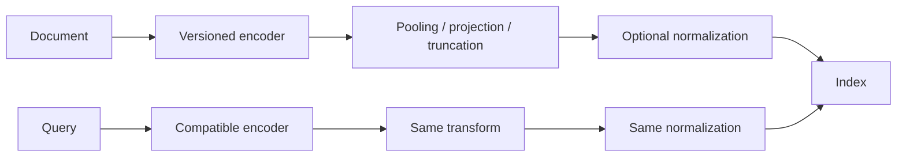

# Embeddings and Similarity

> [!TIP]
> **TL;DR:** An embedding is a model-produced vector whose geometry reflects a training objective. Cosine compares direction, dot product compares direction and norm, and L2 compares Euclidean distance. For unit vectors all three induce the same ranking; otherwise they can disagree. Match metric and normalization to the model's retrieval objective.

## At a glance

| Category | Cost per comparison | Memory per vector | Best for | Worst for | Real systems | Key source |
|---|---:|---:|---|---|---|---|
| Cosine | Θ(d) | `d × bytes/component` | Direction-only relevance | Meaningful norm signals; zero vectors | pgvector, FAISS | [pgvector](https://github.com/pgvector/pgvector) |
| Inner product | Θ(d) | Same vector payload | MIPS and learned dot-product scores | Unintended norm dominance | FAISS, ScaNN | [FAISS paper](https://arxiv.org/abs/1702.08734) |
| L2 / squared L2 | Θ(d) | Same vector payload | Euclidean objectives, norm-sensitive similarity | Norm as irrelevant nuisance | pgvector, FAISS | [FAISS metrics](https://github.com/facebookresearch/faiss/wiki/MetricType-and-distances) |
| Embedding contract | Encode cost is model-dependent | `d × storage dtype` plus metadata | Stable semantic retrieval | Mixed encoders or preprocessing | Text/image/audio retrieval services | [Sentence-BERT](https://arxiv.org/abs/1908.10084) |

**Figure 1.** Score semantics summary; API details vary by version.  
**Takeaway:** Record the encoder, transforms, score, normalization, and ordering as one contract.

## The picture

```text
                     y (unit vector)
                     ↑
                 .---●
              .-'   /  angle θ
           .-'     /
origin O ●---------●----------------→ x
        x (unit vector)

cos(q,x) = q·x / (||q|| ||x||)
dot(q,x) = ||q|| ||x|| cos θ
||q−x||² = ||q||² + ||x||² − 2||q||||x||cos θ
if both norms = 1: ||q−x||² = 2 − 2 cos(q,x)
```

**Figure 2.** Unit-sphere geometry, simplified. Learned vectors need not occupy directions uniformly.  
**How to read this:** Cosine removes radial magnitude; dot retains it as a factor; L2 depends on both. For unit vectors cosine/dot descending and L2 ascending rankings agree. The numeric scales do not.

**Takeaway:** Normalization removes information and is a modeling choice, not harmless cleanup.

## Score semantics and worked example

**TL;DR:** An ANN index orders candidates according to the supplied score; it cannot infer which metric the encoder intended.

Let query `q ∈ R^d`, stored vector `x ∈ R^d`, and encoder `f`. Retrieval ranks by a score or distance:

| Objective | Formula | Sort direction | Norm affects rank? |
|---|---|---|---|
| Cosine similarity | `(q·x)/(||q||₂||x||₂)` | descending | No, for nonzero vectors |
| Inner product | `q·x = Σᵢ qᵢxᵢ` | descending | Yes |
| Euclidean | `sqrt(Σᵢ(qᵢ−xᵢ)²)` | ascending | Yes |
| Squared L2 | `Σᵢ(qᵢ−xᵢ)²` | ascending | Yes; same ranking as L2 |

Example: `q=(1,0)`, `a=(10,1)`, `c=(0.9,0)`. Cosine gives `cos(q,a)=10/√101≈0.995`, `cos(q,c)=1`, so cosine ranks `c` first. Dot gives `q·a=10`, `q·c=0.9`, so dot ranks `a` first. A metric mismatch is therefore a ranking bug, even with exact search.

For nonzero vectors, cosine is invariant to positive rescaling; inner product changes with scale. Sentence-BERT describes sentence vectors compared by cosine, but that is method-specific evidence, not a universal convention ([Reimers & Gurevych, 2019](https://arxiv.org/abs/1908.10084)). Check the embedding model's training recipe and retrieval examples.

**Takeaway:** Make an exact, metric-correct baseline before tuning ANN parameters.

## Normalization contract

**TL;DR:** L2-normalize only when direction is the intended signal or the model/index contract requires unit vectors.

For nonzero `x`, `x̂=x/||x||₂`. This preserves direction and erases norm. If norm carries confidence, popularity, frequency, or a learned retrieval signal, normalization changes the objective. Zero vectors have no defined direction; reject them or route through an explicit fallback rather than dividing by zero.



**Figure 3.** Symmetric preprocessing requirement.  
**Takeaway:** Model or transform changes require a compatibility test or re-embedding migration.

Pin model revision, tokenizer/image transforms, pooling, projection, dimension, dtype, normalization, metric, score direction, and embedding version per record. Validate dimensions and finite values at write time. For model changes, use an explicit dual-index/cutover plan and compare retrieval overlap and task relevance; do not silently mix unrelated vector spaces.

## Anisotropy, hubness, and dimension

**TL;DR:** High-dimensional learned spaces are not necessarily uniform, and distance alone does not guarantee semantic relevance.

Anisotropy means the vector distribution favors some directions or components under a specified diagnostic. Ethayarajh measured anisotropy in contextualized word representations from BERT, ELMo, and GPT-2 in the studied layers ([EMNLP-IJCNLP 2019](https://aclanthology.org/D19-1006/)); do not generalize this result to every current sentence or multimodal encoder. All-but-the-Top removed a mean and leading components and improved several evaluated word-representation tasks ([Mu & Viswanath, ICLR 2018](https://openreview.net/pdf?id=HkuGJ3kCb)); applying this blindly can remove task-relevant signal.

Hubness is skew in reverse-neighbor counts: a few vectors occur in many other vectors' top-k lists. It is a known high-dimensional phenomenon whose extent depends on the distribution and metric ([Radovanović et al., JMLR 2010](https://jmlr.org/papers/v11/radovanovic10a.html)). Distance concentration under common assumptions makes relative distance gaps less discriminative as dimension rises. This is not a theorem that ANN fails above a fixed dimension; intrinsic dimension, data distribution, metric, and hardware all matter ([Andoni, Indyk & Razenshteyn, 2018 survey](https://arxiv.org/abs/1806.09823)).

| Diagnostic | What it reveals | Caution |
|---|---|---|
| Random-pair cosine histogram | Directional concentration / anisotropy signal | Compare within relevant subpopulations |
| Norm histogram by class or time | Norm as possible signal or ingestion drift | Correlation is not proof of relevance |
| PCA variance spectrum | Dominant directions | Removing components must be evaluated downstream |
| Reverse-k occurrence counts | Hubness / popularity concentration | Hubs may be valid popular items |
| Labeled retrieval metrics | Whether a transform improves the task | Avoid optimizing only geometric proxies |

**Figure 4.** Geometry diagnostics table.  
**Takeaway:** Measure before correcting; validate every transform on held-out retrieval judgments.

## Failure modes and trade-offs

**TL;DR:** Most metric failures are detectable by comparing norm distributions and exact rankings.

| Failure | Symptom | Response |
|---|---|---|
| Cosine intent, unnormalized dot used | High-norm records dominate | Verify model intent; normalize only if appropriate |
| Dot intent, vectors normalized | Ranking loses norm signal | Check training objective and raw norms |
| Query/corpus transforms differ | Client-dependent recall | Centralize/version preprocessing |
| Model versions mixed | Old/new vectors appear incompatible | Track versions; re-embed or validate compatibility |
| Zero/NaN/wrong dimension | Errors, missing results, unstable scores | Validate on ingestion and query boundary |
| Low precision changes ties/order | Recall falls against full precision | Measure; rerank candidates if cost permits |

Cost for scoring one query against N vectors of dimension d by exact scan is Θ(Nd); storage for float32 vectors is `N × d × 4` bytes before IDs, metadata, indexes, and allocator overhead. Example: `1,000,000 × 768 × 4 = 3,072,000,000 bytes ≈ 3.07 GB` decimal raw vector payload.

## SDE-1 checklist and interview questions

**TL;DR:** Own the embedding contract and exact baseline; treat geometry changes as migrations.

- Record encoder revision, preprocessing, dimension, dtype, normalization, metric, sort direction.
- Test exact rankings with the same filters and IDs as the production query path.
- Monitor invalid vectors, norm distributions, and model-version mix.
- Re-evaluate before changing normalization or removing principal components.

**Basic — When are cosine and dot equivalent?** 30-second: for ranking, when both query and stored vectors are unit length and nonzero; cosine equals dot. Deep: outside that condition dot scales with norms while cosine divides them out.

**Deep — Why does a model change affect retrieval?** 30-second: it may rotate/restructure the coordinate system and change score calibration, making old vectors incompatible. Deep: version embeddings, re-embed or prove compatibility, and compare exact relevance before traffic cutover.

**Trap — Is cosine always the right semantic metric?** No. Use the model's trained/evaluated objective; cosine is not a universal definition of semantic similarity.

## References

- Reimers & Gurevych, 2019, Sentence-BERT, [arXiv](https://arxiv.org/abs/1908.10084).
- Ethayarajh, 2019, representation geometry, [ACL Anthology](https://aclanthology.org/D19-1006/).
- Mu & Viswanath, 2018, All-but-the-Top, [OpenReview](https://openreview.net/pdf?id=HkuGJ3kCb).
- Radovanović, Nanopoulos & Ivanović, 2010, hubness, [JMLR](https://jmlr.org/papers/v11/radovanovic10a.html).
- Andoni, Indyk & Razenshteyn, 2018, high-dimensional ANN survey, [arXiv](https://arxiv.org/abs/1806.09823).
- [FAISS metric notes](https://github.com/facebookresearch/faiss/wiki/MetricType-and-distances); [pgvector](https://github.com/pgvector/pgvector).

## Version and scope notes

- Product-specific operators, supported dimensions, and score transformations belong in versioned system notes.
- No universal anisotropy/hubness threshold is asserted.

**Next:** [Nearest-neighbor problem](02-nearest-neighbor-problem.md).  
**Related:** [Vector DB vs traditional DB](03-vector-db-vs-traditional-db.md), [glossary](../99-glossary.md), [HNSW figure](../assets/hero-04-hnsw.md).
