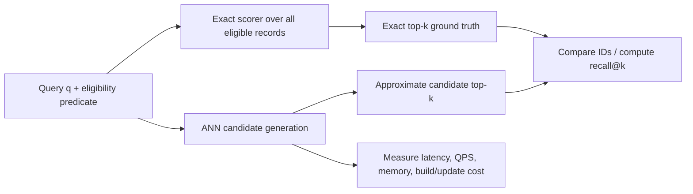

# The Nearest-Neighbor Problem

> [!TIP]
> **TL;DR:** Given a query vector and an eligible corpus, kNN returns the k records with the best exact scores. A dense brute-force scan costs Θ(Nd) per query; ANN indexes reduce work by pruning candidates and accept possible misses. Evaluate candidate quality against exact ground truth with recall@k, plus latency, QPS, memory, build time, and update behavior.

## At a glance

| Category | Complexity / cost | Memory per vector | Best for | Worst for | Real systems | Key source |
|---|---|---:|---|---|---|---|
| Exact flat scan | Θ(Nd) score work/query | Vector + row ID | Ground truth, small/medium corpora, high recall | Latency at large N without enough parallel hardware | FAISS Flat, pgvector sequential scan [DOCS] | [FAISS](https://arxiv.org/abs/1702.08734) |
| ANN | Data-structure dependent; may avoid most exact comparisons | Vector + index overhead/codes | Latency or cost budgets that permit measured error | Unbounded recall requirements without a fallback | HNSW, IVF, DiskANN families | [ANN survey](https://arxiv.org/abs/1806.09823) |
| Recall@k | `|A_k ∩ E_k| / k` per query | None | Comparing candidate recovery to exact results | Relevance judgments; recall is not semantic quality | ANN-Benchmarks and system evals | [ANN-Benchmarks](https://ann-benchmarks.com/) |

**Figure 1.** Exact-vs-approximate objective.  
**Takeaway:** Keep the exact path available as the quality oracle even when production uses ANN.

## The picture



**Figure 2.** Evaluation setup. Ground truth must use the same metric, filters, and corpus snapshot.  
**How to read this:** Exact scoring defines the target; ANN changes candidate generation. Recall is measured per query against exact IDs. Resource measurements are independent dimensions of the trade-off.

**Takeaway:** A recall result is only meaningful if its ground-truth contract matches production.

## Formal objective and exact cost

**TL;DR:** Define the eligible set and score ordering before comparing algorithms.

Let `P={x₁,…,x_N}` be stored vectors in `R^d`, query `q`, eligibility predicate `F(x)`, and score `s(q,x)` (higher is better) or distance `D(q,x)` (lower is better). Exact top-k is the k eligible records ranked by the chosen ordering. If scoring requires d multiply-adds, exhaustive scanning computes N scores: Θ(Nd) arithmetic and Θ(Nd) memory traffic for a straightforward dense layout. Top-k selection can be done with a size-k heap in O(N log k), or by selection/sort strategies with different constants. For small k and large d, vector reads and memory bandwidth can dominate arithmetic; GPU and SIMD implementations change constants, not the fundamental scan volume.

If the predicate matches only M of N records and the execution plan can enumerate those M records cheaply, exact filtered search costs roughly Θ(Md) vector work plus predicate/index access. When the eligible set is broad, scanning all N may be simpler. There is no universal N at which ANN wins: compare measured p95/p99 latency and total resource cost for your hardware, concurrency, vector dimension, and filter distribution.

### Example arithmetic

For `N=10,000,000`, `d=768`, float32: raw vectors occupy `10,000,000 × 768 × 4 = 30,720,000,000 bytes = 30.72 GB` decimal (about 28.6 GiB). One full query reads at least this vector payload if the vectors are not cached and no pruning applies; it also computes `10M × 768 = 7.68B` component contributions. This is a lower-level work estimate, not a latency prediction. Batch queries, cache state, quantization, SIMD, memory bandwidth, and concurrency all affect runtime.

**Takeaway:** Derive the scan baseline from N, d, dtype, filters, and memory behavior before using an index.

## Approximation and recall

**TL;DR:** ANN relaxes exactness in exchange for reducing comparisons, I/O, or memory; recall quantifies returned ground-truth overlap.

For each query let `E_k` be the exact top-k eligible IDs and `A_k` the ANN result IDs. Then:

```text
recall@k(q) = |A_k ∩ E_k| / k
macro_recall@k = (1 / |Q|) Σ(q∈Q) recall@k(q)
```

State how queries are aggregated; micro/weighted metrics can differ when query populations or eligible-set sizes differ. Tie handling must be deterministic or explicitly tolerate multiple exact-valid answers. Recall@k measures neighbor overlap, not human relevance, downstream answer quality, or score calibration. In RAG, a one-ID difference can be unimportant or decisive depending on the missing passage.

An `(1+ε)`-approximate nearest neighbor problem gives a distance guarantee such as `D(q,p') ≤ (1+ε)D(q,p*)` under the formal problem definition. Many production ANN indexes instead target empirical recall@k on a workload; do not confuse a formal approximation ratio with empirical recall. The high-dimensional ANN survey distinguishes formal variants and algorithmic models ([Andoni, Indyk & Razenshteyn](https://arxiv.org/abs/1806.09823)).

| Measure | Question answered | Must report |
|---|---|---|
| Recall@k | Did we return the exact neighbors? | k, exact method, metric, filters, aggregation |
| QPS | How many queries sustained? | Concurrency, batch size, warm/cold state |
| p50/p95/p99 latency | What does the request tail experience? | Workload mix, timeout/errors, queueing |
| Memory / bytes read | What resource budget is consumed? | Resident set/cache vs allocated, index + payload |
| Build/update/freshness | How costly is keeping data current? | Ingest distribution, update/delete mix, rebuild time |

**Takeaway:** The operating point is a workload-specific Pareto point, not a single “fastest ANN” ranking.

## Candidate and rerank pipeline

**TL;DR:** Candidate generation can be approximate while final scoring is exact over the candidates; reranking cannot recover a true neighbor that was never generated.

```text
q → prune/search structure → candidate set C (|C| = r) → exact score C → return k
```

If exact rerank compares the original vectors, candidate score ordering can be corrected inside C. It cannot repair candidate omission. Increasing `r`, probing more IVF lists, widening graph search, or adding a second retrieval route can raise recall while increasing compute or I/O. Measure each stage separately when diagnosing a quality gap.

**Figure 3.** Candidate-and-rerank pipeline.  
**Takeaway:** Separate candidate recall from reranker quality; they fail for different reasons.

## Trade-offs, failure modes, and SDE-1 ownership

**TL;DR:** Start with exact ground truth, then tune ANN against a representative fixed workload and snapshot.

| Failure | Likely cause | Check |
|---|---|---|
| Reported recall > 1 or odd average | Wrong denominator, duplicate IDs, inconsistent ties | Unit-test set formula and deduplicate |
| Recall looks perfect but product quality falls | Ground truth or embedding relevance is poor | Add judged relevance / downstream metrics |
| Benchmark improves, production slows | Different filters, concurrency, cache, payload fetch, queueing | Reproduce workload and measure end-to-end tails |
| ANN returns fewer than k after filter | Candidate starvation or restrictive predicate | Compare exact filtered path and filter-aware methods |
| Exact result changes across runs | Data snapshot, score, tie policy, or floating point differences | Pin corpus/version and deterministic comparator |

SDE-1 checklist: pin corpus snapshot and query set; compute exact results with the production score/filter; include duplicates/ties; record per-query recall and latency; report recall percentiles as well as mean; capture memory and index build/update costs; rerun cold and warm; save configs and software versions.

**Basic interview:** What is recall@k? **30-second:** Fraction of exact top-k IDs returned by ANN. **Deep:** Define exact ground truth under the same score, filter, snapshot, tie policy, and aggregation; it measures overlap, not relevance.

**Deep interview:** Why might brute force outperform ANN? **30-second:** At smaller N, high parallelism, or selective filters, scan simplicity and bandwidth can beat index traversal overhead. **Deep:** Benchmark both under realistic concurrency, memory residency, and filter selectivity; the crossover is hardware-specific.

**Trap:** Does recall 0.95 mean the search is 95% relevant? No. It says the ANN result overlaps 95% with the exact top-k under the chosen metric; relevance is a separate evaluation.

## References

- Andoni, Indyk & Razenshteyn, 2018, *Approximate Nearest Neighbor Search in High Dimensions*, [arXiv](https://arxiv.org/abs/1806.09823).
- Johnson, Douze & Jégou, 2017, *Billion-scale similarity search with GPUs*, [arXiv](https://arxiv.org/abs/1702.08734).
- [ANN-Benchmarks](https://ann-benchmarks.com/) (benchmark framework; inspect its current methodology before comparing published plots).
- [pgvector exact/approximate search docs](https://github.com/pgvector/pgvector).

## Version and scope notes

- No universal ANN crossover size is claimed; determine from the target workload and hardware.
- Benchmark methodology and dataset licenses must be checked before reusing a public corpus.

**Next:** [Vector DB vs traditional DB](03-vector-db-vs-traditional-db.md).  
**Related:** [Embeddings and similarity](01-embeddings-and-similarity.md), [metrics](../07-evaluation-benchmarking/01-metrics-recall-qps-latency.md), [flat baseline](../02-indexing-algorithms/01-flat-and-brute-force.md).
