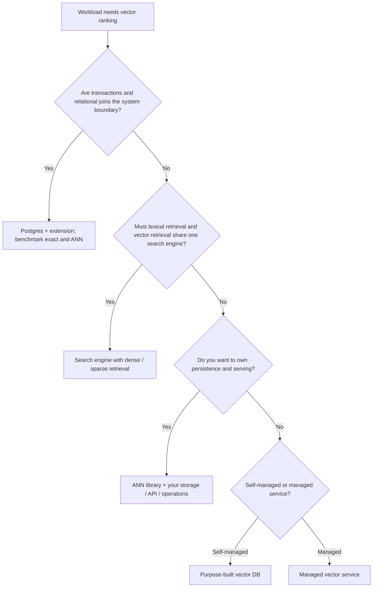

# Vector DB vs. Traditional DB, Search Engine, Extension, or Library

> [!TIP]
> **TL;DR:** “Vector database” describes a workload capability, not one architecture or guarantee. PostgreSQL plus pgvector keeps vectors inside a relational database; FAISS is a search library; Lucene is an indexing/search engine; purpose-built vector databases add data management and service operations; managed services own more of the control plane. Choose by transaction, filtering, freshness, scale, operations, and measured retrieval needs.

## At a glance

| Category | Primary abstraction | Vector retrieval | What it does not automatically provide | Best when | Key source |
|---|---|---|---|---|---|
| RDBMS | Tables, transactions, SQL | Extension or custom operator/index | Vector-specific scaling/recall policy unless added | Relational joins, constraints, transactional writes are central | [PostgreSQL indexes](https://www.postgresql.org/docs/current/indexes.html) |
| Search engine / inverted index | Documents, terms, fields, ranking | Dense/sparse vector fields alongside lexical search | Same operational shape as dedicated vector DB is not guaranteed | Text relevance, facets, and vector retrieval share corpus/query path | [Elasticsearch vector docs](https://www.elastic.co/docs/solutions/search/vector) |
| PostgreSQL extension | Native SQL plus extension types/operators/indexes | Exact scan, HNSW, IVFFlat in pgvector | Separate distributed vector-search control plane | Existing Postgres is operational boundary | [pgvector](https://github.com/pgvector/pgvector) |
| ANN library | In-process vectors and index objects | Flat, IVF, HNSW, PQ, GPU paths in FAISS | Durable metadata, transactions, replication, authorization service | Custom application owns storage and serving | [FAISS](https://arxiv.org/abs/1702.08734) |
| Purpose-built vector DB | Collections/points, filters, vector indexes, service APIs | ANN plus metadata/data management | Same SQL/transaction semantics as an RDBMS by default | Vector retrieval is a core service workload | [Milvus paper](https://doi.org/10.1145/3448016.3457550) |
| Managed vector service | Hosted API and managed control plane | Service-defined indexes and scaling | Direct control of internals; portability varies | Team prefers lower operational burden | Vendor docs / contract, verify current version |

**Figure 1.** Category matrix, not a feature ranking. Product capabilities change by version and deployment mode.  
**Takeaway:** Compare the operating model and guarantees, not the product label.

## The picture: category decision tree

**Figure 2.** Architecture selection sketch.  
**How to read this:** First decide which system owns the data and transactions. Then decide whether the team owns index persistence, routing, backups, and upgrades. Benchmark only after the categories that violate hard requirements are eliminated.

**Takeaway:** The simplest workable data ownership model often matters more than an isolated ANN benchmark.

## What the categories mean

**TL;DR:** Distinguish algorithm from engine and service boundary.

### RDBMS and extensions

Relational systems optimize durable rows, constraints, joins, and transactional query semantics. PostgreSQL provides access methods and index types such as B-tree, GiST, and GIN; its extension mechanism lets packages add types, operators, and index methods ([PostgreSQL index docs](https://www.postgresql.org/docs/current/indexes.html)). pgvector adds vector types/operators and HNSW/IVFFlat while keeping records in Postgres ([project documentation](https://github.com/pgvector/pgvector)). This is attractive when vector search is one query feature over relational data. Costs include shared CPU/memory/I/O with transactional workloads and scale limits determined by the chosen Postgres deployment. Exact scan remains a useful baseline; approximate scans trade recall for speed.

### Inverted-index search engines

An inverted index maps terms to documents and supports lexical retrieval, filters, facets, and aggregations. Lucene-based systems can also store dense vectors and use HNSW for approximate kNN; Elasticsearch documents `dense_vector` and kNN APIs ([Elastic docs](https://www.elastic.co/docs/solutions/search/vector)). Such systems can avoid a separate lexical/vector data plane for hybrid search. They remain search engines with segment/shard lifecycle and their own query semantics—not simply an ANN library or relational database. Version-specific mapping defaults, quantization, filters, and rescoring need current-doc verification.

### Libraries

FAISS exposes index structures and GPU/CPU primitives for similarity search and clustering. Its paper focuses on billion-scale search and GPU k-selection ([Johnson, Douze & Jégou, 2017](https://arxiv.org/abs/1702.08734)); the project describes itself as a library ([repository](https://github.com/facebookresearch/faiss)). A library gives control and can offer strong performance, but the application must build durability, ID-to-payload storage, recovery, filtering semantics, sharding, authorization, backups, and observability around it. hnswlib has a similar library boundary; it is not a hosted database.

### Purpose-built and managed services

Purpose-built systems expose vector-oriented APIs plus metadata, filtering, persistence, and distributed serving. The Milvus SIGMOD paper describes a data-management system designed around vector workloads ([Wang et al., 2021](https://doi.org/10.1145/3448016.3457550)); current Milvus docs describe a version-specific disaggregated architecture with access, coordinator, workers, and storage ([docs](https://milvus.io/docs/architecture_overview.md)). Qdrant and Weaviate also provide persistent vector/metadata APIs, but exact consistency, filtering, index, and replication guarantees need product-version documentation. Managed services abstract more operations while introducing service/API, cost, region, and portability constraints.

**Takeaway:** An algorithm choice does not supply the surrounding database guarantees.

## Comparison by workload dimension

**TL;DR:** Compare the request path and ownership boundaries that your team will actually operate.

| Question | RDBMS + extension | Search engine | ANN library | Purpose-built DB / managed |
|---|---|---|---|---|
| Who owns records and metadata? | Relational tables | Search documents/index | Application-defined storage | Collection/point API, product-specific |
| Exact search possible? | Often yes via scan | Depends on query/index path | Yes with flat index | Depends on system and query plan |
| Approximate index? | Extension-provided | Engine-provided | Direct library choice | Product-provided and version-specific |
| Joins/transactions? | Native relational semantics | Search-engine document model | Application must implement | Product-specific APIs/guarantees |
| Hybrid lexical+dense? | SQL composition/extensions | Core engine strength | Compose independently | Varies by system |
| Durable persistence and recovery? | Database WAL/backup semantics | Segment/translog/replica semantics | Not supplied by index alone | Product-specific persistence/recovery |
| Operational trade-off | Share DB capacity and expertise | Share search cluster and lifecycle | Highest control and integration work | Lower custom-engineering; service constraints |

Do not compress this into a universal “best product” score. Use hard gates for durability, tenancy, data residency, filters, and update freshness. Then measure representative recall@k, p99, QPS, storage, ingestion rate, recovery, and total cost. Pin versions and workload details.

## Failure modes and decision procedure

**TL;DR:** A category is wrong when it violates an operational invariant, not merely because another product won a microbenchmark.

1. State the source of truth and whether writes need SQL transactions or cross-row constraints.
2. List query predicates, lexical requirements, top-k, freshness, concurrency, and tail-latency budget.
3. Decide who operates backups, replication, upgrades, security, and index rebuilds.
4. Eliminate categories that fail a hard requirement.
5. Run exact ground truth and benchmark candidate systems with the same corpus snapshot and filter distribution.
6. Compare failure and recovery behavior, not only steady-state query latency.

| Anti-pattern | Why it fails | Better test |
|---|---|---|
| “FAISS is a vector database” | Library does not provide a database service contract | Account for persistence, IDs, replication, and lifecycle separately |
| “Postgres cannot do vector search” | Extensions add types/indexing while preserving database workflows | Test pgvector exact + ANN under actual filters and scale |
| “Vector DB always beats Elasticsearch” | Engines overlap and differ by query mix | Benchmark hybrid lexical/vector requests on production mappings |
| “Managed means no operations” | Application still owns embedding versions, auth, cost, and migration | Model service limits, regions, quotas, backup/export, and exit path |

## SDE-1 checklist and interview Q&A

**TL;DR:** Describe each product as a category, name its boundary, and compare workload fit.

- Confirm which system is authoritative for payload and metadata.
- Check whether filters are pre-, post-, or index-aware and measure selectivity effects.
- Include data lifecycle, recovery, and schema/version upgrades in comparison.
- Keep exact search as a baseline and record current product versions.

**Basic — Why not just use FAISS?** 30-second: FAISS is an index/search library; choose it when you want control and can own persistence, metadata, routing, and operations. Deep: include the end-to-end cost of building those service features before comparing query latency.

**Deep — When is pgvector a good fit?** 30-second: when Postgres is already the source of truth and vector retrieval benefits from relational data and transactions, provided its measured performance meets the workload. Deep: compare exact selective scans and ANN under concurrent relational load, filter selectivity, and write patterns.

**Trap — Are vector databases a distinct database theory category?** Not necessarily. It is a workload/product category; implementations range from extensions and libraries to distributed services.

## References

- PostgreSQL, [Indexes documentation](https://www.postgresql.org/docs/current/indexes.html).
- pgvector, [project docs](https://github.com/pgvector/pgvector).
- Elastic, [Vector search docs](https://www.elastic.co/docs/solutions/search/vector).
- Johnson, Douze & Jégou, 2017, FAISS/GPU similarity search, [arXiv](https://arxiv.org/abs/1702.08734).
- Wang et al., 2021, Milvus, SIGMOD, [DOI](https://doi.org/10.1145/3448016.3457550); [current architecture docs](https://milvus.io/docs/architecture_overview.md).

## Version and scope notes

- Qdrant, Weaviate, Pinecone, Elasticsearch, and pgvector feature/version details belong in their comparison modules and must be rechecked against current docs when authored.
- No cross-product performance ranking is asserted.

**Next:** [Flat and brute force](../02-indexing-algorithms/01-flat-and-brute-force.md).  
**Related:** [Nearest-neighbor problem](02-nearest-neighbor-problem.md), [system comparison matrix](../06-system-comparisons/09-decision-matrix.md), [glossary](../99-glossary.md).
