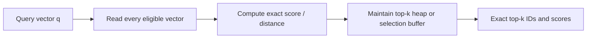

# Flat Index and Brute-Force kNN

> [!TIP]
> **TL;DR:** A flat index stores vectors without candidate-pruning structure and scores every eligible vector. It costs Θ(Nd) work per query and gives exact top-k under the implemented score, making it the quality oracle and often the right choice for small or selective workloads. Its bottleneck is vector traffic, not a universal row-count threshold.

## At a glance

| Category | Complexity | Memory/vector | Best for | Worst for | Used in | Key source |
|---|---|---:|---|---|---|---|
| Flat dense scan | Θ(Nd) score work/query; top-k selection depends on method | `d × bytes + ID` | Exact ground truth, small corpora, selective eligible subsets | Large cold scans with tight p99 | FAISS `IndexFlat`, pgvector sequential scan [DOCS] | [FAISS indexes](https://github.com/facebookresearch/faiss/wiki/Faiss-indexes) |
| SIMD/GPU brute force | Same asymptotic work, higher parallel throughput potential | Same payload plus scratch buffers | Batch queries / high parallel compute | Tiny requests dominated by launch and transfer overhead | FAISS CPU/GPU flat variants [DOCS] | [FAISS paper](https://arxiv.org/abs/1702.08734) |

**Figure 1.** Flat search costs and role.  
**Takeaway:** Keep a flat path for correctness testing even after deploying ANN.

## Main diagram



**Figure 2.** Flat-search pipeline (simplified). Vector payload may come from RAM, page cache, SSD, or an accelerator; that changes performance, not the all-candidate nature of the scan.  
**How to read this:** Predicate evaluation defines the eligible set. Every eligible vector receives an exact score. The selection stage retains only the best k without sorting the full result set.

**Takeaway:** Flat search removes index approximation but not data access, score, or filtering costs.

## Cost and memory arithmetic

**TL;DR:** Estimate bytes and arithmetic before predicting latency.

For N vectors of dimension d and b bytes per component, raw vector payload is `Ndb` bytes, excluding IDs, metadata, alignment, row overhead, and replicas. Query scoring reads up to `Ndb` bytes if the full matrix is scanned and not resident in a faster cache. Dense dot or L2 requires O(Nd) arithmetic. With an online size-k heap, top-k maintenance is O(N log k); optimized selection or GPU kernels alter constants.

Example: 5M × 384 × float32 = `5,000,000 × 384 × 4 = 7,680,000,000 bytes` = 7.68 GB decimal raw vectors. Actual process RSS is larger when rows, IDs, metadata, allocator overhead, and temporary buffers are included. A GPU implementation may need both device and host copies depending on ingestion and update design; measure rather than assume.

| Situation | Why flat may fit |
|---|---|
| Small N | Index build, graph traversal, and memory overhead can exceed scan cost |
| Highly selective metadata predicate | Enumerate a small candidate set, then score it exactly |
| Recall-sensitive evaluation | Provides exact neighbors for ANN recall computation |
| Frequently changing collection | No stale trained partition or graph quality to rebuild |
| Batch GPU workload | Dense matrix operations and top-k selection can exploit parallel hardware |

## Exact baseline pseudocode

**TL;DR:** The baseline and ANN path must use the same metric, filters, tie policy, and corpus snapshot.

```text
function exact_top_k(q, records, predicate, score, k):
    heap = min-heap keyed by score (retain best k)
    for record in records:
        if predicate(record.metadata):
            s = score(q, record.vector)
            if heap.size < k or s better_than heap.worst:
                heap.push_or_replace(record.id, s)
    return heap.sorted_by_score()
```

For distance, invert the heap ordering so the worst retained item is the farthest. Define deterministic tie-breaking (e.g., ID) when exact recall is evaluated. Validate NaNs and vector dimensions before this loop; NaN comparisons can make top-k behavior undefined or implementation-dependent.

**Takeaway:** “Exact” means exact for the stored representation and score implementation, not human relevance or infinite-precision arithmetic.

## Failure modes and comparison

**TL;DR:** A flat benchmark is easy to misread when cache state, filters, or concurrent load differ.

| Failure | Diagnosis |
|---|---|
| Scan latency grows with corpus | Expected payload reads scale with N; consider selective execution, compression, ANN, or tiering |
| High mean but terrible p99 | Queueing, memory bandwidth contention, page faults, or large batch variance |
| “Exact” answer differs from application | Metric direction, transform, filter, tie policy, or stale payload mismatch |
| GPU scan loses to CPU | Small batch, host/device transfer, launch overhead, poor layout, or concurrency mismatch |
| Filtered scan is still slow | Predicate not selective/indexed, poor locality, or predicate cost dominates |

Flat versus ANN is not “slow versus fast”: ANN pays build/memory/update complexity to reduce candidate work. Flat is a strong production candidate when exact filtered sets are small or throughput is affordable. Compare cost per query at target recall and include writes, replicas, and cold-cache behavior.

## SDE-1 checklist and interview questions

**TL;DR:** Build exact ground truth once and preserve the query contract.

- Use a pinned corpus snapshot and exact implementation.
- Verify metric, normalization, score direction, predicate semantics, duplicate IDs, and ties.
- Record dtype, batch size, CPU/GPU, thread count, warm/cold cache, and memory bandwidth context.
- Compare p50/p95/p99 and throughput under concurrent load.

**Basic — Why keep brute force?** 30-second: It is the simplest exact baseline for evaluating ANN recall and is competitive for small/selective workloads. Deep: It also isolates ANN index errors from embedding relevance errors.

**Deep — How does a filter change scan cost?** 30-second: If the execution plan enumerates M eligible rows cheaply, scoring can be Θ(Md) instead of Θ(Nd). Deep: Predicate access, row locality, and planner behavior determine whether that optimization is real.

**Trap — Is flat search always exact?** Only relative to the stored values and score arithmetic; reduced precision, inconsistent filtering, duplicate IDs, and ties can change results.

## References

- [FAISS index families](https://github.com/facebookresearch/faiss/wiki/Faiss-indexes).
- Johnson, Douze & Jégou, *Billion-scale similarity search with GPUs*, [arXiv](https://arxiv.org/abs/1702.08734).
- [pgvector exact and approximate search](https://github.com/pgvector/pgvector).

**Next:** [IVF family](02-ivf-family.md).  
**Related:** [Nearest-neighbor problem](../01-foundations/02-nearest-neighbor-problem.md), [evaluation metrics](../07-evaluation-benchmarking/01-metrics-recall-qps-latency.md).
