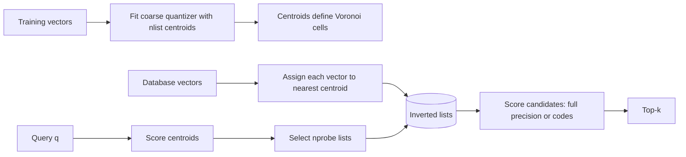

# IVF Family: Inverted Files and Coarse Quantization

> [!TIP]
> **TL;DR:** IVF trains a coarse quantizer, assigns each vector to an inverted list, then searches the `nprobe` closest cells per query. More probes usually scan more candidates and improve recall at higher cost. IVF-Flat keeps full vectors; IVF-PQ stores compressed residual/vector codes and adds quantization error. Training distribution and list balance matter.

## At a glance

| Category | Complexity / cost | Memory/vector | Best for | Worst for | Used in | Key source |
|---|---|---:|---|---|---|---|
| IVF-Flat | Train coarse centroids; scan selected list vectors, roughly `nprobe × average_list_size × d` | Full vector + ID + list assignment | Tunable scan reduction, batched workloads | Severe list imbalance, high update/freshness demands without suitable design | FAISS `IndexIVFFlat`, pgvector IVFFlat [DOCS] | [FAISS indexes](https://github.com/facebookresearch/faiss/wiki/Faiss-indexes) |
| IVF-PQ / IVFADC | Coarse list scan plus table-based code distances | PQ code + ID + codebooks | Large corpora under memory pressure | High recall with too few probes/bits | FAISS IVFPQ [DOCS] | [Jégou et al.](https://doi.org/10.1109/TPAMI.2010.57) |
| IVF-SQ | Coarse scan with scalar-coded values | Quantized vector + ID | Simpler lower-bit representation | Tight recall with aggressive quantization | FAISS SQ variants [DOCS] | [FAISS indexes](https://github.com/facebookresearch/faiss/wiki/Faiss-indexes) |

**Figure 1.** IVF variants overview. The concrete index names and combinations differ by library/product.  
**Takeaway:** IVF is a coarse candidate-pruning family; quantization is an optional additional approximation.

## Main diagram: cells and probing



**Figure 2.** IVF build and query flow, simplified.  
**How to read this:** `nlist` controls partition count at build time; `nprobe` controls query-time breadth. Training centroids and vector assignment create candidate lists. IVF-Flat scores full vectors in the selected lists; IVF-PQ estimates scores from codes.

**Takeaway:** `nprobe` is a recall/latency knob; `nlist` also changes training, list sizes, and index structure.

## Build and search

**TL;DR:** Train on a representative sample and evaluate the list-size distribution, not just the nominal `nlist`.

Simplified build:

```text
centroids = kmeans(training_sample, nlist)
for x in database:
    j = argmin_j distance(x, centroids[j])
    residual = x - centroids[j]        # used by residual PQ variants
    inverted_list[j].append(encode(x or residual))
```

Query:

```text
probe_ids = argmin_nprobe_centroids distance(q, centroids)
candidates = concatenate(inverted_list[j] for j in probe_ids)
score candidates; retain top-k
```

If assignments were perfectly balanced, average list length is N/nlist, so a first-order candidate estimate is `nprobe × N/nlist`. Real clusters are rarely perfectly balanced; actual work is the sum of lengths of the selected lists. A query near a dense centroid can scan much more than the mean.

Worked size: `N=12,000,000`, `nlist=3,000`, `nprobe=30` gives idealized average length 4,000 and rough candidate count 120,000. This is an arithmetic estimate, not a latency or recall guarantee. If the selected lists are 2× the average, candidate scoring approaches 240,000 vectors.

## Parameters and tuning

**TL;DR:** Sweep `nlist`, training sample/seed, quantizer type, and `nprobe` against exact ground truth and list statistics.

| Knob | Higher value tends to… | Main cost / failure if mis-set |
|---|---|---|
| `nlist` | Shorten average lists and create finer partitions | More centroids, training/assignment work; too many tiny lists or insufficient training data |
| `nprobe` | Visit more cells and generally recover more neighbors | More scoring/I/O; latency rises, and `nprobe=nlist` approaches exhaustive scan |
| Training sample size | Improve representation of corpus distribution | More train cost; biased sample leads to poor coarse routing |
| PQ subquantizers / bits | Improve compressed-distance fidelity | Larger codes/codebooks and more memory/bandwidth |
| Residual encoding | Reduce local variation after coarse assignment | Adds training and code complexity; must match the implementation variant |

Do not treat square-root or `N/whatever` heuristics as universal defaults. Tune on current corpus size and distribution, record build seed/version, inspect quantizer drift, and retrain if workload/corpus shifts materially. For streaming updates, verify how the product handles new vectors, list imbalance, and index rebuilds.

## Accuracy and variants

**TL;DR:** IVF-Flat approximates by skipping cells; IVF-PQ adds a second source of approximation through compressed codes.

| Variant | Candidate pruning | Approximate score | Typical reason to use | Quality risks |
|---|---|---|---|---|
| IVF-Flat | Unvisited lists omitted | Full vector score | Preserve precise candidate ranking within probed lists | Misses neighbors in unprobed cells |
| IVF-PQ / IVFADC | Unvisited lists omitted | PQ estimate; optionally rerank | Compress vectors and lower scan bandwidth | Cell miss + quantization distortion |
| IVF-SQ | Unvisited lists omitted | Scalar-quantized score | Lower storage with simpler coding | Quantization noise and tie/order changes |

The original product quantization method splits vectors into subspaces and encodes each separately; asymmetric distance computation compares a full query to compressed database codes ([Jégou, Douze & Schmid, TPAMI 2011](https://doi.org/10.1109/TPAMI.2010.57)). In IVFADC-style designs, coarse assignment narrows the region and PQ codes compact the residual or vector representation. Exact reranking helps only for candidates that IVF returned.

## Failure modes and trade-offs

**TL;DR:** IVF fails quietly through under-probing, poor training, skewed lists, and filters that discard most candidates.

| Symptom | Likely cause | Action |
|---|---|---|
| Low recall at acceptable latency | Too-small nprobe, poor centroids, distribution shift | Sweep probes; retrain on representative sample; compare per-query failures |
| High p99 despite modest average candidate count | Skewed probed lists or random I/O | Log selected-list lengths and cache behavior |
| New data performs worse than old | Quantizer/training drift or list imbalance | Evaluate age cohorts; rebuild/retrain policy |
| Returned fewer than k after filter | Filter applied after candidate scan | Increase candidate budget or use filter-aware/exact-subset path |
| nprobe=nlist is slow | It is nearly a full list scan plus overhead | Compare against flat index and choose the simpler path if faster |

## SDE-1 checklist and interview questions

**TL;DR:** Own list health, exact recall curves, training provenance, and filter-aware candidate budgets.

- Save centroids/training sample metadata, seed, index version, and ingestion time range.
- Track list-length histogram and selected candidate counts by query cohort.
- Plot recall@k and p95/p99 against `nprobe`; include build and memory cost.
- Compare IVF-Flat and compressed variants separately to isolate pruning vs quantization loss.
- Test after corpus drift and under production filters.

**Basic — What is nprobe?** 30-second: Number of coarse IVF lists searched for a query. Deep: More probes generally improve candidate coverage but increase scoring/I/O; the selected lists' actual sizes matter.

**Deep — Why can an IVF index built on old data lose recall?** 30-second: New vectors may not match the coarse centroids or list balance represented by training. Deep: Measure recall and list distribution over time and retrain/rebuild under a tested migration plan.

**Trap — Does IVF-PQ mean the same as IVF-Flat with smaller vectors?** No. PQ changes approximate distance estimation and may encode residuals; specify the actual index construction and scoring path.

## References

- [FAISS index documentation](https://github.com/facebookresearch/faiss/wiki/Faiss-indexes).
- Jégou, Douze & Schmid, 2011, product quantization, TPAMI, [DOI](https://doi.org/10.1109/TPAMI.2010.57).
- [pgvector IVFFlat docs](https://github.com/pgvector/pgvector).

## Version and scope notes

- Parameter defaults and training recommendations vary by library/version; confirm before using in a production runbook.
- No universal `nlist` heuristic or latency estimate is asserted.

**Next:** [HNSW deep dive](03-hnsw-deep-dive.md).  
**Related:** [PQ](../03-compression-quantization/02-product-quantization.md), [nearest-neighbor problem](../01-foundations/02-nearest-neighbor-problem.md), [IVF diagram](../assets/hero-05-ivf.md).
