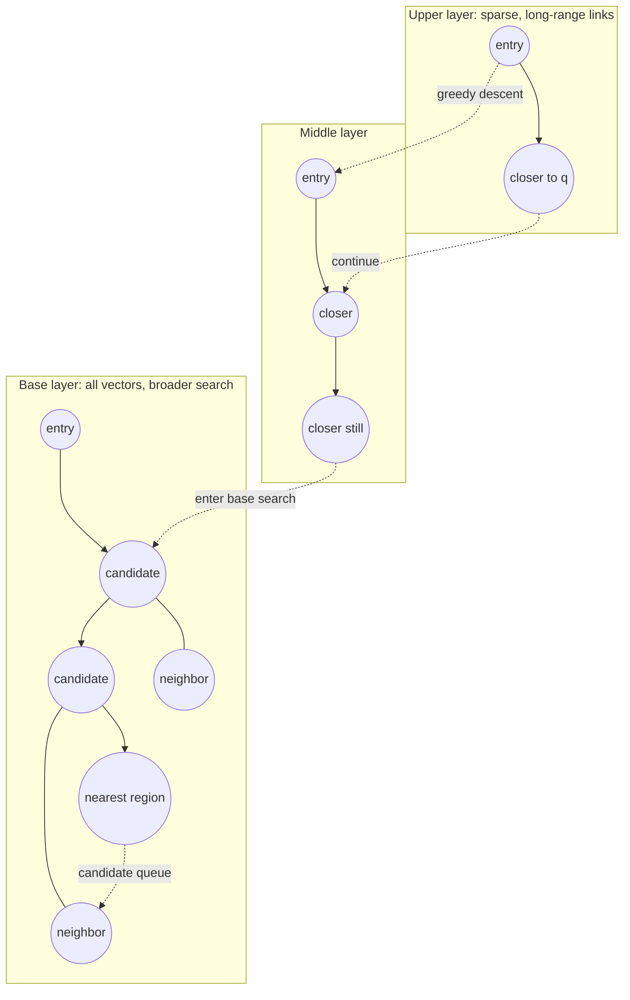

# HNSW Deep Dive

> [!TIP]
> **TL;DR:** HNSW is a multilayer proximity graph. Search greedily descends sparse upper layers, then explores a bounded candidate set in the dense base layer. `M`, `efConstruction`, and `efSearch` trade graph degree/build work/query breadth against recall, latency, and memory. Search is empirically fast on many workloads; logarithmic scaling in the paper is not a worst-case guarantee.

## At a glance

| Category | Complexity / cost | Memory/vector | Best for | Worst for | Used in | Key paper |
|---|---|---:|---|---|---|---|
| HNSW | Empirically near-logarithmic search in evaluated workloads; worst case may inspect many nodes | Raw vectors + graph links, level metadata, IDs | High-recall low-latency in-memory search | Tight RAM, heavy churn/deletion, selective filters without a filter-aware strategy | hnswlib, FAISS, pgvector and others [DOCS] | [Malkov & Yashunin](https://arxiv.org/abs/1603.09320) |

**Figure 1.** HNSW trade-off summary. Concrete degree limits, deletion, concurrency, and memory layout are implementation-specific.  
**Takeaway:** HNSW trades construction and graph memory for navigable candidate search.

## Layered search picture



**Figure 2.** Simplified hierarchy; edges are illustrative. HNSW assigns random maximum levels with exponentially decreasing probability and builds nested proximity graphs ([paper](https://arxiv.org/abs/1603.09320)).  
**How to read this:** Upper layers quickly approach the query region. Search descends when no better neighbor exists at the current layer. Layer 0 uses a wider search with candidate/result queues governed by `efSearch` or its implementation equivalent.

**Takeaway:** Hierarchy supplies multi-scale navigation; layer 0 spends the recall budget.

## Search and construction

**TL;DR:** HNSW construction is incremental; neighbor-selection heuristics preserve navigability rather than simply connecting the nearest M points.

Simplified query:

```text
ep = entry_point
for layer = max_level down to 1:
    ep = greedy_search(layer, q, ep)       # move while a neighbor is closer
candidates, results = best_first_search(layer=0, q, ep, efSearch)
return best k from results
```

Insertion chooses a random level, searches from the current entry point down to the new node's level, selects neighbors at each layer using a diversity heuristic, adds reciprocal links, and prunes overfull neighborhoods. The exact heuristic, tie behavior, and concurrency protocol should be read from the implementation used in production. A purely nearest-M neighbor rule can create redundant short edges and poor long-range connectivity; the original paper's heuristic seeks diverse connections.

**Build pseudocode:**

```text
for each inserted vector x:
    level = sample_exponentially_decaying_level()
    candidates = descend_from_current_entry_point(x)
    for layer = min(level, current_max) down to 0:
        neighbors = search_layer(x, candidates, efConstruction)
        selected = diversity_select(neighbors, M_layer)
        connect_both_directions(x, selected)
        prune_if_degree_exceeded(selected)
    if level > current_max: publish_new_entry_point(x)
```

The paper relates the hierarchy to skip-list-like scale separation and reports logarithmic complexity scaling in its analyzed setting, but operational query cost depends on data, metric, parameters, and implementation. Treat complexity as empirical, measure visited nodes and distance computations, and do not promise O(log N) worst-case behavior.

## Parameters and memory arithmetic

**TL;DR:** Tune recall against memory and build cost; do not assume a nominal `M` translates directly to a fixed RAM multiplier.

| Parameter | Higher tends to do | Recall / cost effect | Failure if mis-set |
|---|---|---|---|
| `M` | Allow more graph connections | Often improves navigability/recall; increases graph memory and build work | Too low: disconnected/poor paths; too high: RAM/build cost and diminishing returns |
| `efConstruction` | Broaden insertion neighbor search | Can improve graph quality; longer builds | Too low: weak graph; too high: expensive build with little gain |
| `efSearch` | Explore more layer-0 candidates | Usually improves recall, increases latency/work | Too low: misses; too high: approaches scan-like work |
| Entry/seed/order | Changes graph construction trajectory | Can affect reproducibility and quality | Different builds produce different query curves |

Memory estimate must use the implementation's actual adjacency format. A rough layer-0 upper-bound-style estimate with 32-bit neighbor IDs and degree cap `2M` is `2M × 4 = 8M` bytes/vector for that layer's IDs, plus vector payload (`d × bytes/component`), level-0 count/capacity metadata, upper-level adjacency, allocator alignment, deleted slots, and replicas. This is not a universal measured multiplier: implementations may use 16/64-bit IDs, compact arrays, reserved capacity, or different degree rules. Example for `M=16`: this rough layer-0 link budget is `32 × 4 = 128 bytes/vector`; 1M such nodes would imply 128 MB for those IDs alone, before all listed overheads.

## Deletion, filtering, and updates

**TL;DR:** “Delete” may mean mark invisible, tombstone, unlink, or rebuild; ask how the exact implementation reclaims graph space and preserves reachability.

HNSW graphs are difficult to mutate safely because removing a node can disconnect useful paths. Libraries commonly provide logical deletion/replacement behavior or require rebuild/compaction strategies; guarantees and APIs differ. Do not infer physical memory reclamation from an API returning success. Monitor deleted-node fraction, graph growth, build backlog, and recall after churn.

Post-filtering can reject candidates reached by ordinary vector traversal, leaving fewer than k eligible results or missing the exact filtered neighbors. Raising `efSearch` may help but is not a universal solution. Compare exact filtered scan, partitioning, iterative search, or purpose-built filter-aware algorithms; see [ACORN](https://arxiv.org/abs/2403.04871) and [Filtered-DiskANN](https://doi.org/10.1145/3543507.3583552).

## Trade-offs and failure modes

**TL;DR:** HNSW is compelling when the graph and vectors fit the memory budget and updates/filters match its implementation.

| Symptom | Likely cause | Response |
|---|---|---|
| Recall falls at same `efSearch` after ingest | Data distribution/order changed, graph quality, more tombstones | Re-run exact eval by age/cohort; rebuild or retune |
| Memory exceeds raw-vector estimate | Links, reserved capacity, metadata, replicas, runtime | Measure RSS/index footprint; account for actual adjacency format |
| p99 spikes | High efSearch, NUMA/cache misses, queueing, filter starvation | Track distance evaluations, visited nodes, cache, filter selectivity |
| Inserts slow under concurrent search | Lock/contention or graph mutation cost | Check library's concurrency model; isolate build or batch writes |
| Filtered query returns too few | Post-filter candidate starvation | Exact filtered baseline; adaptive/iterative or filter-aware path |
| Deletes inflate memory | Logical deletion without physical compaction | Schedule rebuild/compaction and validate cutover |

## SDE-1 checklist and interview Q&A

**TL;DR:** Record exact library version and measure graph behavior, not just parameter names.

- Benchmark `M × efConstruction × efSearch` sweeps against exact recall and p99.
- Capture build order/seed, memory RSS, distance evaluations, tombstones, and insert rate.
- Verify delete, replacement, snapshot, and concurrent-build guarantees in the selected implementation.
- Re-run filtered and high-selectivity cohorts; report k and eligible-set sizes.

**Basic — What does efSearch do?** 30-second: It sets query-time candidate breadth in many HNSW implementations; higher usually costs more and can improve recall. Deep: Its exact meaning and default are implementation-specific; compare visited nodes and recall curves.

**Deep — Why not connect every point to its nearest M neighbors?** 30-second: Many edges become redundant and short-range; diversity heuristics preserve useful routes. Deep: HNSW construction selects neighbors to support navigation at several distance scales, balancing local accuracy and graph connectivity.

**Trap — Is HNSW O(log N) guaranteed?** No. The paper reports/derives logarithmic scaling under its model/experiments; production worst-case and workload behavior are not bounded that way.

## References

- Malkov & Yashunin, 2016 preprint / 2018 TPAMI, [arXiv](https://arxiv.org/abs/1603.09320).
- [hnswlib](https://github.com/nmslib/hnswlib), [FAISS HNSW indexes](https://github.com/facebookresearch/faiss/wiki/Faiss-indexes), [pgvector](https://github.com/pgvector/pgvector).
- Patel et al., ACORN, [arXiv](https://arxiv.org/abs/2403.04871); Gollapudi et al., Filtered-DiskANN, [ACM DOI](https://doi.org/10.1145/3543507.3583552).

## Version and scope notes

- Parameter defaults, degree limits, and delete/reclaim semantics must be verified against the exact shipped library/database version.
- Memory arithmetic above is a transparent rough estimate, not a benchmark; measure actual allocation and RSS.

**Next:** [Graph index family](04-graph-index-family.md).  
**Related:** [IVF family](02-ivf-family.md), [memory sizing](../cheatsheets/memory-sizing.md), [HNSW figure](../assets/hero-04-hnsw.md).
