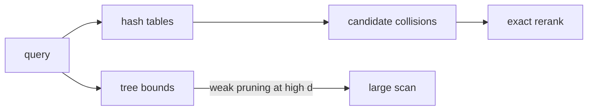

# LSH and tree methods

> **TL;DR:** LSH trades exactness for collision probability; axis-aligned trees work well in low dimensions but often lose pruning power as dimension rises.

**Figure 1: Simplified conceptual view of this topic.**

**Takeaway:** Follow the arrows to see where the method spends work and where the main trade-off enters.

### How to read this

- Follow arrows in the direction data or decisions move.
- The labels name the main components; they do not promise a specific implementation.
- Use the table and field notes below to connect the picture to measurements.

**Visual takeaway:** The diagram shows the main data or decision path; labels are conceptual, not performance guarantees.

## Field notes

Hash families are chosen to make nearby points collide more often than distant points. More tables/probes increase recall and candidate work. Random-projection trees and Annoy-style forests partition geometrically; they are effective for some moderate-dimensional workloads but have no universal win over graph or inverted-file methods.

## Sources

[Indyk–Motwani](https://doi.org/10.1145/276698.276876) · [p-stable LSH](https://doi.org/10.1145/997817.997857). Product behavior and defaults can vary by release; pin the version used in any benchmark.

**Next:** [Master index](../00-INDEX.md) · [Glossary](../99-glossary.md).
