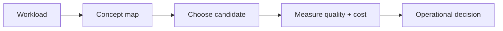

# Indexing algorithms

> **TL;DR:** Follow the visual map, then open a focused note for the assumptions, measurement, and references.

**Figure 1: Simplified study path through this section.**

**Takeaway:** Move from the shared foundation to one method at a time, then validate with measurements.

| Topic | Use |
|---|---|
| [Flat](01-flat-and-brute-force.md) | Start here for the decision summary and linked deep note. |
| [IVF](02-ivf-family.md) | Start here for the decision summary and linked deep note. |
| [HNSW](03-hnsw-deep-dive.md) | Start here for the decision summary and linked deep note. |
| [Graph families](04-graph-index-family.md) | Start here for the decision summary and linked deep note. |
| [LSH and trees](05-lsh-and-tree-methods.md) | Start here for the decision summary and linked deep note. |
| [Disk ANN](06-disk-based-ann.md) | Start here for the decision summary and linked deep note. |

**Start here:** [Flat / brute force](01-flat-and-brute-force.md).

**Next:** [Vector databases master index](../00-INDEX.md).
