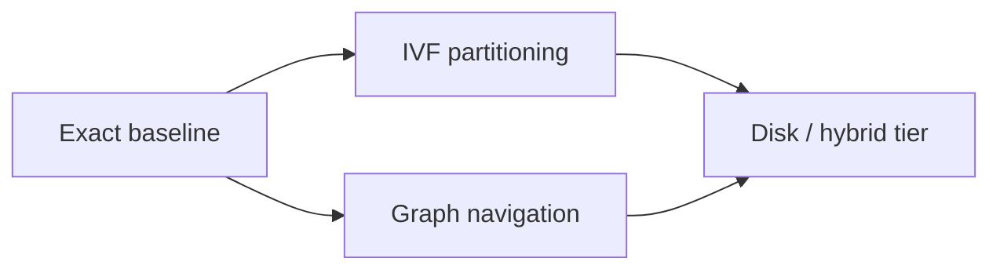

# Indexing Algorithms

> [!TIP] **TL;DR:** ANN indexes trade exactness and query work for candidate-pruning structures; workload and update behavior determine the useful family. Planned notes are `todo`.

**Figure I1.** Index-family map.  
**Takeaway:** Benchmark every candidate against a flat baseline and target workload.

| File | Focus | Status |
|---|---|---|
| [Flat and brute force](01-flat-and-brute-force.md) | Exact scan | todo |
| [IVF family](02-ivf-family.md) | Coarse partitioning and quantized variants | todo |
| [HNSW deep dive](03-hnsw-deep-dive.md) | Layered navigable graph | todo |
| [Graph index family](04-graph-index-family.md) | NSG, Vamana/DiskANN, CAGRA, SSG | todo |
| [LSH and tree methods](05-lsh-and-tree-methods.md) | Hash and tree baselines | todo |
| [Disk-based ANN](06-disk-based-ann.md) | SSD-centric search | todo |

**Start here:** [Flat and brute force](01-flat-and-brute-force.md).

