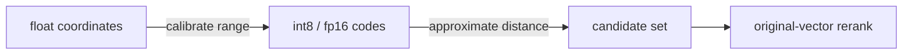

# Scalar quantization

> **TL;DR:** Quantize each coordinate independently to reduce vector bytes; retain originals or rerank when quantization error harms ordering.

**Figure 1: Simplified conceptual view of this topic.**

**Takeaway:** Follow the arrows to see where the method spends work and where the main trade-off enters.

### How to read this

- Follow arrows in the direction data or decisions move.
- The labels name the main components; they do not promise a specific implementation.
- Use the table and field notes below to connect the picture to measurements.

**Visual takeaway:** The diagram shows the main data or decision path; labels are conceptual, not performance guarantees.

## Field notes

FP16 halves coordinate storage relative to float32; int8 typically quarters it, before metadata and alignment. Calibration range, clipping, per-vector versus global scales, and metric implementation affect error. Quantization is not automatically lossless: compare recall and score error against exact float ground truth.

## Sources

[FAISS paper](https://arxiv.org/abs/1702.08734) · [FAISS index guide](https://github.com/facebookresearch/faiss/wiki/Faiss-indexes). Product behavior and defaults can vary by release; pin the version used in any benchmark.

**Next:** [Master index](../00-INDEX.md) · [Glossary](../99-glossary.md).
