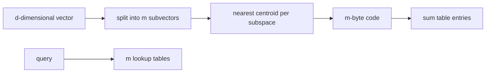

# Product quantization

> **TL;DR:** PQ splits a vector into subvectors and stores one learned code per subspace; ADC computes query-to-code distances from lookup tables.

**Figure 1: Simplified conceptual view of this topic.**

**Takeaway:** Follow the arrows to see where the method spends work and where the main trade-off enters.

### How to read this

- Follow arrows in the direction data or decisions move.
- The labels name the main components; they do not promise a specific implementation.
- Use the table and field notes below to connect the picture to measurements.

**Visual takeaway:** The diagram shows the main data or decision path; labels are conceptual, not performance guarantees.

## Field notes

With m subspaces and 256 centroids each, the code is m bytes per vector, plus codebooks and IDs. Asymmetric distance computation keeps the query uncompressed and looks up each code contribution. OPQ rotates vectors to reduce subspace imbalance. Train on representative data and verify recall after distribution drift; rerank finalists from originals when available.

## Sources

[Product quantization paper](https://doi.org/10.1109/TPAMI.2010.57) · [FAISS index guide](https://github.com/facebookresearch/faiss/wiki/Faiss-indexes). Product behavior and defaults can vary by release; pin the version used in any benchmark.

**Next:** [Master index](../00-INDEX.md) · [Glossary](../99-glossary.md).
