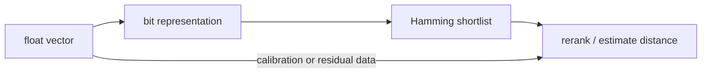

# Binary vectors and RaBitQ

> **TL;DR:** Binary embeddings can use Hamming/popcount operations; RaBitQ is a distinct quantizer with distance-estimation machinery, not merely sign-bit packing.

**Figure 1: Simplified conceptual view of this topic.**

**Takeaway:** Follow the arrows to see where the method spends work and where the main trade-off enters.

### How to read this

- Follow arrows in the direction data or decisions move.
- The labels name the main components; they do not promise a specific implementation.
- Use the table and field notes below to connect the picture to measurements.

**Visual takeaway:** The diagram shows the main data or decision path; labels are conceptual, not performance guarantees.

## Field notes

Binary encoding is attractive when the model is trained for binary retrieval or when aggressive shortlist compression is acceptable. Directly thresholding arbitrary float embeddings can destroy useful magnitude and angular information. RaBitQ develops an unbiased distance estimator and correction information to improve accuracy at low bits per dimension. Report bytes/vector and recall together.

## Sources

[ANN survey](https://arxiv.org/abs/1806.09823) · [FAISS paper](https://arxiv.org/abs/1702.08734). Product behavior and defaults can vary by release; pin the version used in any benchmark.

**Next:** [Master index](../00-INDEX.md) · [Glossary](../99-glossary.md).
