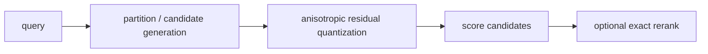

# Anisotropic quantization and ScaNN

> **TL;DR:** For maximum-inner-product search, errors parallel to a candidate vector can affect ranking more than perpendicular errors; quantizers can weight these directions differently.

**Figure 1: Simplified conceptual view of this topic.**

**Takeaway:** Follow the arrows to see where the method spends work and where the main trade-off enters.

### How to read this

- Follow arrows in the direction data or decisions move.
- The labels name the main components; they do not promise a specific implementation.
- Use the table and field notes below to connect the picture to measurements.

**Visual takeaway:** The diagram shows the main data or decision path; labels are conceptual, not performance guarantees.

## Field notes

ScaNN combines partitioning with quantization and score-aware candidate selection. Its anisotropic objective penalizes residual components according to their effect on inner products rather than treating every squared-error direction equally. This is most relevant for MIPS workloads; cosine and L2 pipelines need metric-consistent transformations and benchmarks.

## Sources

[ScaNN paper](https://arxiv.org/abs/1908.10396) · [ScaNN repository](https://github.com/google-research/google-research/tree/master/scann). Product behavior and defaults can vary by release; pin the version used in any benchmark.

**Next:** [Master index](../00-INDEX.md) · [Glossary](../99-glossary.md).
