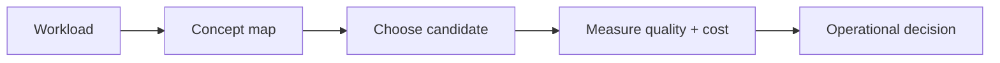

# Compression and quantization

> **TL;DR:** Follow the visual map, then open a focused note for the assumptions, measurement, and references.

**Figure 1: Simplified study path through this section.**

**Takeaway:** Move from the shared foundation to one method at a time, then validate with measurements.

| Topic | Use |
|---|---|
| [Scalar quantization](01-scalar-quantization.md) | Start here for the decision summary and linked deep note. |
| [PQ](02-product-quantization.md) | Start here for the decision summary and linked deep note. |
| [Binary and RaBitQ](03-binary-and-rabitq.md) | Start here for the decision summary and linked deep note. |
| [ScaNN](04-anisotropic-quantization-scann.md) | Start here for the decision summary and linked deep note. |
| [Matryoshka](05-matryoshka-embeddings.md) | Start here for the decision summary and linked deep note. |

**Start here:** [Scalar quantization](01-scalar-quantization.md).

**Next:** [Vector databases master index](../00-INDEX.md).
