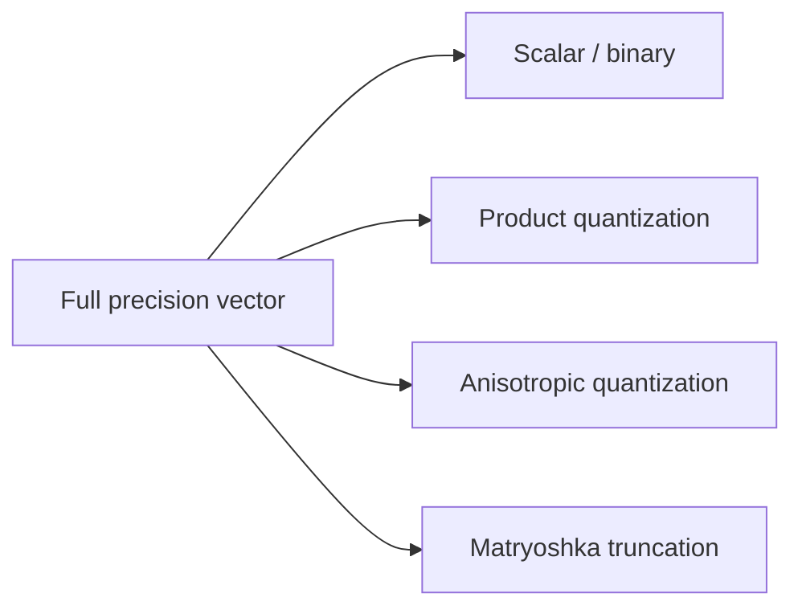

# Compression and Quantization

> [!TIP] **TL;DR:** Compressed vectors reduce storage and memory traffic while adding approximation error; compare quality at the same total system budget. Planned notes are `todo`.

**Figure Q1.** Representation alternatives.  
**Takeaway:** Compression changes scoring and candidate ordering; evaluate recall and end-to-end cost together.

| File | Focus | Status |
|---|---|---|
| [Scalar quantization](01-scalar-quantization.md) | Per-scalar low-bit representation | todo |
| [Product quantization](02-product-quantization.md) | Subspace codebooks and ADC | todo |
| [Binary and RaBitQ](03-binary-and-rabitq.md) | Binary scoring and RaBitQ | todo |
| [Anisotropic quantization / ScaNN](04-anisotropic-quantization-scann.md) | MIPS-aware quantization | todo |
| [Matryoshka embeddings](05-matryoshka-embeddings.md) | Prefix truncation | todo |

**Start here:** [Product quantization](02-product-quantization.md).

