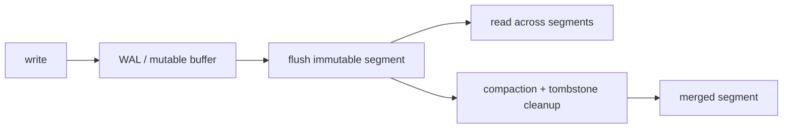

# Segments, LSMs, and tombstones

> **TL;DR:** Immutable segments simplify concurrent reads and recovery; compaction merges small segments and reclaims obsolete versions at a write-amplification cost.

**Figure 1: Simplified conceptual view of this topic.**

**Takeaway:** Follow the arrows to see where the method spends work and where the main trade-off enters.

### How to read this

- Follow arrows in the direction data or decisions move.
- The labels name the main components; they do not promise a specific implementation.
- Use the table and field notes below to connect the picture to measurements.

**Visual takeaway:** The diagram shows the main data or decision path; labels are conceptual, not performance guarantees.

## Field notes

A query may search multiple segments then merge top-k results. Tombstones hide deleted or superseded records until compaction reclaims them. Track segment count, compaction backlog, write amplification, and stale-data visibility. Segment-local indexes permit online builds and swaps, but duplicate work and fragmented search can raise tail latency.

## Sources

[Milvus architecture](https://milvus.io/docs/architecture_overview.md) · [Milvus data processing](https://milvus.io/docs/data_processing.md). Product behavior and defaults can vary by release; pin the version used in any benchmark.

**Next:** [Master index](../00-INDEX.md) · [Glossary](../99-glossary.md).
