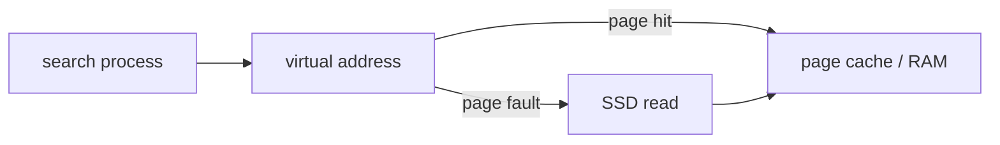

# Memory, disk, mmap, and tiering

> **TL;DR:** Memory mapping exposes file-backed pages through virtual memory; it does not mean data is resident or that random reads are free.

**Figure 1: Simplified conceptual view of this topic.**

**Takeaway:** Follow the arrows to see where the method spends work and where the main trade-off enters.

### How to read this

- Follow arrows in the direction data or decisions move.
- The labels name the main components; they do not promise a specific implementation.
- Use the table and field notes below to connect the picture to measurements.

**Visual takeaway:** The diagram shows the main data or decision path; labels are conceptual, not performance guarantees.

## Field notes

Distinguish resident set, mapped virtual size, and index-file size. A warm benchmark can hide cold-start and page-fault costs. Random graph traversal stresses latency and cache locality; sequential scans can exploit bandwidth. NUMA placement and concurrent memory pressure influence tail latency. Benchmark warm and cold states separately.

## Sources

[DiskANN paper](https://proceedings.neurips.cc/paper/2019/hash/09853c7fb1d3f8ee67a61b6bf4a7f8e6-Abstract.html) · [Filtered-DiskANN](https://doi.org/10.1145/3543507.3583552). Product behavior and defaults can vary by release; pin the version used in any benchmark.

**Next:** [Master index](../00-INDEX.md) · [Glossary](../99-glossary.md).
