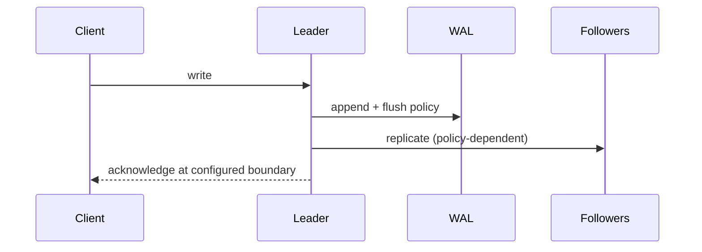

# WAL, durability, and replication

> **TL;DR:** A WAL records changes before data pages are safely persisted; the acknowledged-write guarantee depends on flush and replication policy.

**Figure 1: Simplified conceptual view of this topic.**

**Takeaway:** Follow the arrows to see where the method spends work and where the main trade-off enters.

### How to read this

- Follow arrows in the direction data or decisions move.
- The labels name the main components; they do not promise a specific implementation.
- Use the table and field notes below to connect the picture to measurements.

**Visual takeaway:** The diagram shows the main data or decision path; labels are conceptual, not performance guarantees.

## Field notes

Document whether acknowledgment means process memory, local durable log, quorum, or remote replicas. Recovery replays durable log records; checkpoints bound replay time. Asynchronous replication can lose recent acknowledged writes during failover depending on the contract. Verify consistency semantics from the selected system/version documentation before relying on them.

## Sources

[PostgreSQL WAL](https://www.postgresql.org/docs/current/wal-intro.html) · [PostgreSQL replication](https://www.postgresql.org/docs/current/warm-standby.html). Product behavior and defaults can vary by release; pin the version used in any benchmark.

**Next:** [Master index](../00-INDEX.md) · [Glossary](../99-glossary.md).
