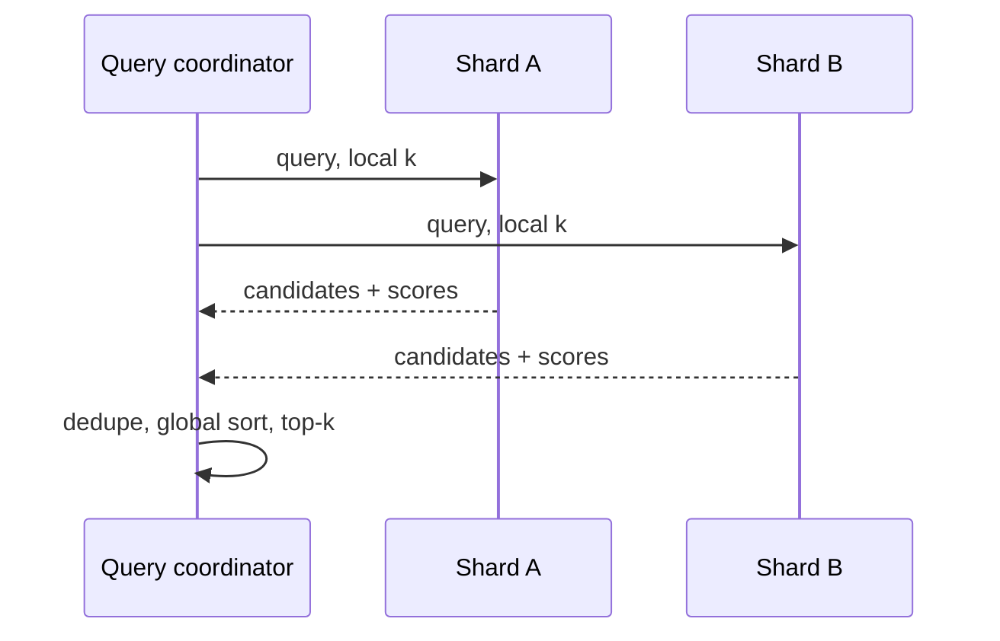

# Sharding and distributed top-k

> **TL;DR:** A distributed query fans out to shards and merges local candidates; each shard must return enough candidates for a correct global top-k under the chosen scoring plan.

**Figure 1: Simplified conceptual view of this topic.**

**Takeaway:** Follow the arrows to see where the method spends work and where the main trade-off enters.

### How to read this

- Follow arrows in the direction data or decisions move.
- The labels name the main components; they do not promise a specific implementation.
- Use the table and field notes below to connect the picture to measurements.

**Visual takeaway:** The diagram shows the main data or decision path; labels are conceptual, not performance guarantees.

## Field notes

Routing by tenant or key can reduce fan-out but may skew load. Scatter-gather adds network and queueing latency; the slowest participating shard often controls tail latency. Overfetch can protect recall when local ANN is approximate, while replication affects read freshness and failover. Measure per-shard skew, fan-out, merge cost, and partial-result behavior.

## Sources

[Milvus architecture](https://milvus.io/docs/architecture_overview.md) · [Milvus data processing](https://milvus.io/docs/data_processing.md). Product behavior and defaults can vary by release; pin the version used in any benchmark.

**Next:** [Master index](../00-INDEX.md) · [Glossary](../99-glossary.md).
