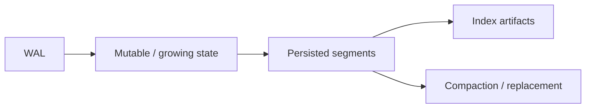

# Storage Engine Internals

> [!TIP] **TL;DR:** A database index is only one part of the serving engine: mutation logs, segment lifecycle, persistence, and distributed routing determine freshness and recovery. Planned notes are `todo`.

**Figure S1.** Conceptual persistence lifecycle; names and guarantees vary by system.  
**Takeaway:** Track durability, visibility, and index readiness as separate guarantees.

| File | Focus | Status |
|---|---|---|
| [Segments and LSM](01-segment-architecture-and-lsm.md) | Mutability, compaction, deletes | todo |
| [Memory vs disk](02-memory-vs-disk-mmap-tiering.md) | mmap, page cache, NUMA, tiers | todo |
| [WAL and replication](03-wal-durability-replication.md) | Durability and recovery | todo |
| [Sharding](04-sharding-and-distributed-search.md) | Scatter-gather and global top-k | todo |

**Start here:** [Segments and LSM](01-segment-architecture-and-lsm.md).

