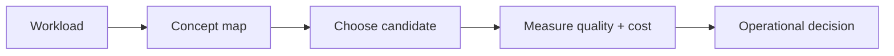

# Storage engine internals

> **TL;DR:** Follow the visual map, then open a focused note for the assumptions, measurement, and references.

**Figure 1: Simplified study path through this section.**

**Takeaway:** Move from the shared foundation to one method at a time, then validate with measurements.

| Topic | Use |
|---|---|
| [Segments and LSM](01-segment-architecture-and-lsm.md) | Start here for the decision summary and linked deep note. |
| [Memory and disk](02-memory-vs-disk-mmap-tiering.md) | Start here for the decision summary and linked deep note. |
| [WAL and replication](03-wal-durability-replication.md) | Start here for the decision summary and linked deep note. |
| [Sharding](04-sharding-and-distributed-search.md) | Start here for the decision summary and linked deep note. |

**Start here:** [Segments and LSM](01-segment-architecture-and-lsm.md).

**Next:** [Vector databases master index](../00-INDEX.md).
