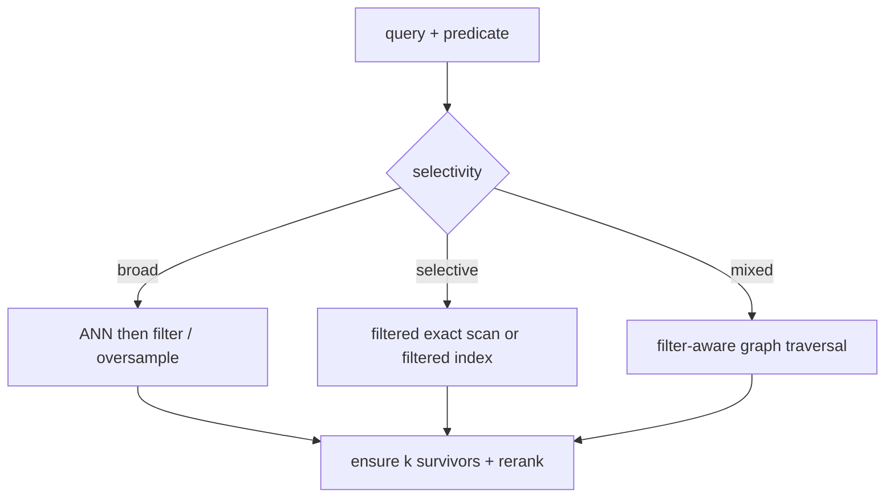

# Filtered and hybrid search

> **TL;DR:** A metadata predicate changes the candidate population; prefilter, postfilter, and filter-aware traversal trade wasted search work against incomplete results.

**Figure 1: Simplified conceptual view of this topic.**

**Takeaway:** Follow the arrows to see where the method spends work and where the main trade-off enters.

### How to read this

- Follow arrows in the direction data or decisions move.
- The labels name the main components; they do not promise a specific implementation.
- Use the table and field notes below to connect the picture to measurements.

**Visual takeaway:** The diagram shows the main data or decision path; labels are conceptual, not performance guarantees.

## Field notes

Postfiltering may return fewer than k results; oversampling helps but can still fail under selective predicates. Prefiltering shrinks the corpus, but can make ANN traversal disconnected or expensive. ACORN and Filtered-DiskANN are examples of filter-aware approaches. Always compare filtered recall against exact top-k computed within the same predicate.

## Sources

[ACORN](https://arxiv.org/abs/2403.04871) · [Filtered-DiskANN](https://doi.org/10.1145/3543507.3583552). Product behavior and defaults can vary by release; pin the version used in any benchmark.

**Next:** [Master index](../00-INDEX.md) · [Glossary](../99-glossary.md).
