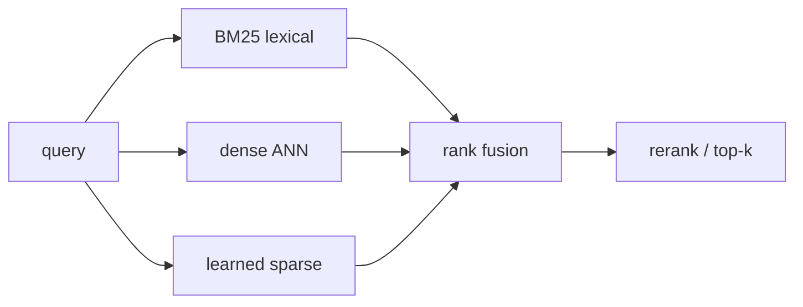

# BM25, dense, and sparse hybrid retrieval

> **TL;DR:** Lexical and semantic retrievers fail differently; rank fusion combines lists without pretending their raw scores share a calibrated scale.

**Figure 1: Simplified conceptual view of this topic.**

**Takeaway:** Follow the arrows to see where the method spends work and where the main trade-off enters.

### How to read this

- Follow arrows in the direction data or decisions move.
- The labels name the main components; they do not promise a specific implementation.
- Use the table and field notes below to connect the picture to measurements.

**Visual takeaway:** The diagram shows the main data or decision path; labels are conceptual, not performance guarantees.

## Field notes

BM25 favors exact term matches and rarity; dense vectors capture semantic proximity; learned sparse methods add expansion while retaining term-level signals. Reciprocal rank fusion uses rank positions, reducing dependence on score calibration. Tune candidate depths and fusion weights on held-out relevance judgments, and account for duplicate documents across lists.

## Sources

[Reciprocal rank fusion](https://plg.uwaterloo.ca/~gvcormac/cormacksigir09-rrf.pdf) · [ColBERT](https://arxiv.org/abs/2004.12832). Product behavior and defaults can vary by release; pin the version used in any benchmark.

**Next:** [Master index](../00-INDEX.md) · [Glossary](../99-glossary.md).
