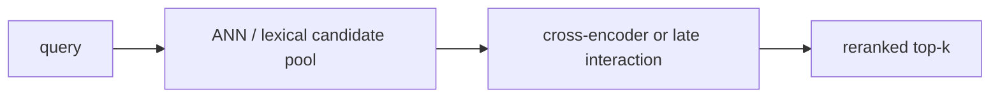

# Reranking and multivector retrieval

> **TL;DR:** A fast first stage retrieves a candidate pool; a more expressive model reranks it, improving ordering while adding compute proportional to candidate count.

**Figure 1: Simplified conceptual view of this topic.**

**Takeaway:** Follow the arrows to see where the method spends work and where the main trade-off enters.

### How to read this

- Follow arrows in the direction data or decisions move.
- The labels name the main components; they do not promise a specific implementation.
- Use the table and field notes below to connect the picture to measurements.

**Visual takeaway:** The diagram shows the main data or decision path; labels are conceptual, not performance guarantees.

## Field notes

Cross-encoders jointly score query-document pairs and are usually too costly for corpus-wide search. ColBERT uses token-level late interaction; PLAID accelerates ColBERT-style retrieval, while MUVERA maps multi-vector comparison toward fixed-dimensional retrieval. Evaluate candidate recall separately from reranker quality: a reranker cannot recover absent relevant documents.

## Sources

[Reciprocal rank fusion](https://plg.uwaterloo.ca/~gvcormac/cormacksigir09-rrf.pdf) · [ColBERT](https://arxiv.org/abs/2004.12832). Product behavior and defaults can vary by release; pin the version used in any benchmark.

**Next:** [Master index](../00-INDEX.md) · [Glossary](../99-glossary.md).
