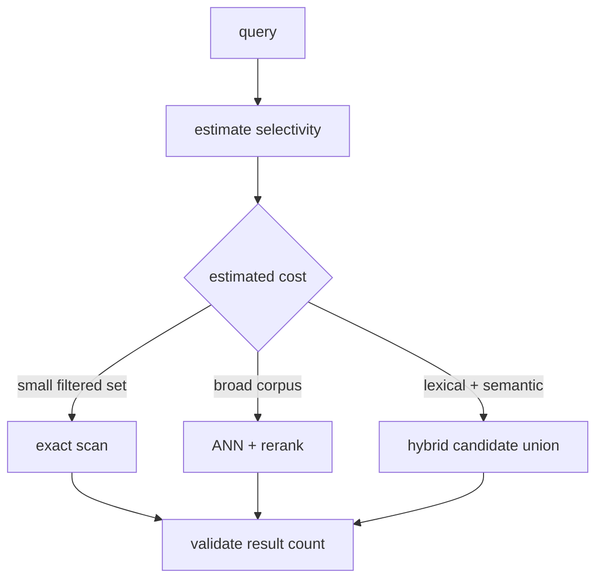

# Query planning and cost models

> **TL;DR:** Choose among scan, ANN, and hybrid plans using corpus size, predicate selectivity, index readiness, and a measured latency model.

**Figure 1: Simplified conceptual view of this topic.**

**Takeaway:** Follow the arrows to see where the method spends work and where the main trade-off enters.

### How to read this

- Follow arrows in the direction data or decisions move.
- The labels name the main components; they do not promise a specific implementation.
- Use the table and field notes below to connect the picture to measurements.

**Visual takeaway:** The diagram shows the main data or decision path; labels are conceptual, not performance guarantees.

## Field notes

A simplistic cost model can compare estimated filtered rows times dimension against ANN traversal plus filtering and merge overhead. Real models need calibration for cache state, concurrent load, dimension, and index parameters. Keep a safe fallback when statistics are stale, and measure estimate-versus-actual error by query cohort.

## Sources

[pgvector](https://github.com/pgvector/pgvector) · [PostgreSQL indexes](https://www.postgresql.org/docs/current/indexes.html). Product behavior and defaults can vary by release; pin the version used in any benchmark.

**Next:** [Master index](../00-INDEX.md) · [Glossary](../99-glossary.md).
