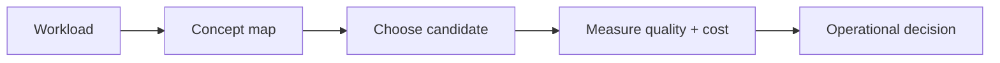

# Query processing

> **TL;DR:** Follow the visual map, then open a focused note for the assumptions, measurement, and references.

**Figure 1: Simplified study path through this section.**

**Takeaway:** Move from the shared foundation to one method at a time, then validate with measurements.

| Topic | Use |
|---|---|
| [Filtered search](01-filtered-and-hybrid-search.md) | Start here for the decision summary and linked deep note. |
| [Hybrid retrieval](02-hybrid-bm25-dense-sparse.md) | Start here for the decision summary and linked deep note. |
| [Reranking](03-reranking-and-multivector.md) | Start here for the decision summary and linked deep note. |
| [Planning](04-query-planning-and-cost-model.md) | Start here for the decision summary and linked deep note. |

**Start here:** [Filtered and hybrid search](01-filtered-and-hybrid-search.md).

**Next:** [Vector databases master index](../00-INDEX.md).
