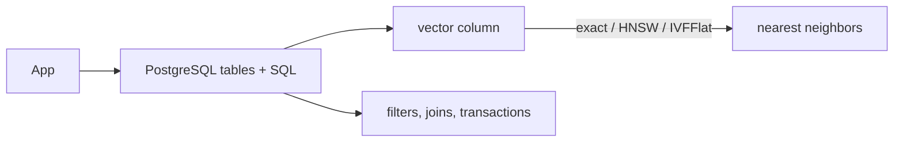

# pgvector

> **TL;DR:** pgvector adds vector types and ANN indexes inside PostgreSQL, keeping relational data and transactions close to retrieval.

**Figure 1: Simplified conceptual view of this topic.**

**Takeaway:** Follow the arrows to see where the method spends work and where the main trade-off enters.

### How to read this

- Follow arrows in the direction data or decisions move.
- The labels name the main components; they do not promise a specific implementation.
- Use the table and field notes below to connect the picture to measurements.

**Visual takeaway:** The diagram shows the main data or decision path; labels are conceptual, not performance guarantees.

## Field notes

Choose it when SQL joins, operational familiarity, and modest deployment complexity outweigh specialized vector scaling needs. Its planner, maintenance, memory, and filtering behavior are tied to PostgreSQL and extension versions. Check current operator classes, index options, and query-plan behavior in the official repository; verify recall on your own filtered workload.

## Sources

[pgvector](https://github.com/pgvector/pgvector) · [PostgreSQL indexes](https://www.postgresql.org/docs/current/indexes.html). Product behavior and defaults can vary by release; pin the version used in any benchmark.

**Next:** [Master index](../00-INDEX.md) · [Glossary](../99-glossary.md).
