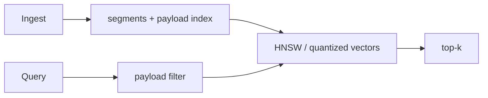

# Qdrant

> **TL;DR:** Qdrant is an open-source vector database with payload filtering and segment-based storage; benchmark its index and filter choices against the workload.

**Figure 1: Simplified conceptual view of this topic.**

**Takeaway:** Follow the arrows to see where the method spends work and where the main trade-off enters.

### How to read this

- Follow arrows in the direction data or decisions move.
- The labels name the main components; they do not promise a specific implementation.
- Use the table and field notes below to connect the picture to measurements.

**Visual takeaway:** The diagram shows the main data or decision path; labels are conceptual, not performance guarantees.

## Field notes

Evaluate payload index coverage, filter selectivity, quantization, replication, and segment lifecycle together. Documentation describes current configuration, but product defaults can evolve: pin the tested server version and record it with benchmark results. Avoid inferring managed-service behavior from an open-source deployment.

## Sources

[Qdrant documentation](https://qdrant.tech/documentation/) · [Qdrant filtering](https://qdrant.tech/articles/vector-search-filtering/). Product behavior and defaults can vary by release; pin the version used in any benchmark.

**Next:** [Master index](../00-INDEX.md) · [Glossary](../99-glossary.md).
