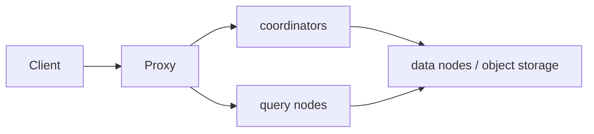

# Milvus

> **TL;DR:** Milvus separates client/query, coordination, and storage/data paths to support distributed vector workloads and multiple index/storage choices.

**Figure 1: Simplified conceptual view of this topic.**

**Takeaway:** Follow the arrows to see where the method spends work and where the main trade-off enters.

### How to read this

- Follow arrows in the direction data or decisions move.
- The labels name the main components; they do not promise a specific implementation.
- Use the table and field notes below to connect the picture to measurements.

**Visual takeaway:** The diagram shows the main data or decision path; labels are conceptual, not performance guarantees.

## Field notes

This architecture makes deployment topology and resource roles part of the operational choice. Evaluate consistency, segment loading, compaction, index building, and object-store access with the chosen release. The official architecture and data-processing docs are the source of truth for current component names and behavior.

## Sources

[Milvus architecture](https://milvus.io/docs/architecture_overview.md) · [Milvus data processing](https://milvus.io/docs/data_processing.md). Product behavior and defaults can vary by release; pin the version used in any benchmark.

**Next:** [Master index](../00-INDEX.md) · [Glossary](../99-glossary.md).
