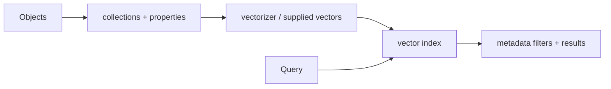

# Weaviate

> **TL;DR:** Weaviate offers a schema-aware vector database with configurable vector indexes and integrated retrieval features.

**Figure 1: Simplified conceptual view of this topic.**

**Takeaway:** Follow the arrows to see where the method spends work and where the main trade-off enters.

### How to read this

- Follow arrows in the direction data or decisions move.
- The labels name the main components; they do not promise a specific implementation.
- Use the table and field notes below to connect the picture to measurements.

**Visual takeaway:** The diagram shows the main data or decision path; labels are conceptual, not performance guarantees.

## Field notes

Compare self-provided versus integrated vectorization, schema evolution, filter behavior, replication, and operational footprint. Vectorizer integrations and defaults are changeable; pin versions and inspect the selected vector-index configuration. Treat product feature summaries as starting points, then validate with representative data.

## Sources

[Weaviate documentation](https://docs.weaviate.io/weaviate) · [Weaviate vector index](https://docs.weaviate.io/weaviate/config-refs/schema/vector-index). Product behavior and defaults can vary by release; pin the version used in any benchmark.

**Next:** [Master index](../00-INDEX.md) · [Glossary](../99-glossary.md).
