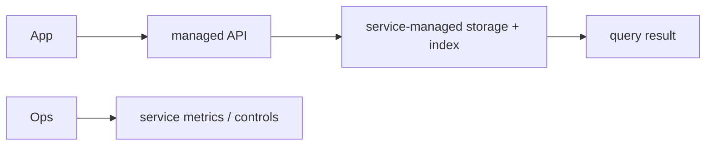

# Pinecone

> **TL;DR:** A managed vector service can reduce infrastructure ownership; assess data governance, latency, scaling controls, and vendor-specific query semantics.

**Figure 1: Simplified conceptual view of this topic.**

**Takeaway:** Follow the arrows to see where the method spends work and where the main trade-off enters.

### How to read this

- Follow arrows in the direction data or decisions move.
- The labels name the main components; they do not promise a specific implementation.
- Use the table and field notes below to connect the picture to measurements.

**Visual takeaway:** The diagram shows the main data or decision path; labels are conceptual, not performance guarantees.

## Field notes

Managed services shift operations rather than eliminate them: teams still own data modeling, embedding migrations, workload design, evaluation, and access control. Validate region, retention, backup/export, filtering, consistency, and cost dimensions against current contracts and docs. Compare end-to-end cost under realistic load, including ingestion and idle capacity.

## Sources

[Pinecone documentation](https://docs.pinecone.io/) · [Pinecone architecture](https://www.pinecone.io/learn/series/faiss/vector-database/). Product behavior and defaults can vary by release; pin the version used in any benchmark.

**Next:** [Master index](../00-INDEX.md) · [Glossary](../99-glossary.md).
