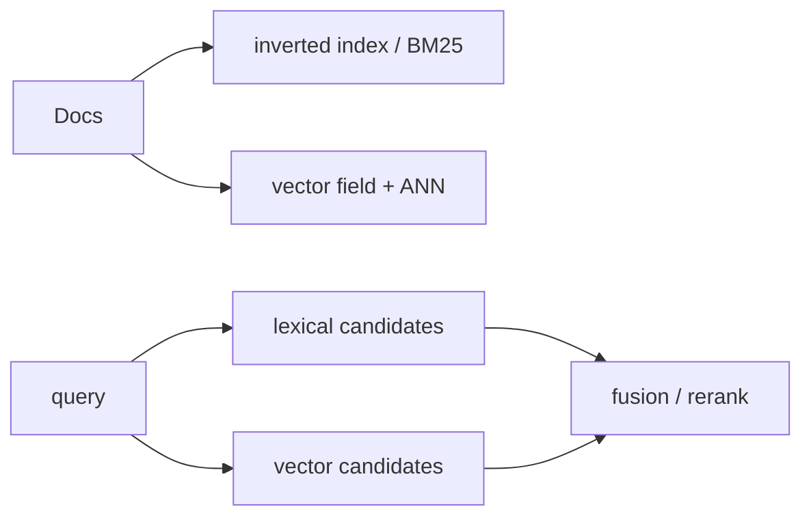

# Elasticsearch, OpenSearch, and Lucene

> **TL;DR:** Search engines combine inverted lexical indexes with vector retrieval, making hybrid queries and text-centric operations a natural fit.

**Figure 1: Simplified conceptual view of this topic.**

**Takeaway:** Follow the arrows to see where the method spends work and where the main trade-off enters.

### How to read this

- Follow arrows in the direction data or decisions move.
- The labels name the main components; they do not promise a specific implementation.
- Use the table and field notes below to connect the picture to measurements.

**Visual takeaway:** The diagram shows the main data or decision path; labels are conceptual, not performance guarantees.

## Field notes

Lucene underlies core search capabilities, while Elasticsearch and OpenSearch expose product-level APIs and operational models. Index types, quantization, filters, and defaults vary by version. For a fair choice, test hybrid relevance, indexing throughput, shard overhead, and p99 under the same corpus and query distribution.

## Sources

[Elasticsearch vector search](https://www.elastic.co/docs/solutions/search/vector) · [Lucene vector API](https://lucene.apache.org/core/10_3_1/core/org/apache/lucene/util/hnsw/package-summary.html). Product behavior and defaults can vary by release; pin the version used in any benchmark.

**Next:** [Master index](../00-INDEX.md) · [Glossary](../99-glossary.md).
