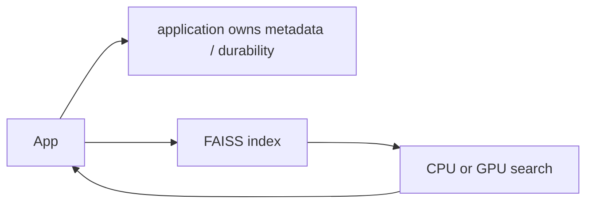

# FAISS library

> **TL;DR:** FAISS is an ANN library, not a complete transactional database: it supplies index structures and GPU/CPU search primitives for an application to integrate.

**Figure 1: Simplified conceptual view of this topic.**

**Takeaway:** Follow the arrows to see where the method spends work and where the main trade-off enters.

### How to read this

- Follow arrows in the direction data or decisions move.
- The labels name the main components; they do not promise a specific implementation.
- Use the table and field notes below to connect the picture to measurements.

**Visual takeaway:** The diagram shows the main data or decision path; labels are conceptual, not performance guarantees.

## Field notes

Use FAISS when you want algorithm choice and direct control inside an application or service. You must design persistence, concurrent updates, metadata filtering, sharding, and recovery around it. Its index guide is useful for code-size and memory estimates, but measured recall and latency remain data- and hardware-dependent.

## Sources

[FAISS paper](https://arxiv.org/abs/1702.08734) · [FAISS index guide](https://github.com/facebookresearch/faiss/wiki/Faiss-indexes). Product behavior and defaults can vary by release; pin the version used in any benchmark.

**Next:** [Master index](../00-INDEX.md) · [Glossary](../99-glossary.md).
