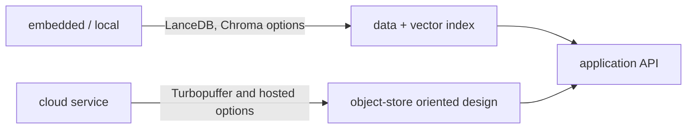

# LanceDB, Turbopuffer, and Chroma

> **TL;DR:** These products occupy different deployment and storage points; compare their current operating model instead of treating “vector database” as one architecture.

**Figure 1: Simplified conceptual view of this topic.**

**Takeaway:** Follow the arrows to see where the method spends work and where the main trade-off enters.

### How to read this

- Follow arrows in the direction data or decisions move.
- The labels name the main components; they do not promise a specific implementation.
- Use the table and field notes below to connect the picture to measurements.

**Visual takeaway:** The diagram shows the main data or decision path; labels are conceptual, not performance guarantees.

## Field notes

LanceDB emphasizes columnar data and local/object-store workflows; Chroma provides an approachable developer database with local and hosted options; Turbopuffer describes an object-storage-oriented managed system. These are broad product positioning statements, not performance claims. Check current docs for tenancy, persistence, consistency, filtering, and pricing before choosing.

## Sources

[Chroma documentation](https://docs.trychroma.com/) · [LanceDB documentation](https://docs.lancedb.com/). Product behavior and defaults can vary by release; pin the version used in any benchmark.

**Next:** [Master index](../00-INDEX.md) · [Glossary](../99-glossary.md).
