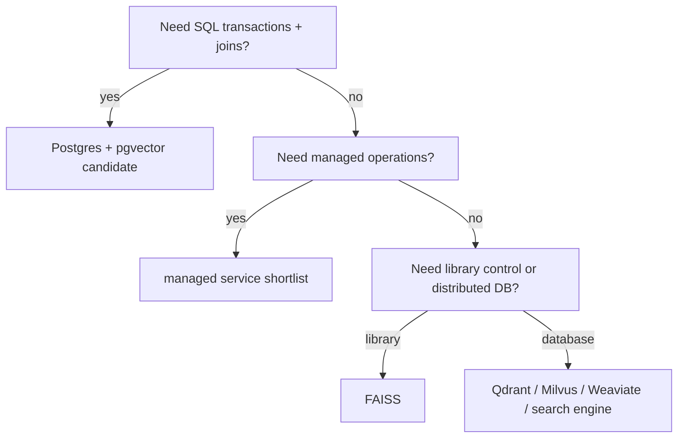

# Vector retrieval decision matrix

> **TL;DR:** Select by ownership and workload constraints, then eliminate candidates with measured quality, operations, and cost requirements.

**Figure 1: Simplified conceptual view of this topic.**

**Takeaway:** Follow the arrows to see where the method spends work and where the main trade-off enters.

### How to read this

- Follow arrows in the direction data or decisions move.
- The labels name the main components; they do not promise a specific implementation.
- Use the table and field notes below to connect the picture to measurements.

**Visual takeaway:** The diagram shows the main data or decision path; labels are conceptual, not performance guarantees.

## Field notes

This tree is a shortlist, not a winner declaration. Add hard constraints (region, data residency, backup, consistency, filters, update rate, vector count), then run a common benchmark. Any system that fails exact-ground-truth recall, p99, recovery, or budget gates is removed regardless of feature count.

## Sources

[pgvector](https://github.com/pgvector/pgvector) · [PostgreSQL indexes](https://www.postgresql.org/docs/current/indexes.html). Product behavior and defaults can vary by release; pin the version used in any benchmark.

**Next:** [Master index](../00-INDEX.md) · [Glossary](../99-glossary.md).
