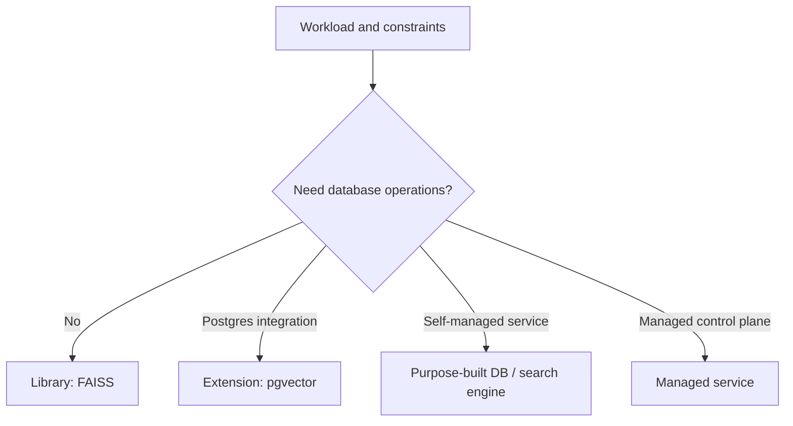

# System Comparisons

> [!TIP] **TL;DR:** Compare products by category and guarantees: library, engine, extension, purpose-built database, and managed service solve different operational problems. Notes are `todo` pending versioned source review.

**Figure P1.** Category-level selection sketch, not a vendor ranking.  
**Takeaway:** Select the operational category first; verify feature behavior against current versioned documentation.

| File | System | Status |
|---|---|---|
| [pgvector](01-pgvector.md) | PostgreSQL extension | todo |
| [Qdrant](02-qdrant.md) | Purpose-built database | todo |
| [Milvus](03-milvus.md) | Distributed purpose-built database | todo |
| [Weaviate](04-weaviate.md) | Purpose-built database | todo |
| [Pinecone](05-pinecone.md) | Managed service | todo |
| [Elasticsearch / OpenSearch / Lucene](06-elasticsearch-opensearch-lucene.md) | Search engines and library | todo |
| [FAISS](07-faiss-library.md) | ANN library | todo |
| [LanceDB / Turbopuffer / Chroma](08-lancedb-turbopuffer-chroma.md) | Embedded / object-store / database designs | todo |
| [Decision matrix](09-decision-matrix.md) | Workload mapping | todo |

**Start here:** [Decision matrix](09-decision-matrix.md).

