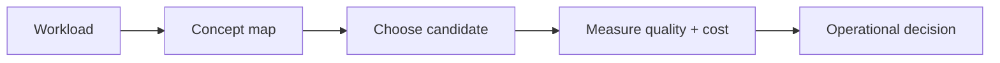

# System comparisons

> **TL;DR:** Follow the visual map, then open a focused note for the assumptions, measurement, and references.

**Figure 1: Simplified study path through this section.**

**Takeaway:** Move from the shared foundation to one method at a time, then validate with measurements.

| Topic | Use |
|---|---|
| [pgvector](01-pgvector.md) | Start here for the decision summary and linked deep note. |
| [Qdrant](02-qdrant.md) | Start here for the decision summary and linked deep note. |
| [Milvus](03-milvus.md) | Start here for the decision summary and linked deep note. |
| [Weaviate](04-weaviate.md) | Start here for the decision summary and linked deep note. |
| [Pinecone](05-pinecone.md) | Start here for the decision summary and linked deep note. |
| [Search engines](06-elasticsearch-opensearch-lucene.md) | Start here for the decision summary and linked deep note. |
| [FAISS](07-faiss-library.md) | Start here for the decision summary and linked deep note. |
| [LanceDB / Turbopuffer / Chroma](08-lancedb-turbopuffer-chroma.md) | Start here for the decision summary and linked deep note. |
| [Decision matrix](09-decision-matrix.md) | Start here for the decision summary and linked deep note. |

**Start here:** [Decision matrix](09-decision-matrix.md).

**Next:** [Vector databases master index](../00-INDEX.md).
