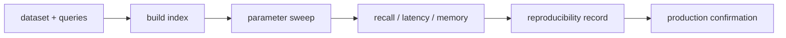

# ANN benchmarks and Big ANN

> **TL;DR:** Public benchmarks help compare reproducible workloads, but results transfer only when metrics, hardware, build settings, and workload resemble production.

**Figure 1: Simplified conceptual view of this topic.**

**Takeaway:** Follow the arrows to see where the method spends work and where the main trade-off enters.

### How to read this

- Follow arrows in the direction data or decisions move.
- The labels name the main components; they do not promise a specific implementation.
- Use the table and field notes below to connect the picture to measurements.

**Visual takeaway:** The diagram shows the main data or decision path; labels are conceptual, not performance guarantees.

## Field notes

ANN-Benchmarks and Big ANN provide public datasets and evaluation frameworks. Dataset scale, query distribution, distance, filtering, update behavior, and warm/cold cache can change rankings. Publish index parameters, software versions, build time, peak memory, hardware, and exact ground-truth method alongside curves.

## Sources

[ANN-Benchmarks](https://ann-benchmarks.com/) · [Big ANN benchmarks](https://big-ann-benchmarks.com/). Product behavior and defaults can vary by release; pin the version used in any benchmark.

**Next:** [Master index](../00-INDEX.md) · [Glossary](../99-glossary.md).
